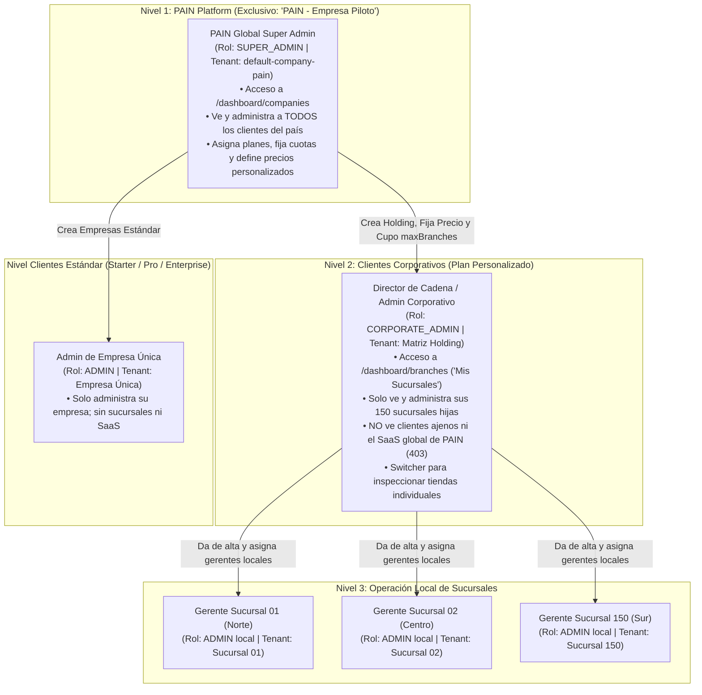

# Plan de Implementación: Plan "Personalizado" y Arquitectura Multi-Sucursal (Holding Corporativo)

> [!IMPORTANT]
> **Documento de Especificación y Auditoría Técnica (v1.0)**  
> **Destinatario / Auditor Técnico:** Arquitecto de Software / Revisor AI (Gemini).  
> **Objetivo:** Auditar, refinar y validar la viabilidad técnica, seguridad, aislamiento multi-tenant y escalabilidad de la extensión para corporativos con múltiples sucursales a nivel nacional (Plan **"Personalizado"**), preservando la exclusividad de control de la plataforma SaaS para **"PAIN - Empresa Piloto"**.

---

## 1. Contexto General del Proyecto

### 1.1. ¿Qué es Reconocimiento Facial PAIN?
**Reconocimiento Facial PAIN** es una plataforma SaaS B2B de control de asistencia, puntualidad y gestión de fuerza laboral que reemplaza los relojes checadores tradicionales (huella dactilar, tarjetas RFID o firmas de papel) por una solución biométrica facial sin contacto, higiénica y a prueba de suplantación (*buddy punching*).

El sistema opera bajo dos módulos integrados en tiempo real:

1. **Módulo Kiosco Biométrico (Client-Side Edge en Tablets):**
   - Aplicación web optimizada para tabletas o pantallas táctiles montadas en los accesos de las instalaciones.
   - Corre un modelo de visión por computadora en el navegador mediante **`face-api.js` (TensorFlow.js Core)**.
   - Detecta rostros en video en vivo, alinea 68 puntos faciales (*landmarks*) y genera un vector de incrustación facial (*embedding*) de **128 dimensiones numéricas**.
   - Descarga la plantilla facial de la empresa en la memoria RAM del dispositivo y realiza comparación de distancia euclidiana en milisegundos (< 150 ms) sin enviar video en streaming al servidor.
   - Registra entradas, salidas, calcula retardos al instante según el turno del empleado y sincroniza mediante WebSockets.

2. **Módulo Dashboard Administrativo (Panel Web Cloud):**
   - Portal responsivo para administradores, directores y jefes de Recursos Humanos.
   - Gestión integral de colaboradores, departamentos, asignación de turnos (fijos y rotativos con tolerancia y descansos), incidencias (faltas, retardos, permisos justificados con/sin goce, vacaciones e incapacidades), reportes analíticos exportables (Excel / PDF) y centro de notificaciones operativas en tiempo real.
   - **Módulo SaaS para Super Administrador:** Gestión de inquilinos (*tenants*), límites de empleados/kioscos, activación/suspensión y monitoreo de empresas activas en la nube.

---

## 2. Stack Tecnológico Exhaustivo

| Capa del Sistema | Tecnología / Librería | Versión / Detalle Técnico | Propósito y Responsabilidad |
| :--- | :--- | :--- | :--- |
| **Frontend** | React + Vite | React 18/19, Vite 5 | SPA moderna, modular, con carga rápida y separación estricta por rutas. |
| **Estilos & UI** | Tailwind CSS + CSS Modules | Dark Theme Corporativo | Paleta oscura (`#09090b`, `#18181b`, `#27272a`), responsiva, accesible y consistente. |
| **Iconografía & Gráficas** | Lucide React + Recharts | Recharts 2.x | Gráficas dinámicas de barras, pie charts y visualizaciones analíticas. |
| **Biometría Web** | `face-api.js` | SSD MobileNet V1 | Detección facial, 68 landmarks y descriptores de 128 flotantes en el Kiosco. |
| **Backend Runtime** | Node.js + Express.js | Node 18+ LTS, Express 4.x | API REST estructurada en arquitectura modular por dominio (`modules/*`). |
| **Comunicación en Vivo** | Socket.io | Socket.io 4.x | Salas aisladas por inquilino (`company_${id}`) para eventos, checadas y alertas. |
| **ORM & Capa de Datos** | Prisma ORM | Prisma 5.x (`$extends`) | Extensiones que inyectan automáticamente `{ companyId }` en 14 métodos relacionales. |
| **Base de Datos (RDBMS)** | MariaDB 11.8 LTS | `11.8.9-MariaDB-log` (InnoDB) | Motor relacional transaccional ACID con 25 claves foráneas compuestas con `ON DELETE RESTRICT`. |
| **Cifrado Biométrico** | Crypto (Node nativo) | AES-256-GCM (`enc_gcm:...`) | Cifrado simétrico de vectores biométricos. No se almacenan fotografías originales en BD (GDPR/ARCO). |
| **Seguridad Web** | CSRF + Bcrypt + SHA-256 | Double Submit Cookie | Protección CSRF en mutaciones, hash de contraseñas y tokens de Kioscos cifrados en SHA-256. |
| **Infraestructura** | Docker + Nginx + TLS 1.3 | Docker Compose | Despliegue en contenedor único/multiservicio en servidores VPS KVM (Hostinger Linux). |

---

## 3. Estado Actual de la Arquitectura Multi-Tenant

1. **Aislamiento por Base de Datos Compartida:**
   - Todas las tablas de negocio contienen `companyId` como parte de su clave única/primaria (`@@unique([id, companyId])`).
   - El middleware `tenantContext.js` utiliza **`AsyncLocalStorage`** de Node.js para ligar el `companyId` del usuario autenticado al hilo de ejecución de la petición.
   - El token JWT de administradores regulares fija inmutablemente su empresa; cualquier intento de enviar cabeceras como `x-tenant-id` es neutralizado automáticamente para evitar ataques de suplantación (*tenant spoofing*).

2. **Nivel de Super Administrador Actual:**
   - La plataforma cuenta con una empresa raíz llamada **`"PAIN - Empresa Piloto"`** (identificador reservado `default-company-pain`).
   - El rol `SUPER_ADMIN` actual opera sobre `/api/v1/companies`, permitiendo ver el inventario global de empresas, crear nuevos clientes y configurar planes estándar.

3. **Planes Estándar Actuales:**
   - **`STARTER`:** Sugerido para hasta 50 empleados y 3 kioscos.
   - **`PRO`:** Sugerido para hasta 200 empleados y 10 kioscos.
   - **`ENTERPRISE`:** Sugerido para hasta 1,000 empleados y 50 kioscos (ampliable manualmente por el Super Admin).

---

## 4. El Nuevo Requerimiento: Plan "Personalizado" y Multi-Sucursal

### 4.1. Caso de Uso y Justificación de Negocio
Un cliente corporativo (por ejemplo, una cadena de 150 farmacias, tiendas de conveniencia o gasolineras en todo México) tiene:
- **150 sucursales físicas.**
- Promedio de **20 empleados por sucursal** (Total: 3,000 empleados y 150+ kioscos).

**Por qué no entra en los planes actuales:**
1. **Cobro Inadecuado:** Sería injusto cobrarle la tarifa estándar de Enterprise ($X/mes) a una corporación con 150 unidades de negocio operando simultáneamente. Requiere un **precio personalizado por contrato** (`customPrice`), calculado por número de sucursales o bolsa global de empleados.
2. **Caos Administrativo:** Si las 150 tiendas se meten dentro de una sola empresa plana, los 3,000 empleados y 150 kioscos quedan mezclados. El gerente de la sucursal de Tijuana vería las checadas y empleados de la sucursal de Cancún.
3. **Necesidad de Descentralización con Control Central:**
   - La **Dirección Nacional de Recursos Humanos** requiere un portal para dar de alta sus sucursales, ver el mapa/directorio nacional y consultar la asistencia consolidada en todo el país.
   - Cada **Gerente de Sucursal** solo debe ver y operar los turnos y asistencias de su propia tienda.

---

## 5. Jerarquía de Roles y Reglas de Seguridad Innegociables



### Reglas de Aislamiento Estricto:
1. **Regla de Oro PAIN:** La capacidad de ver todas las empresas del país, fijar precios y acceder a `/api/v1/companies` queda **restringida exclusivamente** para administradores cuyo `companyId === 'default-company-pain'` y `role === 'SUPER_ADMIN'`.
2. **Aislamiento Corporativo:** El administrador corporativo (`CORPORATE_ADMIN`) tiene un portal idéntico en potencia a un Super Admin, pero su consulta de base de datos está permanentemente condicionada a `WHERE parentCompanyId = miEmpresaMatrizId`.
3. **Imposibilidad de Fuga:** Las peticiones de un Admin Corporativo jamás pueden consultar, alterar o enterarse de la existencia de otras cadenas o empresas independientes que contrataron a PAIN.

---

## 6. Modelo de Datos Propuesto (MariaDB / Prisma)

En lugar de crear tablas separadas que dupliquen la lógica de asistencia, empleados y turnos, la entidad `Company` se autorreferencia como un árbol de sucursales:

```prisma
enum AdminRole {
  SUPER_ADMIN      // Exclusivo de "PAIN - Empresa Piloto"
  CORPORATE_ADMIN  // Administrador de Holding Corporativo (Plan Personalizado)
  ADMIN            // Administrador de Sucursal o de Empresa Estándar
  VIEWER           // Supervisor de solo lectura
}

model Company {
  id                  String       @id @default(uuid())
  name                String       // Ej: "Farmacias del Sol - Matriz" o "Farmacias del Sol - Sucursal 084"
  slug                String       @unique
  customDomain        String?      @unique
  plan                String       @default("STARTER") // "STARTER" | "PRO" | "ENTERPRISE" | "CUSTOM"
  
  // Jerarquía Multi-Sucursal
  parentCompanyId     String?      // NULL para empresas independientes y matrices; ID de la matriz para sucursales
  parentCompany       Company?     @relation("CompanyBranches", fields: [parentCompanyId], references: [id], onDelete: Restrict)
  branches            Company[]    @relation("CompanyBranches")
  
  // Parámetros del Plan Personalizado
  isHolding           Boolean      @default(false)     // True = Empresa Matriz que gestiona sucursales
  maxBranches         Int          @default(1)         // Cupo de sucursales autorizadas (ej. 150)
  customPrice         Decimal?     @db.Decimal(10, 2)  // Precio acordado en contrato (ej. 45000.00 MXN)
  billingFrequency    String?      @default("MONTHLY") // "MONTHLY" | "ANNUAL" | "CUSTOM"
  contractNotes       String?      @db.Text            // Notas de facturación, folio de contrato

  // Cuotas operativas de esta ubicación
  maxEmployees        Int          @default(50)        // Empleados permitidos en esta sucursal
  maxDevices          Int          @default(3)         // Kioscos permitidos en esta sucursal
  
  // Datos geográficos de la sucursal
  branchCode          String?      // Código interno del cliente: "SUC-084"
  address             String?      // Dirección física
  city                String?      // Ciudad: "Guadalajara"
  state               String?      // Estado: "Jalisco"
  
  // Seguridad y ciclo de vida
  isActive            Boolean      @default(true)
  timezone            String       @default("America/Mexico_City")
  descriptorsVersion  Int          @default(1)
  createdAt           DateTime     @default(now())
  updatedAt           DateTime     @updatedAt

  // Relaciones existentes con integridad compuesta intactas
  employees           Employee[]
  departments         Department[]
  shifts              Shift[]
  devices             Device[]
  adminUsers          AdminUser[]
  attendanceRecords   AttendanceRecord[]
  notifications       Notification[]
  adminAuditLogs      AdminAuditLog[]

  @@index([parentCompanyId])
  @@index([plan, isHolding])
}
```

---

## 7. Módulos y Flujos en el Frontend

### 7.1. Para el Super Administrador de PAIN (Gabriel)
- En [`CompaniesPage.jsx`](file:///c:/Users/gabri/OneDrive/Escritorio/Portafolio/ReconocimentoFacialPainProject/frontend/src/pages/dashboard/CompaniesPage.jsx), al presionar **"Registrar Empresa"**:
  - Selector de plan con 4 opciones: `Starter`, `Pro`, `Enterprise` y **`Personalizado`**.
  - Al marcar **Personalizado**, se activan los campos comerciales:
    * **Precio Acordado ($ MXN):** Input numérico para registrar la tarifa pactada.
    * **Cupo de Sucursales:** Cantidad máxima de tiendas (ej. `150`).
    * **Configuración por Sucursal:** Cuota base sugerida de empleados (ej. `25`) y kioscos (ej. `2`) por tienda.
    * **Notas de Contrato:** Espacio libre para registrar condiciones comerciales.

### 7.2. Para el Administrador Corporativo (Cliente con Plan Personalizado)
- **Barra Lateral Adaptativa:**
  - **No ve** la opción "Empresas SaaS" de PAIN.
  - En su lugar, cuenta con el módulo: **`🏢 Mis Sucursales`** (`/dashboard/branches`).
- **Pantalla de "Gestión de Sucursales" (`/dashboard/branches`):**
  - **Barra de Cupo:** Visualiza `112 / 150 Sucursales Ocupadas`.
  - **KPIs Consolidados:** Total de empleados registrados a nivel nacional, asistencia de hoy en toda la cadena y kioscos faciales en línea.
  - **Directorio de Tiendas:** Buscador en vivo por código, ciudad o estado, con estado de asistencia de cada tienda y botón *"Entrar a Sucursal ➔"*.
  - **Alta Rápida de Sucursal:** Botón para registrar una nueva tienda en segundos (asigna nombre, ciudad, código de sucursal y credenciales del gerente local).
- **Branch Switcher en la Cabecera:**
  - Selector desplegable para alternar de forma inmediata entre la **Visión Nacional Consolidada** o la operación detallada de una sucursal específica.

---

## 8. Guía de Auditoría para Gemini (Puntos Críticos de Revisión)

Al someter este documento al análisis del auditor técnico, solicitamos evaluar los siguientes aspectos de arquitectura y seguridad:

1. **Eficiencia en Consultas Agregadas:**
   - ¿Qué estrategia de indexación o agregación recomiendas para que el Dashboard Nacional Consolidado calcule la asistencia de 3,000 empleados en 150 sucursales en menos de 500 ms sin saturar el pool de conexiones de MariaDB?
2. **Modelo de Cuotas (Bolsa Global vs Cuota por Sucursal):**
   - ¿Es más conveniente que cada sucursal tenga su propio `maxEmployees` rígido (ej. 25 empleados por tienda), o que exista un pool corporativo flexible (ej. 3,750 empleados en total para toda la cadena distribuidos libremente entre sus 150 tiendas)?
3. **Gestión de Biometría entre Sucursales:**
   - Si un supervisor corporativo o empleado comodín visita múltiples sucursales de la misma cadena, ¿cómo estructurar la sincronización de descriptores faciales en los kioscos de distintas sucursales hijas sin duplicar empleados en la base de datos?
4. **Mecanismo de Impersonación Segura (Branch Switcher):**
   - ¿Cuál es la forma más limpia y segura de implementar el cambio de contexto del Admin Corporativo al entrar a auditar una sucursal hija: generar un JWT efímero con el `companyId` de la sucursal o permitir que el token corporativo envíe una cabecera de ámbito `x-branch-id` validada por middleware?
5. **Aislamiento Multi-Tenant de 2do Nivel:**
   - ¿Existe algún riesgo de fuga de datos o escalamiento de privilegios entre un `CORPORATE_ADMIN` y un `SUPER_ADMIN` global de PAIN que deba blindarse a nivel middleware o en la extensión de Prisma?
