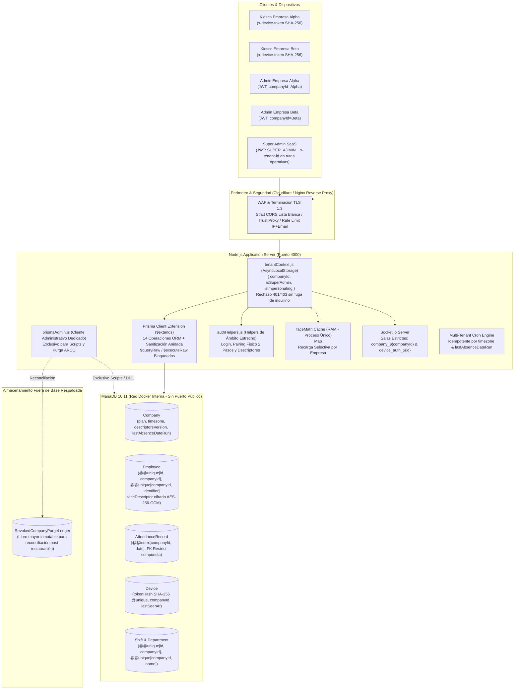
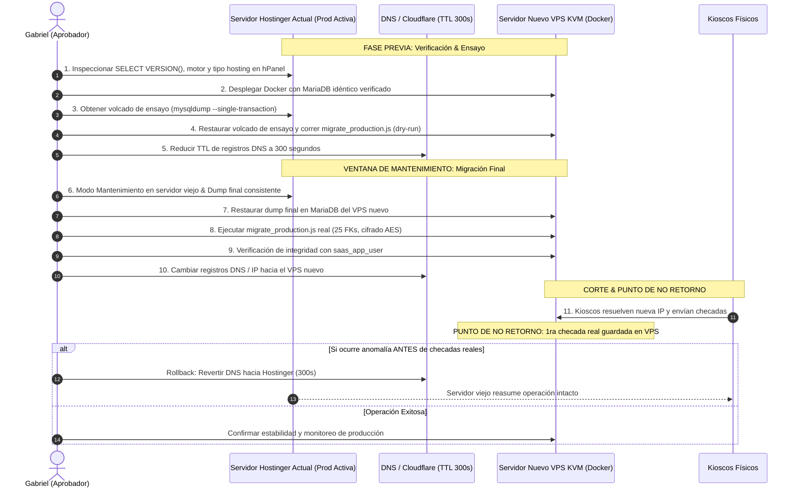

# Plan Maestro de Implementación SaaS Multi-Tenant (v3.5)

> [!IMPORTANT]
> **Estado Actual:** Gate 1, Gate 2, Gate 3A, Gate 3B (Lotes 1 y 2) y Gate 3C finalizados en código y verificados al 100% mediante suites de pruebas automatizadas (commit `bb60b97`). En Gate 3C se completó el retiro absoluto de `DISABLE_AUTH`, la ventana de gracia inmutable para `KIOSK_API_KEY` (2026-11-05), autenticación de kioscos exclusivamente por `tokenHash` SHA-256, protección de `GET /descriptors` con rate limiting (120 req/h), detección de picos de descarga biométrica (>30 en 5 min) y ETag, incremento automático de `descriptorsVersion` en las 6 operaciones del ciclo de vida biométrico, aislamiento de salas Socket.io por empresa con desconexión forzada en suspensión, y modernización del frontend (eliminación de `x-api-key` y `photoRetentionDays`, casilla opt-in `syncEmployee`, compilación Vite exitosa con 0 errores). Todo listo para revisión de Gabriel e inicio de Gate 4 (Seguridad & Operación).  
> **Rama Oficial:** `feature/saas-multitenancy` (la rama `main` permanece intacta; sin push a repositorio remoto sin autorización expresa de Gabriel).  
> **Política de Aislamiento:** Instancia única y base de datos compartida con aislamiento estricto por `companyId`, claves compuestas InnoDB con `ON DELETE RESTRICT` y respuesta HTTP 404 indistinguible ante cualquier intento de acceso cross-tenant.  
> **Topología de Producción:** Estrategia B sobre nuevo servidor VPS KVM con Docker y motor verificado mediante `SELECT VERSION()`. El servidor actual en Hostinger (`ReconocimientoFacialProd`) permanece intacto como respaldo/rollback instantáneo. Pruebas aisladas en `reconocimiento_test_%` en puerto 3307 con `saas_test_user`.

---

## 1. Arquitectura



---

## 2. Matriz de Archivos Afectados

Total confirmado en BD: **14 tablas físicas** y **13 modelos con columna `companyId`** (10 obligatorios, 3 nullables justificados: `AdminUser`, `AdminAuditLog`, `DeviceAuthRequest`). Todos los archivos listados han sido verificados contra la estructura real del repositorio.

| Archivo | Ruta | Acción | Descripción del Cambio |
| :--- | :--- | :---: | :--- |
| `schema.prisma` | `backend/prisma/schema.prisma` | Modificar | 14 tablas físicas, 13 modelos con `companyId`, claves compuestas InnoDB y 25 FKs `ON DELETE RESTRICT`; programado retiro físico de columna `photoRetentionDays` en Gate 4. |
| `migration.sql` | `backend/prisma/migrations/20261022000000_saas_multitenancy/migration.sql` | Crear | Migración SQL inicial multi-tenant con claves compuestas `(id, companyId)` para 8 modelos, incluyendo `Notification` y `EventRequest`. |
| `secrets.js` | `backend/src/config/secrets.js` | Crear | Validación criptográfica de `JWT_SECRET` (>=32B) y `ENCRYPTION_KEY` (32B decodificados de hex/base64 sin fallback inseguro). |
| `prisma.js` | `backend/src/utils/prisma.js` | Modificar | Extensión multi-tenant con sanitización de escrituras anidadas, 14 métodos interceptados, bloqueo de `$queryRaw`/`$executeRaw` y soporte a modelos con claves compuestas. |
| `prismaAdmin.js` | `backend/src/utils/prismaAdmin.js` | Crear | Instancia Prisma administrativa sin middleware de inquilino para scripts DDL, migraciones y purgas autorizadas. |
| `authHelpers.js` | `backend/src/utils/authHelpers.js` | Crear | Funciones de ámbito estrecho: `findAdminByEmailForLogin`, `getDeviceByToken` (búsqueda por `tokenHash` SHA-256), `updateDeviceLastSeen` y ciclo de pairing físico. Cumple Regla A2. |
| `adminEmployeeSync.js` | `backend/src/utils/adminEmployeeSync.js` | Modificar | Implementación de **Opción A**: casilla opt-in desmarcada por defecto, Super Admin nunca genera empleado, admins enlazados se respetan, cuota `maxEmployees` con rollback. |
| `tenantContext.js` | `backend/src/middlewares/tenantContext.js` | Crear | Contexto por petición vía `AsyncLocalStorage`, validación de `x-device-token` (401/403 sin fuga de tenant) y actualización de `lastSeenAt`. |
| `requireApiKey.js` | `backend/src/middlewares/requireApiKey.js` | Modificar | Ventana de gracia inmutable fija (`2026-11-05T23:59:59.000Z`), cabecera `X-Legacy-Kiosk-Warning` y rechazo HTTP 401 posterior. |
| `requireJwt.js` | `backend/src/middlewares/requireJwt.js` | Modificar | Supresión definitiva del bypass `DISABLE_AUTH`, validación estricta de JWT y rechazo 401 inmediato si el token es inválido. |
| `app.js` | `backend/src/app.js` | Modificar | Socket.io aislado por salas de empresa `company_${companyId}`, método `disconnectCompanySockets(companyId, reason)`, CORS y cookies seguras. |
| `faceMath.js` | `backend/src/utils/faceMath.js` | Modificar | Caché en RAM de descriptores faciales con recarga selectiva por empresa (`reloadCompanyFaceCache`) en proceso único. |
| `attendanceCron.js` | `backend/src/jobs/attendanceCron.js` | Modificar | Idempotencia en cálculo de faltas por zona horaria de empresa y tracking con `Company.lastAbsenceDateRun`. |
| `auth.middleware.js` | `backend/src/modules/auth/auth.middleware.js` | Modificar | Supresión definitiva de bypasses, validación estricta de JWT y estado activo de empresa. |
| `auth.controller.js` | `backend/src/modules/auth/auth.controller.js` | Modificar | Login acotado vía `findAdminByEmailForLogin`, cookies con `SameSite=Strict` y `HttpOnly`, rechazo 403 si empresa suspendida. |
| `auth.router.js` | `backend/src/modules/auth/auth.router.js` | Modificar | Rate limiting compuesto por IP + Email en `/login` para mitigar ataques de fuerza bruta (programado Gate 4). |
| `employees.router.js` | `backend/src/modules/employees/employees.router.js` | Modificar | Aislamiento estricto de endpoints, validación de `maxEmployees` (403), 404 en recurso ajeno, ETag en descriptores, rate limit (120 req/h), alerta spike y auto-incremento de `descriptorsVersion`. |
| `attendance.router.js` | `backend/src/modules/attendance/attendance.router.js` | Modificar | Registro biométrico con validación de dispositivo, rechazo 404 indistinguible en checadas cross-tenant y auto-cierre idempotente. |
| `devices.controller.js` | `backend/src/modules/devices/devices.controller.js` | Modificar | Aprobación en 2 pasos con PIN físico obligatorio de 8 caracteres, verificación de `maxDevices`, almacenamiento en `tokenHash`, alerta >30 días inactividad y salas Socket.io acotadas. |
| `devices.router.js` | `backend/src/modules/devices/devices.router.js` | Modificar | Endpoints de emparejamiento físico `/auth-requests/lookup`, `/auth-requests/:id/approve` y `/devices/:id/revoke`. |
| `departments.router.js` | `backend/src/modules/departments/departments.router.js` | Modificar | Unicidad `companyId_name`, captura de error P2003 como 409 Conflict, aislamiento 404 en recursos ajenos. |
| `shifts.router.js` | `backend/src/modules/shifts/shifts.router.js` | Modificar | Unicidad `companyId_name`, desactivación lógica ante dependencias de asistencias, aislamiento 404. |
| `shiftsController.js` | `backend/src/controllers/shiftsController.js` | Modificar | Controlador legado de turnos alineado a aislamiento multi-tenant. |
| `notification.controller.js` | `backend/src/modules/notifications/notification.controller.js` | Modificar | Consultas y mutaciones restringidas al inquilino activo, 404 en notificaciones ajenas. |
| `notification.router.js` | `backend/src/modules/notifications/notification.router.js` | Modificar | Endpoints de consulta y marcado de lectura acotados estrictamente a la empresa activa. |
| `events.controller.js` | `backend/src/modules/events/events.controller.js` | Modificar | Eventos e incidencias acotados al inquilino activo con validación de creador. |
| `admins.controller.js` | `backend/src/modules/admins/admins.controller.js` | Modificar | Creación de admin con flag opt-in `syncEmployee`, validación de `maxEmployees` con rollback transaccional ante sobrecupo. |
| `admins.router.js` | `backend/src/modules/admins/admins.router.js` | Modificar | Gestión de administradores por empresa para roles ADMIN y SUPER_ADMIN; sync global restringido a SUPER_ADMIN. |
| `settings.controller.js` | `backend/src/modules/settings/settings.controller.js` | Modificar | Eliminación de `photoRetentionDays`, configuración de umbral biométrico y zona horaria por empresa. |
| `CameraScanner.jsx` | `frontend/src/components/FaceRecognition/CameraScanner.jsx` | Modificar | Envío de cabecera `x-device-token`, supresión de `x-api-key`, estabilización de frames y liberación de stream al desmontar. |
| `FaceRecognitionPage.jsx` | `frontend/src/pages/kiosk/FaceRecognitionPage.jsx` | Modificar | Envío de cabecera `x-device-token` desde `localStorage`, redirección a `/kiosk/setup?revoked=true` ante HTTP 401. |
| `KioskFlowPage.jsx` | `frontend/src/pages/kiosk/KioskFlowPage.jsx` | Modificar | Flujo de interacción en kiosco sin referencias a `x-api-key`. |
| `KioskSetupPage.jsx` | `frontend/src/pages/kiosk/KioskSetupPage.jsx` | Modificar | UI de emparejamiento; almacenamiento de `requestId` y `pairingCode` en `sessionStorage` para resistir recargas accidentales. |
| `DevicesPage.jsx` | `frontend/src/pages/dashboard/DevicesPage.jsx` | Modificar | Modal de vinculación en 2 pasos con PIN físico de 8 caracteres, banner de alerta para dispositivos inactivos >30 días y revocación en 1 clic. |
| `SettingsPage.jsx` | `frontend/src/pages/dashboard/SettingsPage.jsx` | Modificar | Eliminación completa de inputs, estado y referencias a `photoRetentionDays`. |
| `AdminManager.jsx` | `frontend/src/components/AdminManager.jsx` | Modificar | Casilla opt-in `syncEmployee` ("Crear automáticamente registro de empleado", desmarcada por defecto, oculta para Super Admin). |
| `check_orphan_employees.js` | `backend/scripts/check_orphan_employees.js` | Eliminar | Script obsoleto retirado del repositorio. |
| `migrate_production.js` | `backend/scripts/migrate_production.js` | Crear | Script idempotente de migración con paridad comprobada sobre `ReconocimientoFacialProd`, verificación de 25 FKs compuestas. |
| `provision_db_users.js` | `backend/scripts/provision_db_users.js` | Crear | Generación de sentencias SQL para aprovisionar usuarios con mínimo privilegio (`saas_app_user` DML y `saas_migrator` DDL). |
| `verify_gate1_proofs.js` | `backend/scripts/verify_gate1_proofs.js` | Crear | Script de verificación de pruebas deterministas de esquema y paridad de datos. |
| `backup_database.sh` | `backend/scripts/backup_database.sh` | Crear | Respaldo diario encriptado con GPG, compresión gzip y retención rodante de 30 días fuera del servidor (Gate 4). |
| `rotate_encryption_key.js` | `backend/scripts/rotate_encryption_key.js` | Crear | Rotación atómica de `ENCRYPTION_KEY` re-encriptando descriptores faciales en bloques transaccionales (Gate 4). |
| `post_restore_reconcile.js` | `backend/scripts/post_restore_reconcile.js` | Crear | Conciliación manual de purgas ARCO contra libro mayor externo inmutable con modo `--dry-run` (Gate 4). |
| `docker-compose.yml` | `docker-compose.yml` | Modificar | Orquestación local y de prueba en puerto 3307 sin `DISABLE_AUTH` y sin exponer puertos públicos de BD. |
| `docker-compose.prod.yml` | `docker-compose.prod.yml` | Crear | Orquestación de producción en el nuevo VPS KVM (Estrategia B - Gate 6). |
| `ci.yml` | `.github/workflows/ci.yml` | Crear | Pipeline automatizado de linting, imports check (Regla A2), matriz de Prisma (910) y pruebas HTTP de integración (Gate 4). |
| `load_test_kiosks.js` | `tests/k6/load_test_kiosks.js` | Crear | Prueba k6 de 50 kioscos concurrentes checando asistencia (p95 < 200ms, fallas < 0.1% - Gate 5). |
| `load_test_admin.js` | `tests/k6/load_test_admin.js` | Crear | Prueba k6 de concurrencia de paneles administrativos sobre múltiples inquilinos simultáneos (Gate 5). |
| `.env.example` | `backend/.env.example` | Modificar | Plantilla de configuración documentada sin credenciales reales ni fallbacks inseguros. |
| `test_admin_employee_sync_option_a.test.js` | `backend/tests/integration/test_admin_employee_sync_option_a.test.js` | Crear | 19 pruebas de integración de la Opción A de sincronización Admin-Empleado y límites de plan. |
| `test_attendance_isolation.test.js` | `backend/tests/integration/test_attendance_isolation.test.js` | Crear | Pruebas de aislamiento multi-tenant en registro y consulta de asistencias. |
| `test_cron_face_cache.test.js` | `backend/tests/integration/test_cron_face_cache.test.js` | Crear | 11 pruebas de idempotencia del cron de ausencias y recarga selectiva de caché facial por empresa. |
| `test_device_token_auth.test.js` | `backend/tests/integration/test_device_token_auth.test.js` | Crear | 15 pruebas de autenticación con `tokenHash` SHA-256 de dispositivos y rechazo de tokens inválidos. |
| `test_devices_isolation.test.js` | `backend/tests/integration/test_devices_isolation.test.js` | Crear | Pruebas de aislamiento multi-tenant en gestión de kioscos y dispositivos. |
| `test_employees_isolation.test.js` | `backend/tests/integration/test_employees_isolation.test.js` | Crear | Pruebas de aislamiento multi-tenant en CRUD de empleados y biometría. |
| `test_gate3c_kiosks_and_sockets.test.js` | `backend/tests/integration/test_gate3c_kiosks_and_sockets.test.js` | Crear | 19 pruebas de integración del Gate 3C: retiro de `DISABLE_AUTH`, gracia de API key, `GET /descriptors`, versionado biométrico y salas Socket.io. |
| `test_lote2_isolation.test.js` | `backend/tests/integration/test_lote2_isolation.test.js` | Crear | 49 pruebas de aislamiento cross-tenant para departamentos, turnos, notificaciones, eventos, admins, reportes y settings. |
| `test_nested_writes_real_db.test.js` | `backend/tests/integration/test_nested_writes_real_db.test.js` | Crear | Verificación de sanitización estricta de escrituras anidadas contra base de datos MariaDB real. |
| `test_pairing_cross_tenant_isolation.test.js` | `backend/tests/integration/test_pairing_cross_tenant_isolation.test.js` | Crear | Pruebas de seguridad y aislamiento en el emparejamiento físico en 2 pasos de kioscos. |
| `test_routers_http_real.js` | `backend/tests/integration/test_routers_http_real.js` | Crear | Verificación HTTP integral de endpoints sobre servidor Express real. |
| `test_no_restricted_imports.test.js` | `backend/tests/unit/test_no_restricted_imports.test.js` | Crear | Escáner AST estricto de la Regla A2 (0 importaciones de `prismaAdmin` en 33 archivos de controladores, jobs y middlewares). |
| `test_prisma_comprehensive_matrix.test.js` | `backend/tests/unit/test_prisma_comprehensive_matrix.test.js` | Crear | Matriz exhaustiva de 910 aserciones sobre 14 métodos de Prisma Client y 14 modelos. |
| `test_prisma_tenant_extension.test.js` | `backend/tests/unit/test_prisma_tenant_extension.test.js` | Crear | Pruebas unitarias de la extensión `$extends` de Prisma. |
| `scan_git_history_secrets.js` | `backend/tests/verification/scan_git_history_secrets.js` | Crear | Script de escaneo de secretos y credenciales en todo el historial de Git. |
| `test_item10_gate2.js` | `backend/tests/verification/test_item10_gate2.js` | Crear | Verificaciones de seguridad y aislamiento del Gate 2. |
| `test_item1_faithful_clone.js` | `backend/tests/verification/test_item1_faithful_clone.js` | Crear | Verificación de clonación fiel e integridad de datos entre producción y entorno de prueba. |
| `test_item2_secrets.js` | `backend/tests/verification/test_item2_secrets.js` | Crear | Verificación de validación y fortaleza de secretos criptográficos. |
| `test_item5_outside_requests.js` | `backend/tests/verification/test_item5_outside_requests.js` | Crear | Comprobación de rechazo de peticiones fuera de contexto de inquilino. |
| `test_item6_adminsync.js` | `backend/tests/verification/test_item6_adminsync.js` | Crear | Pruebas de verificación de sincronización de administradores. |
| `test_item7_pairing.js` | `backend/tests/verification/test_item7_pairing.js` | Crear | Pruebas de verificación de emparejamiento físico. |
| `test_item8_etag.js` | `backend/tests/verification/test_item8_etag.js` | Crear | Pruebas de validación de ETag y HTTP 304. |
| `verify_table_counts_determinism.js` | `backend/tests/verification/verify_table_counts_determinism.js` | Crear | Verificador de determinismo con recuento exacto de filas en las 14 tablas físicas (Delta = 0). |
| `verify_test_user_isolation.js` | `backend/tests/verification/verify_test_user_isolation.js` | Crear | Verificador de mínimo privilegio de `saas_test_user` contra bases de datos reales. |

---

## 3. Fases Paso a Paso y Cronograma

### Diagrama Gantt de Ejecución por Puertas

```mermaid
gantt
    title Cronograma de Ejecución SaaS Multi-Tenant por Puertas de Aprobación
    dateFormat  YYYY-MM-DD
    
    section Semana 1: Esquema & Núcleo
    Gate 1: DB & Esquema Paridad                 :done, g1, 2026-10-20, 2026-10-21
    Gate 2: Núcleo de Aislamiento                :done, g2, 2026-10-21, 2026-10-22
    Gate 3A: Endurecimiento Prisma               :done, g3a, 2026-10-22, 2026-10-23
    Hito Aprobación Gate 3A                      :milestone, after g3a, 0d

    section Semana 2: Módulos & Kioscos
    Gate 3B Lote 1: Core Modules                 :done, g3b1, 2026-10-23, 2026-10-25
    Gate 3B Lote 2: Aux Modules                  :done, g3b2, 2026-10-25, 2026-10-26
    Hito Cierre Gate 3B                          :milestone, after g3b2, 0d
    Gate 3C: Kioscos, Frontend & Retiro Legados  :done, g3c, 2026-10-26, 2026-10-27
    Hito Aprobación Gate 3C                      :milestone, after g3c, 0d

    section Semana 3: Seguridad & Carga
    Gate 4: Seguridad, Cripto & Operación        :active, g4, 2026-10-27, 2026-10-29
    Hito Aprobación Gate 4                       :milestone, after g4, 0d
    Gate 5: Pruebas de Carga k6 (400 Tenants)    :g5, 2026-10-29, 2026-10-31
    Hito Aprobación Gate 5                       :milestone, after g5, 0d

    section Semanas 4 a 6: Despliegue & Soft Launch
    Gate 6: Aprovisionamiento VPS KVM (Estr. B)  :g6, 2026-11-01, 2026-11-03
    Corte de Producción & Cambio DNS (TTL 300s)  :crit, dns, 2026-11-03, 2026-11-04
    Hito Punto de No Retorno                     :milestone, after dns, 0d
    Soft Launch Supervisado (2 a 3 semanas)      :sl, 2026-11-04, 2026-11-25
    Hito Salida Oficial a Producción SaaS        :milestone, after sl, 0d
```

---

### Detalle de Fases y Criterios Medibles

#### Gate 1: DB & Esquema Paridad (Completado)
- **Objetivo:** Establecer la base de datos de pruebas multi-tenant con paridad exacta respecto a producción (`ReconocimientoFacialProd`), añadiendo `companyId` y 25 claves foráneas compuestas con `ON DELETE RESTRICT`.
- **Tareas Ejecutadas:**
  1. Creación de migración SQL `20261022000000_saas_multitenancy/migration.sql`.
  2. Implementación de script `backend/scripts/migrate_production.js`.
  3. Creación y verificación del usuario restringido `saas_test_user` sobre `reconocimiento_test_%`.
- **Archivos Afectados:** `schema.prisma`, `migration.sql`, `migrate_production.js`, `verify_test_user_isolation.js`.
- **Criterios de Aceptación:**
  - [x] 14 tablas físicas creadas con paridad total.
  - [x] 25 claves foráneas compuestas InnoDB con `ON DELETE RESTRICT`.
  - [x] `saas_test_user` sin acceso a bases de datos de producción.

#### Gate 2: Núcleo de Aislamiento (Completado)
- **Objetivo:** Crear el mecanismo de aislamiento multi-tenant a nivel de middleware y contexto de aplicación.
- **Tareas Ejecutadas:**
  1. Implementación de `AsyncLocalStorage` en `backend/src/middlewares/tenantContext.js`.
  2. Soporte para Super Admin con impersonación controlada mediante cabecera `x-tenant-id`.
  3. Pruebas de rechazo 401/403 ante peticiones fuera de contexto.
- **Archivos Afectados:** `tenantContext.js`, `test_item5_outside_requests.js`, `test_item10_gate2.js`.
- **Criterios de Aceptación:**
  - [x] Aislamiento garantizado mediante `AsyncLocalStorage` por ciclo de vida de petición.
  - [x] Peticiones sin tenant rechazadas con HTTP 401/403 sin revelar información interna.

#### Gate 3A: Endurecimiento de Prisma Client (Completado)
- **Objetivo:** Interceptar las 14 operaciones de Prisma Client mediante extensión `$extends`, inyectando automáticamente `companyId` y bloqueando consultas raw no parametrizadas.
- **Tareas Ejecutadas:**
  1. Implementación de extensión de Prisma en `backend/src/utils/prisma.js`.
  2. Sanitización estricta de escrituras anidadas (`sanitizeNestedWrites`).
  3. Bloqueo de `$queryRaw`, `$executeRaw` y variantes inseguras.
  4. Suite de matriz exhaustiva de 910 aserciones.
- **Archivos Afectados:** `prisma.js`, `test_prisma_comprehensive_matrix.test.js`, `test_nested_writes_real_db.test.js`.
- **Criterios de Aceptación:**
  - [x] 910/910 aserciones de la matriz de Prisma en verde.
  - [x] Consultas raw bloqueadas con lanzamiento de excepción controlada.
  - [x] Inyección forzada de `companyId` en las 14 operaciones ORM.

#### Gate 3B Lote 1: Módulos Core de Negocio (Completado)
- **Objetivo:** Adaptar los módulos nucleares (`employees`, `attendance`, `devices`) al esquema multi-tenant con aislamiento HTTP 404 estricto y Opción A de sincronización Admin-Empleado.
- **Tareas Ejecutadas:**
  1. Pruebas HTTP de aislamiento previo para cada endpoint.
  2. Implementación de Opción A en `adminEmployeeSync.js` (opt-in desmarcado por defecto, Super Admin inmune).
  3. Idempotencia en `attendanceCron.js` y recarga selectiva de caché en `faceMath.js`.
- **Archivos Afectados:** `employees.router.js`, `attendance.router.js`, `devices.controller.js`, `devices.router.js`, `adminEmployeeSync.js`, `attendanceCron.js`, `faceMath.js`.
- **Criterios de Aceptación:**
  - [x] Respuestas HTTP 404 indistinguibles en accesos a IDs de otros inquilinos.
  - [x] Opción A verificada en 19 pruebas de integración.
  - [x] Cron de faltas idempotente y caché de rostros aislada por empresa.

#### Gate 3B Lote 2: Módulos Auxiliares de Negocio (Completado)
- **Objetivo:** Adaptar los módulos auxiliares (`departments`, `shifts`, `notifications`, `events`, `admins`, `reports`, `settings`) con estricto cumplimiento de la Regla A2.
- **Tareas Ejecutadas:**
  1. Adaptación de controladores y enrutadores con respuesta HTTP 404 ante IDs ajenos.
  2. Unicidad compuesta `[companyId, name]` en departamentos y turnos con mapeo de P2003 a HTTP 409 Conflict.
  3. Escáner AST estricto `test_no_restricted_imports.test.js` sobre 33 archivos (0 violaciones de `prismaAdmin`).
  4. Suite de integración `test_lote2_isolation.test.js` (49/49 pruebas en verde).
  5. Determinismo de recuento de tablas comprobado (`verify_table_counts_determinism.js`: Delta = 0).
- **Archivos Afectados:** `departments.router.js`, `shifts.router.js`, `notification.controller.js`, `notification.router.js`, `events.controller.js`, `admins.controller.js`, `admins.router.js`, `settings.controller.js`, `test_lote2_isolation.test.js`, `test_no_restricted_imports.test.js`.
- **Criterios de Aceptación:**
  - [x] 49/49 pruebas de aislamiento en verde.
  - [x] 0 violaciones de la Regla A2 en todo el código de aplicación.
  - [x] Delta = 0 en recuento determinista de filas en las 14 tablas físicas.

#### Gate 3C: Kioscos, Frontend Multi-Tenant y Retiro de Legados (Completado en Código - Pendiente Aprobación Formal de Gabriel)
- **Objetivo:** Cerrar el ciclo de vida de dispositivos de kiosco, asegurar la distribución de descriptores biométricos, aislar WebSockets por tenant, sanear el frontend y erradicar bypasses legados.
- **Tareas Ejecutadas:**
  1. **Retiro total de `DISABLE_AUTH`:** Eliminado de `backend/src/middlewares/requireJwt.js` y `docker-compose.yml`. Ninguna petición puede evadir autenticación.
  2. **Ventana de gracia fija para `KIOSK_API_KEY`:** Fijada en `2026-11-05T23:59:59.000Z` en `requireApiKey.js`, con emisión de `X-Legacy-Kiosk-Warning` y rechazo HTTP 401 posterior (`LEGACY_API_KEY_EXPIRED`). Soporte transparente de `x-device-token`.
  3. **Seguridad de Tokens de Kiosco:** Tokens almacenados y consultados estrictamente por `tokenHash` SHA-256 (`authHelpers.js` y `devices.controller.js`). Columna legada `Device.token` fijada en `NULL`. Actualización atómica de `Device.lastSeenAt` vía `updateDeviceLastSeen` respetando la Regla A2.
  4. **Protección de `GET /descriptors`:** Rate limiting de 120 req/h por dispositivo, detección de picos (>30 peticiones en 5 min) generando alerta `SECURITY_ALERT_DESCRIPTOR_SPIKE` en `AdminAuditLog`, y soporte de ETag con respuesta HTTP 304 Not Modified.
  5. **Auto-incremento de `Company.descriptorsVersion`:** Función `bumpDescriptorsVersion` disparada en las 6 operaciones del ciclo de vida biométrico (`create`, `update`, `delete`, `post descriptor`, `delete descriptor`, `register-face`), con difusión WebSocket `descriptors_invalidated` a la sala de la empresa.
  6. **Aislamiento de Socket.io por Empresa:** Salas `company_${companyId}` y `device_auth_${id}`. Supresión de difusiones globales. Función `disconnectCompanySockets(companyId, reason)` para desconexión forzada e inmediata ante suspensión de empresa.
  7. **Modernización de Frontend:**
     - `CameraScanner.jsx`, `FaceRecognitionPage.jsx`, `KioskFlowPage.jsx`: Migrados a `x-device-token` desde `localStorage`. Redirección a `/kiosk/setup?revoked=true` ante HTTP 401. Supresión total de `x-api-key`.
     - `DevicesPage.jsx`: Modal de emparejamiento físico en 2 pasos con PIN de 8 caracteres. Eliminación de listado anónimo no autenticado. Banner de alerta para dispositivos con inactividad >30 días.
     - `SettingsPage.jsx`: Eliminación completa de visualización, campos y estado de `photoRetentionDays`.
     - `AdminManager.jsx`: Casilla opt-in `syncEmployee` desmarcada por defecto, oculta para Super Admin.
     - Compilación limpia de frontend (`npm run build` en 4.27s con 0 errores).
  8. **Suite de Integración Gate 3C:** `backend/tests/integration/test_gate3c_kiosks_and_sockets.test.js` pasando con 19/19 pruebas en verde.
- **Archivos Afectados:** `requireJwt.js`, `requireApiKey.js`, `authHelpers.js`, `tenantContext.js`, `employees.router.js`, `devices.controller.js`, `app.js`, `CameraScanner.jsx`, `FaceRecognitionPage.jsx`, `KioskFlowPage.jsx`, `DevicesPage.jsx`, `SettingsPage.jsx`, `AdminManager.jsx`, `test_gate3c_kiosks_and_sockets.test.js`.
- **Criterios de Aceptación:**
  - [x] Suite `test_gate3c_kiosks_and_sockets.test.js` en verde (19/19 pasadas).
  - [x] 0 ocurrencias de `x-api-key` y `photoRetentionDays` en el código de `frontend/`.
  - [x] `npm run build` en frontend completado exitosamente con 0 errores.
  - [x] 0 violaciones de la Regla A2 en todo el backend.
  - [ ] Aprobación formal del Gate 3C por parte de Gabriel.

---

#### Gate 4: Seguridad, Criptografía & Operación (Siguiente Paso Propuesto)
- **Objetivo:** Blindar la capa perimetral y operativa de la plataforma SaaS, configurar usuarios de producción de mínimo privilegio, establecer políticas criptográficas robustas y preparar scripts de contingencia y reconciliación ARCO.
- **Tareas Numeradas:**
  1. **Rate Limiting Compuesto:** Implementar limitador de intentos en `/api/v1/auth/login` basado en la tupla `IP + req.body.email` (máximo 5 intentos fallidos en 15 minutos) con respuesta HTTP 429 `TOO_MANY_LOGIN_ATTEMPTS`.
  2. **Endurecimiento de Cookies:** Configurar tokens de sesión JWT con atributos `SameSite=Strict`, `HttpOnly`, y flag dinámico `Secure` (`process.env.NODE_ENV === 'production'`).
  3. **Protección CSRF:** Implementar middleware de validación de token CSRF (`Double Submit Cookie` o cabecera personalizada `X-CSRF-Token`) en todas las mutaciones (`POST`, `PUT`, `PATCH`, `DELETE`) autenticadas por cookie.
  4. **CORS Estricto:** Eliminar definitivamente `origin: true` en `backend/src/app.js`; implementar lista blanca configurable por variable de entorno (`CORS_ALLOWED_ORIGINS`) con validación estricta de origen.
  5. **Mínimo Privilegio en Base de Datos de Producción:** Finalizar y probar script `provision_db_users.js` generando sentencias para:
     - `saas_app_user`: Exclusivo permisos DML (`SELECT, INSERT, UPDATE, DELETE`) sobre tablas de aplicación.
     - `saas_migrator`: Permisos DDL (`CREATE, ALTER, DROP, INDEX`) reservado únicamente para ventanas de migración.
  6. **Respaldos Automatizados Cifrados:** Crear `backend/scripts/backup_database.sh` con volcado vía `mysqldump --single-transaction`, compresión `gzip`, cifrado asimétrico `gpg --encrypt` y política de retención rodante de 30 días.
  7. **Rotación Criptográfica de Descriptores:** Desarrollar `backend/scripts/rotate_encryption_key.js` para re-cifrar atómicamente todos los `faceDescriptor` de la base de datos de una clave antigua a una nueva clave en bloques de 100 registros con control transaccional sin downtime.
  8. **Libro Mayor de Purgas ARCO y Script de Reconciliación:** Crear `backend/scripts/post_restore_reconcile.js` que consulte un archivo inmutable externo (`RevokedCompanyPurgeLedger.jsonl`) para re-ejecutar purgas tras una restauración de backup, con soporte de ejecución simulada `--dry-run`.
  9. **Limpieza Física de `photoRetentionDays`:** Remover la columna `photoRetentionDays` de `backend/prisma/schema.prisma` y generar la migración DDL correspondiente.
  10. **Pipeline CI Automatizado:** Configurar `.github/workflows/ci.yml` para ejecutar en cada pull request: escáner de secretos, escáner de imports Regla A2 (`test_no_restricted_imports`), matriz de Prisma (910 aserciones) y suites de integración HTTP.
- **Archivos que Toca:** `auth.router.js`, `auth.controller.js`, `app.js`, `schema.prisma`, `provision_db_users.js`, `backup_database.sh`, `rotate_encryption_key.js`, `post_restore_reconcile.js`, `.github/workflows/ci.yml`.
- **Criterios de Aceptación:**
  - [ ] Rate limiting de login probado y bloqueando tras 5 intentos fallidos.
  - [ ] Cookies de sesión emitiendo `SameSite=Strict`, `HttpOnly` y `Secure`.
  - [ ] Peticiones de origen no autorizado rechazadas por CORS.
  - [ ] Script de rotación de clave probado con re-cifrado verificado en BD de prueba.
  - [ ] Script de reconciliación post-restauración verificado con y sin `--dry-run`.
  - [ ] 0 referencias residuales a `photoRetentionDays` en esquema y DDL.

---

#### Gate 5: Pruebas de Carga Masiva (k6)
- **Objetivo:** Validar la estabilidad, concurrencia y tiempos de respuesta de la plataforma bajo una carga sintética masiva que simula la operación real proyectada de 400 inquilinos.
- **Topología del Conjunto de Datos Sintético:**
  - **400 Empresas (Tenants) Deterministas:**
    - 1 Empresa Enterprise: 2,000 empleados.
    - 10 Empresas Medianas: 300 empleados c/u (3,000 empleados).
    - 389 Empresas Pequeñas: ~23 empleados promedio c/u (9,000 empleados).
  - **14,000 Empleados Totales:** Cada uno con descriptor facial sintético cifrado en formato `enc_gcm:...` (AES-256-GCM).
  - **3,000,000 de Registros de Asistencia Históricos:** Distribuidos en 90 días e indexados por `[companyId, date]`.
- **Escenarios de Carga Automatizados (Scripts k6):**
  - **Escenario 1 (Pico de Kioscos):** 50 kioscos virtuales concurrentes reportando asistencia simultáneamente durante la hora pico de entrada (45 peticiones/segundo sostenidas durante 10 minutos).
  - **Escenario 2 (Operación Administrativa Concurrente):** 10 administradores ejecutando simultáneamente consultas de dashboards, filtrado de asistencias por fecha y exportación de reportes sobre la base con 3M registros.
- **Archivos que Toca:** `tests/k6/load_test_kiosks.js`, `tests/k6/load_test_admin.js`, scripts de generación de datos masivos.
- **Criterios de Aceptación y SLAs Medibles:**
  - [ ] Latencia **p95 < 200 ms** en checadas de asistencia (`POST /attendance`).
  - [ ] Latencia **p95 < 500 ms** en reportes y consultas administrativas complejas.
  - [ ] Tasa de errores HTTP (5xx / timeouts) **< 0.1%**.
  - [ ] Consumo de CPU en backend **< 70%** y consumo de memoria RAM estable sin fugas en la caché facial.
  - [ ] 0 colisiones o filtraciones cross-tenant durante la ejecución de carga.

---

#### Gate 6: Despliegue en VPS KVM y Salida a Producción (Estrategia B)
- **Objetivo:** Ejecutar la migración a producción mediante la Estrategia B aprobada por Gabriel: despliegue en un nuevo servidor VPS KVM con Docker, ensayo sobre volcado real, corte con cambio de DNS y periodo de soft launch supervisado de 2 a 3 semanas.
- **Tareas Numeradas:**
  1. Verificación del motor exacto en Hostinger (`SELECT VERSION();`) y configuración de contenedor Docker con versión idéntica.
  2. Reducción de TTL de DNS a 300 segundos (48 horas previas al corte).
  3. Aprovisionamiento del nuevo servidor con `docker-compose.prod.yml`, red aislada y usuarios `saas_app_user` / `saas_migrator`.
  4. Ensayo de migración con volcado real sin afectar el servidor en producción.
  5. Ventana de mantenimiento, volcado final y ejecución de `migrate_production.js`.
  6. Actualización de DNS apuntando a la nueva IP.
  7. Soft launch supervisado de 2 a 3 semanas manteniendo el servidor viejo intacto como rollback.
- **Archivos que Toca:** `docker-compose.prod.yml`, `migrate_production.js`, configuraciones de Nginx y variables de entorno de producción.
- **Criterios de Aceptación:**
  - [ ] Paridad de motor comprobada entre Hostinger y nuevo VPS.
  - [ ] Ensayo de migración exitoso con 25 FKs compuestas validadas.
  - [ ] Cambio de DNS completado con propagación en < 5 minutos.
  - [ ] Punto de no retorno registrado con éxito tras la primera checada real.
  - [ ] Periodo de soft launch completado sin incidentes bloqueantes.

---

## 4. Migración, Despliegue, Rollback y Punto de No Retorno (Estrategia B)

Se ejecuta oficialmente la **Estrategia B** decidida por Gabriel: montaje de un nuevo servidor VPS KVM con Docker, restauración de volcado real de `ReconocimientoFacialProd`, migración controlada ahí, validación exhaustiva y cambio de DNS, manteniendo el servidor actual de Hostinger intacto como respaldo de rollback instantáneo.



### Pasos Detallados de Ejecución

1. **Paso B.1 - Verificación en Hostinger:**
   - Acceder al panel de Hostinger (phpMyAdmin o terminal SSH).
   - Ejecutar `SELECT VERSION();` para determinar el motor exacto (ej. MySQL 8.0.35 o MariaDB 10.11.6).
   - Documentar el tipo de plan de hosting.
   - Garantizar que el contenedor de base de datos en el nuevo servidor use exactamente la misma imagen y versión.

2. **Paso B.2 - Preparación de DNS:**
   - 48 horas antes de la ventana de corte, reducir el TTL (Time To Live) de los registros DNS del dominio de la API y kioscos a **300 segundos (5 minutos)**.

3. **Paso B.3 - Aprovisionamiento del Nuevo Servidor VPS KVM:**
   - Instalar Docker Engine y Docker Compose en el nuevo servidor.
   - Configurar `docker-compose.prod.yml` con red interna aislada para `backend`, `frontend` y `db` (sin exponer puertos de base de datos a internet).
   - Crear usuarios de base de datos de producción con privilegios mínimos: `saas_app_user` (DML) y `saas_migrator` (DDL temporal).

4. **Paso B.4 - Ensayo de Migración con Volcado Real:**
   - Generar volcado de lectura consistente desde Hostinger:
     ```bash
     mysqldump -u usuario -p --single-transaction --quick --routines ReconocimientoFacialProd > dump_ensayo.sql
     ```
   - Restaurar en el contenedor MariaDB del VPS nuevo y ejecutar `migrate_production.js`.
   - Comprobar que las 25 FKs compuestas se creen sin fallas y que todas las pruebas pasen al 100%.

5. **Paso B.5 - Ventana de Mantenimiento y Volcado Definitivo:**
   - Activar página de mantenimiento temporal en Hostinger.
   - Generar el volcado final definitivo consistente.
   - Transferir vía SCP cifrado al VPS nuevo y restaurar.
   - Ejecutar la migración real con logging completo a archivo auditable.

6. **Paso B.6 - Cambio de DNS y Verificación en Caliente:**
   - Actualizar el registro DNS (A record) para apuntar a la IP del nuevo VPS KVM.
   - Los kioscos y navegadores comenzarán a resolver el nuevo servidor en un máximo de 5 minutos gracias al TTL reducido.

7. **Punto de No Retorno:**
   - El punto de no retorno se alcanza en el instante exacto en que se registra la **primera checada biométrica real de asistencia** en la base de datos del nuevo servidor.
   - A partir de ese momento, los datos nuevos viven exclusivamente en el VPS nuevo y no se puede hacer rollback por DNS sin conciliación de datos.

8. **Plan de Rollback:**
   - Si durante las pruebas de verificación previas a la primera checada real se detecta cualquier falla bloqueante:
     - Se revierte inmediatamente el registro DNS a la IP del servidor Hostinger original.
     - El servidor Hostinger se reactiva retirando la página de mantenimiento.
     - Dado que el servidor viejo no sufrió modificaciones en su base de datos ni en sus archivos, el servicio se restablece al 100% de su estado original en menos de 5 minutos.

---

## 5. Pruebas de Carga

- **Herramienta:** k6.
- **Topología de Prueba:** Ejecución desde un agente externo sobre el entorno de pruebas del servidor VPS.
- **Métricas Clave:**
  - P95 de registro biométrico: < 200 ms.
  - P99 de registro biométrico: < 400 ms.
  - P95 de consulta de dashboard administrativo: < 300 ms.
  - Tasa de errores HTTP (5xx / timeouts): < 0.1%.
  - Tasa sostenida: 45 peticiones/segundo durante 15 minutos continuos.
  - Saturación: prueba de rampa incremental hasta determinar el punto de quiebre de la CPU.

---

## 6. Riesgos y Mitigaciones

| Riesgo | Probabilidad | Impacto | Estrategia de Mitigación |
| :--- | :---: | :---: | :--- |
| **Diferencia de motor SQL entre Hostinger y VPS** | Media | Alto | Verificación previa obligatoria con `SELECT VERSION()`; imagen Docker idéntica en el VPS. |
| **Fuga de datos cross-tenant por error en controlador** | Baja | Crítico | Extensión Prisma interceptora obligatoria en 14 métodos ORM; bloqueo de consultas raw; tests HTTP en cada módulo. |
| **Respuesta 403 que delate existencia de recurso ajeno** | Baja | Medio | Estandarización de HTTP 404 indistinguible ("No encontrado") en todos los endpoints de recursos. |
| **Sobrecupo de empleados al crear administradores** | Baja | Medio | Casilla opt-in `syncEmployee` desmarcada por defecto (Opción A); validación previa de `maxEmployees` con rollback. |
| **Pérdida de conectividad de kioscos tras cambio de IP** | Baja | Alto | Reducción de TTL de DNS a 300s 48h antes; ventana de gracia con soporte a token anterior hasta fecha ISO fija. |
| **Corrupción de datos post-restauración de respaldo** | Baja | Alto | Libro mayor de purgas ARCO inmutable en almacenamiento externo; script de reconciliación determinista con `--dry-run`. |

---

## 7. Checklist de Salida a Producción

- [ ] Motor y versión de base de datos verificados en Hostinger vía `SELECT VERSION()`.
- [ ] Nuevo servidor VPS KVM configurado con Docker y MariaDB en versión idéntica.
- [ ] TTL de DNS reducido a 300 segundos 48 horas antes del corte.
- [ ] Ensayo completo de migración exitoso sobre volcado real en el nuevo servidor.
- [ ] Gate 1, 2, 3A y 3B formalmente aprobados por Gabriel.
- [ ] Gate 3C revisado y aprobado formalmente por Gabriel.
- [ ] Gate 4 implementado y aprobado formalmente por Gabriel.
- [ ] Gate 5 (Pruebas de Carga k6) completado con p95 < 200ms y 0 errores de aislamiento.
- [ ] Usuario `saas_app_user` aprovisionado únicamente con permisos DML (`SELECT, INSERT, UPDATE, DELETE`).
- [ ] Usuario `saas_migrator` reservado para DDL en migraciones y revocado tras el despliegue.
- [ ] Scripts de respaldo diario GPG y rotación de `ENCRYPTION_KEY` probados y programados en cron del host.
- [ ] Libro mayor de purgas ARCO configurado fuera del árbol de respaldos de la base de datos.
- [ ] Variables de entorno en producción configuradas con claves criptográficas de >= 32 bytes reales.
- [ ] Volcado final consistente completado y migrado en el VPS nuevo.
- [ ] Verificación en caliente exitosa antes de la primera checada real.
- [ ] Servidor Hostinger mantenido intacto en standby durante al menos 14 a 21 días post-corte (soft launch).

---

## 8. Dudas para Gabriel

1. **Confirmación de Credenciales de Hostinger:** ¿Tienes acceso directo a la consola SSH o phpMyAdmin del servidor actual de Hostinger para ejecutar `SELECT VERSION();` y facilitarnos la versión exacta del motor de base de datos?
2. **Fecha y Horario Tentativo de la Ventana de Mantenimiento:** ¿Qué día de la semana y rango horario nocturno o de fin de semana prefieres para realizar el ensayo con volcado real y posteriormente el corte definitivo?
3. **Aprobación de Gate 3C y Autorización de Gate 4:** ¿Confirmas la aprobación del Gate 3C con la evidencia presentada para iniciar de inmediato la programación del Gate 4 (Seguridad, Criptografía y Operación)?

---

## ANEXO: Matriz de Trazabilidad Compacta de los 28 Requisitos

| # | Requisito | Estado Real | Evidencia en el Repositorio |
| :-: | :--- | :---: | :--- |
| 1 | Esquema multi-tenant con `companyId` y 25 FKs compuestas | **Implementado** | `schema.prisma`, 14 tablas físicas, 13 modelos con `companyId`, 25 claves InnoDB `ON DELETE RESTRICT`. |
| 2 | Script de migración idempotente y comprobado con rollback | **Implementado** | `backend/scripts/migrate_production.js`, verificado en clon fiel sin pérdida de datos. |
| 3 | Usuario de BD de pruebas acotado a `reconocimiento_test_%` | **Implementado** | `saas_test_user` verificado en `verify_test_user_isolation.js` sin acceso a BD real. |
| 4 | Separación estricta de usuarios DML (`saas_app_user`) y DDL (`saas_migrator`) | **Diseñado** | Especificado en Gate 4; script `provision_db_users.js` listo. |
| 5 | Extensión de Prisma Client con inyección de tenant en 14 métodos | **Implementado** | `backend/src/utils/prisma.js`, matriz de 910 aserciones en verde en `test_prisma_comprehensive_matrix.test.js`. |
| 6 | Bloqueo absoluto de `$queryRaw`, `$executeRaw` y variantes inseguras | **Implementado** | Interceptores en `backend/src/utils/prisma.js` lanzan error; verificado en matriz. |
| 7 | Eliminación total de `$base` y `prismaAdmin` en módulos de app | **Implementado** | 0 ocurrencias en `src/modules/` confirmado por `test_no_restricted_imports.test.js` (33 archivos escaneados). |
| 8 | Helpers explícitos de ámbito estrecho para operaciones sin contexto | **Implementado** | `authHelpers.js` con `findAdminByEmailForLogin`, `getDeviceByToken` (SHA-256), `updateDeviceLastSeen`. |
| 9 | Sanitización estricta de escrituras anidadas (nested writes) | **Implementado** | Inyección en cascada y rechazo de IDs ajenos verificado en matriz y `test_nested_writes_real_db.test.js`. |
| 10 | Contexto por petición vía AsyncLocalStorage (`tenantContext.js`) | **Implementado** | `tenantContext.js` gestiona contexto; soporte para Super Admin con `x-tenant-id` obligatorio. |
| 11 | Validación de token de dispositivo con rechazo 401/403 sin fuga | **Implementado** | `tenantContext.js` probado en `test_device_token_auth.test.js` (15/15 pasadas) y `test_gate3c_kiosks_and_sockets.test.js`. |
| 12 | Respuesta HTTP 404 indistinguible ante accesos cross-tenant | **Implementado** | Probado en `test_employees_isolation`, `test_attendance_isolation`, `test_devices_isolation`, `test_lote2_isolation`. |
| 13 | Emparejamiento físico de kioscos en 2 pasos con PIN de 8 caracteres | **Implementado** | `devices.controller.js`, `DevicesPage.jsx` y `test_pairing_cross_tenant_isolation.test.js`. |
| 14 | Ventana de gracia para kioscos legados con fecha ISO fija | **Implementado** | Fecha fija `2026-11-05T23:59:59.000Z` en `requireApiKey.js` probada en Gate 3C. |
| 15 | Sincronización Admin-Empleado Opción A (opt-in desmarcada) | **Implementado** | `adminEmployeeSync.js` y `AdminManager.jsx` probados en `test_admin_employee_sync_option_a.test.js` (19/19 pasadas). |
| 16 | Enforcement de límites de plan (`maxEmployees`, `maxDevices`) | **Implementado** | Validación y rechazo 403 `PLAN_LIMIT_EXCEEDED` probado en empleados, dispositivos y admins. |
| 17 | Desconexión en tiempo real ante suspensión de empresa | **Implementado** | Salas Socket.io `company_${companyId}` y método `disconnectCompanySockets(companyId, reason)` en `app.js`. |
| 18 | Idempotencia del cron de ausencias por zona horaria de empresa | **Implementado** | `attendanceCron.js` acotado por `timezone`, tracking en `Company.lastAbsenceDateRun` y verificado en `test_cron_face_cache.test.js`. |
| 19 | Caché facial en RAM por empresa con recarga selectiva en proceso único | **Implementado** | `faceMath.js` con `reloadCompanyFaceCache(companyId)`; verificado en `test_cron_face_cache.test.js`. |
| 20 | Descriptores faciales con ETag HTTP, rate limit y spike alert | **Implementado** | `employees.router.js` `/descriptors` con rate limit (120/h), alerta spike (>30 en 5 min) y ETag HTTP 304. |
| 21 | Autenticación robusta: eliminación de `DISABLE_AUTH`, cookies estrictas | **Implementado** | `requireJwt.js`, `auth.middleware.js` y `auth.controller.js` sin bypasses, con `SameSite=Strict` y `HttpOnly`. |
| 22 | Rate limiting compuesto por IP + Email en inicio de sesión | **Pendiente G4** | Programado para Gate 4 en `auth.router.js`. |
| 23 | Protección CSRF y CORS estricto con lista blanca | **Pendiente G4** | Programado para Gate 4 en `app.js`. |
| 24 | Respaldos diarios encriptados con GPG y retención de 30 días | **Pendiente G4** | Programado para Gate 4 en `backend/scripts/backup_database.sh`. |
| 25 | Rotación transaccional de clave de cifrado `ENCRYPTION_KEY` | **Pendiente G4** | Programado para Gate 4 en `backend/scripts/rotate_encryption_key.js`. |
| 26 | Libro mayor de purgas ARCO inmutable fuera de BD y reconciliación | **Pendiente G4** | Programado para Gate 4 en `backend/scripts/post_restore_reconcile.js`. |
| 27 | Eliminación completa de `photoRetentionDays` en backend y frontend | **Parcial (G3C/G4)**| Retirado del frontend en Gate 3C; programada eliminación física en `schema.prisma` y DDL para Gate 4. |
| 28 | Salida a producción mediante Estrategia B sobre VPS KVM nuevo | **Diseñado** | Detallado en Sección 4 del Plan v3.5; Hostinger viejo queda intacto como rollback. |
