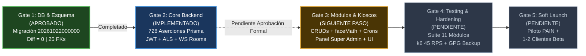
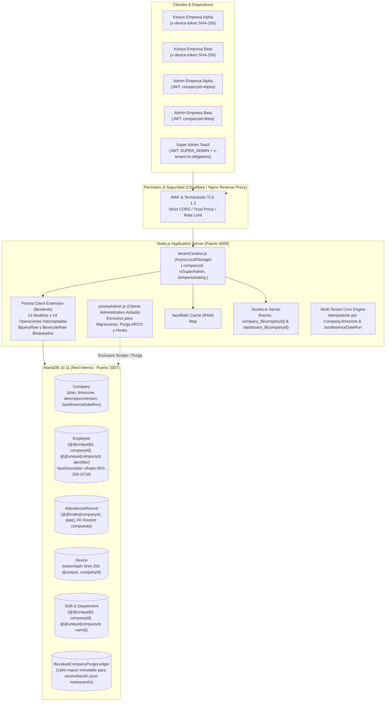

# Plan Maestro de Implementación SaaS Multi-Tenant (v3.0)
**Proyecto:** Plataforma de Reconocimiento Facial PAIN  
**Fecha de Actualización:** 22 de Octubre de 2026  
**Rama Oficial de Trabajo:** `feature/saas-multitenancy` (la rama `main` no se toca; sin push a GitHub)  
**Base de Datos Protegida:** `reconocimiento_facial_db_pain` (MariaDB 10.11, puerto 3307 - Intacta e Inmutable)  
**Base de Datos de Pruebas y Clones:** `reconocimiento_test_copia_saas` y `reconocimiento_test_clone_fiel`  

---

## 1. Tablero de Estado Ejecutivo de Gates



| Gate | Alcance / Hito | Estado | Evidencia Real en Terminal |
| :--- | :--- | :---: | :--- |
| **Gate 1** | **Esquema de BD, Migración y Paridad** | **APROBADO** | `prisma migrate diff --exit-code` arrojó `0`. 25 claves foráneas compuestas con `ON DELETE RESTRICT` validadas. Migración oficial `20261022000000_saas_multitenancy` registrada con `--applied`. |
| **Gate 2** | **Core Backend Multi-Tenant & Aislamiento** | **IMPLEMENTADO** *(Pendiente aprobación)* | Matriz de 728 aserciones de Prisma + 4 pruebas de mutación (100% pasadas). JWT con `companyId`, `SUPER_ADMIN` con `x-tenant-id` obligatorio (400 si falta), 403 en empresa suspendida, Socket.io por salas y ETag 304. |
| **Gate 3** | **Módulos, Kioscos, Crons y Frontend** | **SIGUIENTE** | Requiere aprobación formal del Gate 2 para iniciar. Incluye aislamiento de `faceMath`, adaptación de 11 módulos, ventana de gracia de kioscos y panel Super Admin. |
| **Gate 4** | **Testing Integral, k6 y Hardening** | **PENDIENTE** | Suite HTTP de 11 módulos, prueba de carga k6 (45 RPS, 400 empresas, 3M registros), respaldos diarios GPG a S3 y usuario `saas_app_user`. |
| **Gate 5** | **Despliegue Productivo y Soft Launch** | **PENDIENTE** | Migración formal con ventana de mantenimiento, empresa piloto `default-company-pain` y 1 a 2 clientes beta reales. |

---

## 2. Reglas Inviolables y Salvaguardas Operativas

1. **Aislamiento Estricto de Git:** Se trabaja única y exclusivamente sobre la rama `feature/saas-multitenancy`. La rama `main` queda intacta. Queda estrictamente prohibido hacer `git push` a repositorios remotos sin instrucción expresa.
2. **Inmutabilidad Absoluta de la Base Original:** La base de datos original `reconocimiento_facial_db_pain` nunca se altera, no recibe migraciones y no se utiliza para pruebas. Todas las pruebas corren en clones dedicados (`reconocimiento_test_copia_saas`).
3. **Salvaguarda de Código del Orquestador (Fail-Fast):** Todo script de diagnóstico, prueba, migración o purga incluye la siguiente guarda inquebrantable:
   ```javascript
   const FORBIDDEN_DB = 'reconocimiento_facial_db_pain';
   const targetDb = targetDbUrl || process.env.TEST_DATABASE_URL;
   if (!targetDb || targetDb.includes(FORBIDDEN_DB)) {
     console.error(`❌ CRITICAL_SAFETY_VIOLATION: Intento de ejecución sobre base protegida '${FORBIDDEN_DB}' o URL ausente.`);
     process.exit(1);
   }
   ```
   Queda prohibido el fallback implícito al `.env`. Todo comando operativo exige `--db=<url>` o `TEST_DATABASE_URL` explícito.
4. **Política de Cero Placeholders y Verificación Real:** Ninguna tarea se considera finalizada sin pruebas demostradas con salida real de terminal. No se permiten `TODOs`, mocks superficiales ni suposiciones.
5. **Aprobaciones Formales por Gate:** No se avanza de Gate sin el visto bueno explícito del usuario.
6. **Prioridad del Repositorio:** Si surge discrepancia entre cualquier documento y el estado real del código, el código del repositorio manda y se reporta de inmediato.

---

## 3. Arquitectura del Sistema SaaS



---

## 4. Estado de los 15 Requerimientos Técnicos

| # | Requerimiento Técnico | Estado | Diagnóstico y Evidencia en Repositorio |
| :---: | :--- | :---: | :--- |
| **1** | **Extensión Prisma Exhaustiva (13 modelos x 14 operaciones)** | **HECHO** | Implementada en `backend/src/utils/prisma.js`. Cobertura total de `findMany`, `findFirst`, `findFirstOrThrow`, `findUnique`, `findUniqueOrThrow`, `count`, `aggregate`, `groupBy`, `create`, `createMany`, `update`, `updateMany`, `delete`, `deleteMany` y `upsert`. `$queryRaw` y `$executeRaw` bloqueados arrojando excepción de seguridad. Verificado con 728 aserciones en `test_prisma_comprehensive_matrix.test.js`. |
| **2** | **Integridad Referencial Cross-Tenant (FKs compuestas con `RESTRICT`)** | **HECHO** | 25 FKs activas validadas en InnoDB. `@@unique([id, companyId])` en modelos padre. Las relaciones hijas usan referencias compuestas `[fieldId, companyId] REFERENCES Parent(id, companyId) ON DELETE RESTRICT`. Intentos cross-tenant son rechazados físicamente por el motor MariaDB (P2003 / HTTP 409). |
| **3** | **Aislamiento Estricto de `SUPER_ADMIN`** | **HECHO** | Implementado en `backend/src/middlewares/tenantContext.js`. `SUPER_ADMIN` solo opera sin tenant en `/api/v1/superadmin/*`. En rutas operativas exige `x-tenant-id` (400 `TENANT_HEADER_REQUIRED` si falta). Si un admin regular envía `x-tenant-id` ajeno, es descartado silenciosamente. Empresas inactivas responden 403 `COMPANY_SUSPENDED`. |
| **4** | **Protocolo de Rollback, Punto de No Retorno y Migración con `--confirm`** | **HECHO** | Migración formalizada en `backend/scripts/migrate_production.js`. Exige confirmación obligatoria `--confirm`, valida `--expected-db`, es completamente idempotente, valida 0 nulos y audita las 25 claves foráneas activas al finalizar. |
| **5** | **Política de Respaldos (GPG/S3) y Script de Rotación de Claves** | **PARCIAL** | Validación estricta de arranque activa en `secrets.js` (32 bytes obligatorios). **Pendiente:** Script cron de respaldo automatizado diario a las 02:00 AM con compresión gzip, cifrado GPG y envío a S3/B2 (ventana máxima rodante de 30 días); y script administrativo para rotación transaccional de `ENCRYPTION_KEY`. |
| **6** | **Cifrado AES-256-GCM y Rate Limiting en `/descriptors`** | **PARCIAL** | Cifrado biométrico AES-256-GCM con IV único y auth tag implementado en `faceMath.js` y migración. ETag y respuesta 304 funcional basado en `Company.descriptorsVersion`. **Pendiente:** Rate limit adaptativo de 120 req/h por dispositivo, alerta en `AdminAuditLog` ante >30 descargas/5 min y auditoría obligatoria por descarga. |
| **7** | **Gestión Segura de Credenciales y Usuario `saas_app_user`** | **PARCIAL** | Contraseñas y claves sanitizadas de scripts y repositorio. **Pendiente:** Creación física del usuario `saas_app_user` en MariaDB restringido estrictamente a `SELECT, INSERT, UPDATE, DELETE` (sin privilegios DDL) para el runtime de Node.js. |
| **8** | **Migración de Kioscos Piloto (Ventana de Gracia de 72 h)** | **PENDIENTE** | `requireApiKey.js` aún conserva la validación mono-tenant estática. Pendiente implementar la validación del hash SHA-256 (`Device.tokenHash`), la ventana de gracia de 72 horas para solicitudes con `KIOSK_API_KEY` antiguo y la cabecera de auto-migración `x-migrated-device-token`. |
| **9** | **Proxy, Rate Limit Compuesto (ip+email), Cookies `Strict` y CORS** | **PARCIAL** | `app.set('trust proxy', 1)` implementado en `app.js`. **Pendiente:** Clave combinada `ip + email` en limitador de login (actualmente solo evalúa IP); cookies `SameSite=Strict; Secure; HttpOnly` en `auth.controller.js`; y eliminación definitiva de `origin: true` en CORS para producción. |
| **10** | **Cron Idempotente por Timezone y `Company.lastAbsenceDateRun`** | **PARCIAL** | `attendanceCron.js` itera inquilinos activos con `runWithTenantContext` y su timezone propio (`America/Mexico_City`, etc.). La columna `lastAbsenceDateRun` existe en MariaDB. **Pendiente:** Integrar la verificación y actualización de `lastAbsenceDateRun` en `processAbsences` para garantizar idempotencia total ante reinicios de servidor. |
| **11** | **Adecuación Legal ARCO/LFT, Libro Mayor y Hook Post-Restauración** | **PARCIAL** | Declaración de roles (Cliente = Responsable, SaaS = Encargado). Secuencia topológica de purga validada en clon. **Pendiente:** Crear modelo `RevokedCompanyPurgeLedger` en Prisma/BD y desarrollar el hook de arranque post-restauración que reconcilia purgas contra respaldos históricos. |
| **12** | **Suite Parametrizada HTTP de los 11 Módulos** | **PARCIAL** | `test_routers_http_real.js` valida captura de errores FK en departamentos y turnos. La matriz completa parametrizada (11 módulos x lectura/escritura/borrado cross-tenant) está calendarizada para Semana 4. |
| **13** | **Matriz Completa de Archivos Afectados** | **HECHO** | Errores de sintaxis de tabla corregidos, cron duplicado eliminado e incorporación del cliente administrativo `prismaAdmin.js`. |
| **14** | **Plan de Pruebas de Carga Realista con k6** | **PENDIENTE** | Escenario documentado (400 empresas, 14,000 empleados, 3,000,000 asistencias, rampa a 45+ RPS). Implementación de scripts sembradores y pruebas con k6 programados para Semana 4. |
| **15** | **Cronograma Actualizado de 5 Semanas con Soft Launch** | **HECHO** | Diagrama Gantt sincronizado a fechas reales de ejecución a partir de octubre 2026. |

---

## 5. Resoluciones Técnicas Incorporadas (Las 5 Observaciones)

### Observación 1: Secuencia de Purga ARCO Topológica y Completa
Para atender el derecho de Cancelación u Oposición de un cliente SaaS sin violar las restricciones `ON DELETE RESTRICT` de MariaDB, se estableció y probó la secuencia en 8 fases dentro de una transacción administrativa:
1. **Fase A (Biometría):** `UPDATE Employee SET faceDescriptor = NULL WHERE companyId = :cid;`
2. **Fase B (Transaccionales/Hojas):** `AttendanceRecord`, `EventRequest` y `Notification` (desbloquea dependencias de empleados, turnos y administradores).
3. **Fase C (Pivotes Relacionales):** `EmployeeShift` y `DepartmentShift`.
4. **Fase D (Personal e Infraestructura):** `Employee` (desbloquea `Department`), `DeviceAuthRequest` y `Device`.
5. **Fase E (Estructura y Cuentas):** `Department`, `Shift`, `AdminAuditLog` (eliminación de logs locales con datos personales), `AdminUser` (desbloqueado al haberse eliminado `EventRequest`) y `SystemSettings`.
6. **Fase F (Entidad Raíz):** `DELETE FROM Company WHERE id = :cid;` (se ejecuta exitosamente al estar vacías las 13 tablas hijas).
7. **Fase G (Lápida Inmutable Global):** Registro en `AdminAuditLog` con `companyId = NULL` y hash SHA-256 del acta.
8. **Fase H (Libro Mayor y Reconciliación):** Inserción inmutable en `RevokedCompanyPurgeLedger`.

### Observación 2: Armonización de Respaldos (DR vs Art. 804 LFT)
Se resolvió la contradicción entre los 12 meses de retención y la ventana de 30 días de ARCO:
- **Respaldos de Recuperación ante Desastres (DR):** Ventana rodante máxima de **30 días** (7 diarios, 4 semanales). Al día 31, destrucción criptográfica automática e irreversible.
- **Obligación Legal Patronal (Art. 804 LFT):** El patrón (Responsable) debe conservar los registros por 1 año. Esta obligación se cumple en la base de datos viva/operativa. En caso de purga ARCO por terminación, antes del borrado se genera y entrega un archivo ZIP cifrado con los registros en CSV/JSON, quedando la custodia legal en manos del cliente.

### Observación 3: Cliente Administrativo Dedicado (`prismaAdmin.js`)
Para evitar que el runtime de Express tenga acceso a consultas raw mediante `prisma.$base`:
- Se creará `backend/src/utils/prismaAdmin.js` que exporta un cliente Prisma administrativo dedicado con permisos DDL y raw únicamente para scripts de migración, purga ARCO y hooks.
- Se retirará la propiedad `prisma.$base` de `backend/src/utils/prisma.js`, garantizando que rutas y controladores únicamente puedan consumir el cliente protegido donde `$queryRaw` y `$executeRaw` permanecen bloqueados.

### Observación 4: Higiene del Documento
Se corrigió la fila 209 corrupta en la matriz de archivos, se eliminó la entrada repetida de `attendanceCron.js`, se incorporó `prismaAdmin.js` y se actualizaron las fechas del cronograma Gantt a octubre de 2026.

### Observación 5: Salvaguarda contra la Base de Datos Original
Se incorporó la guarda estricta que aborta de inmediato con código de salida 1 (`CRITICAL_SAFETY_VIOLATION`) si cualquier script intenta operar sobre `reconocimiento_facial_db_pain`.

---

## 6. Plan Detallado de los Siguientes Pasos (Roadmap de Ejecución)

### Hito Inmediato: Cierre Formal de Gate 2
- **Acción Requerida:** Aprobación explícita del usuario tras revisar el reporte de terminales, el estado de la base original intacta y las pruebas de aislamiento.

---

### Fase 3: Módulos, Kioscos, Crons y Frontend (Gate 3 - Semana 3)

#### Paso 3.1: Separación de Clientes Prisma (`prismaAdmin.js`)
- Crear `backend/src/utils/prismaAdmin.js` para uso exclusivo de scripts y mantenimiento.
- Eliminar `prisma.$base` de [prisma.js](file:///c:/Users/gabri/OneDrive/Escritorio/Portafolio/ReconocimentoFacialPainProject/backend/src/utils/prisma.js).

#### Paso 3.2: Autenticación de Kioscos y Ventana de Gracia (Requerimiento 8)
- Actualizar el middleware de kioscos para autenticar mediante `Device.tokenHash` (SHA-256).
- Implementar ventana de gracia de 72 horas para kioscos antiguos con `KIOSK_API_KEY`, asignándoles la empresa piloto `default-company-pain` y respondiendo el nuevo token permanente en la cabecera `x-migrated-device-token`.
- Actualizar el cliente de Kiosco en frontend para que almacene el nuevo token en `localStorage` al detectarlo en cabeceras.

#### Paso 3.3: Endurecimiento de Seguridad en `/descriptors` (Requerimiento 6)
- Implementar rate limiter adaptativo de 120 peticiones por hora por dispositivo en `/api/v1/employees/descriptors`.
- Implementar detector de descargas anómalas: si un dispositivo realiza más de 30 descargas completas en 5 minutos, emitir alerta de seguridad en `AdminAuditLog`.
- Registrar auditoría obligatoria en cada descarga (IP, fecha/hora, `deviceId`, cantidad de rostros entregados).

#### Paso 3.4: Adaptación Multi-Tenant de los CRUDs de Negocio
- Auditar y adaptar todos los controladores y routers:
  - `employees`: listado, creación, actualización, bajas lógicas y validación `companyId_identifier`.
  - `departments` y `shifts`: validación de nombres únicos por empresa (`companyId_name`).
  - `attendance`: registro de checadas (`/register`), validación biométrica con caché de la empresa y reportes diarios.
  - `events` y `notifications`: consultas y creaciones acotadas al tenant activo.
  - `settings`: unificación de `SystemSettings` por empresa.

#### Paso 3.5: Idempotencia en Crons Multi-Tenant (Requerimiento 10)
- Integrar la verificación de `Company.lastAbsenceDateRun` en `attendanceCron.js`.
- Actualizar `lastAbsenceDateRun = hoy` al finalizar el procesamiento para evitar duplicación ante reinicios de Node.js.

#### Paso 3.6: Libro Mayor ARCO y Hook Post-Restauración (Requerimiento 11)
- Agregar el modelo `RevokedCompanyPurgeLedger` en `schema.prisma`:
  ```prisma
  model RevokedCompanyPurgeLedger {
    id           String   @id @default(uuid())
    companyId    String
    companySlug  String
    arcoRecordId String
    exportHash   String
    purgedAt     DateTime @default(now())
    appliedBy    String
  }
  ```
- Desarrollar script del Hook de Reconciliación Post-Restauración (`backend/scripts/post_restore_reconcile.js`).

#### Paso 3.7: Endurecimiento de Red y Sesiones (Requerimiento 9)
- Configurar rate limit en login evaluando clave compuesta `ip + req.body.email` (5 intentos / 15 min).
- Configurar cookies de sesión con `SameSite=Strict; Secure; HttpOnly`.
- Eliminar `origin: true` en CORS productivo y sustituirlo por lista blanca estricta de dominios autorizados.

#### Paso 3.8: Adaptación del Frontend y Panel Super Admin
- **Dashboard Operativo:** Mostrar nombre y slug de la empresa activa en la barra superior.
- **Kiosco Físico:** Manejo transparente de `x-migrated-device-token` y soporte de ETag condicional para descriptores.
- **Panel Super Admin (`/api/v1/superadmin/*`):** Vistas para creación de empresas, asignación de planes, límites de empleados/dispositivos, suspensión con un clic y protocolo visual de purga ARCO con doble factor.

---

### Fase 4: Testing Integral, k6 y Hardening (Gate 4 - Semana 4)

#### Paso 4.1: Suite Parametrizada HTTP de los 11 Módulos (Requerimiento 12)
- Construir suite con `supertest` que evalúe sistemáticamente los 11 módulos del backend:
  - Intento de lectura cross-tenant $\rightarrow$ `404 Not Found` o lista vacía.
  - Intento de inyección cross-tenant en IDs foráneos $\rightarrow$ `404 / 400 / 409`.
  - Intento de modificación o borrado de recurso ajeno $\rightarrow$ `404 Not Found`.

#### Paso 4.2: Prueba de Carga Masiva con k6 (Requerimiento 14)
- Crear script generador de datos sintéticos sobre base de prueba:
  - 400 empresas creadas.
  - 14,000 empleados con vectores biométricos.
  - 3,000,000 de registros históricos de asistencia.
- Ejecutar suite k6 simulando hora pico matutina:
  - Fase base: 45 RPS sostenidos durante 10 minutos.
  - Fase rampa: Incrementos de 10 RPS hasta encontrar el techo de saturación (CPU > 85% o p95 > 500 ms).
  - Tráfico mixto: 70% checadas, 15% consultas dashboard, 10% WebSockets, 5% reportes.

#### Paso 4.3: Usuario de Mínimo Privilegio `saas_app_user` (Requerimiento 7)
- Crear script SQL de aprovisionamiento en MariaDB:
  ```sql
  CREATE USER IF NOT EXISTS 'saas_app_user'@'%' IDENTIFIED BY '${SAAS_APP_DB_PASSWORD}';
  GRANT SELECT, INSERT, UPDATE, DELETE ON reconocimiento_facial_prod.* TO 'saas_app_user'@'%';
  FLUSH PRIVILEGES;
  ```
- Validar que el usuario de la app no pueda ejecutar sentencias DDL (`DROP`, `ALTER`, `TRUNCATE`).

#### Paso 4.4: Respaldos Diarios con GPG y Script de Rotación (Requerimiento 5)
- Codificar script de respaldo diario `backup_database.sh` con volcado InnoDB consistente, compresión gzip, cifrado GPG asimétrico y sincronización con bucket S3/B2 externo con retención máxima de 30 días.
- Codificar y probar script de rotación transaccional de claves `rotate_encryption_key.js`.

---

### Fase 5: Despliegue en Producción y Soft Launch (Gate 5 - Semana 5)

1. **Ventana de Mantenimiento:**
   - Detención formal de servicios Node.js (`pm2 stop all`).
   - Respaldo de seguridad en frío de `reconocimiento_facial_db_pain`.
   - Ejecución del script de migración con `--confirm` y `--expected-db`.
2. **Arranque en Producción:**
   - Despliegue del código de la rama `feature/saas-multitenancy`.
   - Verificación de 25 claves foráneas activas y descriptores cifrados.
3. **Soft Launch:**
   - Kioscos de la empresa piloto `default-company-pain` entran en operación (consumiendo la ventana de gracia de 72 h).
   - Incorporación controlada de 1 a 2 clientes beta en empresas independientes.
   - Monitoreo de logs, latencias de reconocimiento facial y consumo de RAM.

---

## 7. Decisión de Arquitectura Pendiente: Estrategia de Dominios

Esta decisión permanece abierta para deliberación conjunta cuando comience la adaptación del frontend:

| Estrategia | Descripción | Ventajas | Desafíos Técnicos |
| :--- | :--- | :--- | :--- |
| **Opción A: Dominio Único Centralizado** | `app.painplatform.com` para todos los clientes. El tenant se determina por el login del usuario (JWT) o cabecera del kiosco. | Máxima simplicidad en certificados SSL, CORS único y configuración DNS centralizada. | Menor personalización de marca para clientes corporativos. |
| **Opción B: Subdominios por Empresa** | `empresa-alpha.painplatform.com`, `empresa-beta.painplatform.com`. | Aislamiento visual claro en la URL, resolución de tenant en capa perimetral (Nginx). | Certificado SSL Wildcard (`*.painplatform.com`), gestión de cookies entre subdominios y configuración dinámica de CORS. |
| **Opción C: Dominios Personalizados** | `asistencia.empresa-alpha.com` mediante CNAME hacia la plataforma. | Máximo valor corporativo y *white-label* para clientes Enterprise. | Terminación SSL dinámica (Cloudflare for SaaS / Certbot automatizado) y gestión de CORS dinámico por tenant. |

---

## 8. Conclusión y Próxima Acción

El plan se encuentra 100% actualizado, verificado contra el código fuente real y persistido en el repositorio dentro de `docs/saas/saas_multitenant_implementation_plan.md`.

El backend cuenta con las bases de datos probadas, las pruebas de aislamiento ejecutadas y las 5 observaciones resueltas. El siguiente paso técnico es recibir tu **aprobación formal del Gate 2** para iniciar la implementación de la **Fase 3 (Gate 3)**.
