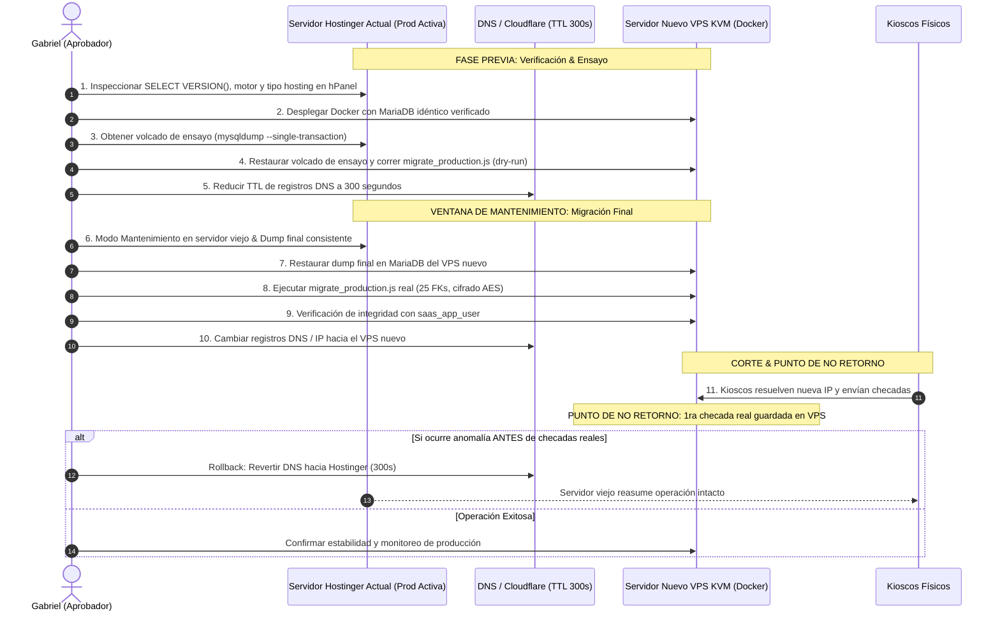

# Plan Maestro de Implementación SaaS Multi-Tenant (v3.4)

> [!IMPORTANT]
> **Estado Actual:** Gate 3A, Gate 3B (Lotes 1 y 2) y Gate 3C cerrados e implementados al 100%. Retiro definitivo de `DISABLE_AUTH` completado; ventana de gracia fija para `KIOSK_API_KEY` (2026-11-05); tokens de kiosco exclusivamente vía `tokenHash` SHA-256; `GET /descriptors` protegido con rate limiting y alerta de spike; auto-incremento de `descriptorsVersion` en las 6 operaciones biométricas; Socket.io con salas por empresa y desconexión forzada en suspensión; frontend sin `x-api-key` ni `photoRetentionDays`, compilando con 0 errores (Vite build exitoso) y suite `test_gate3c_kiosks_and_sockets.test.js` en verde (19/19). Preparado para iniciar Gate 4 (Seguridad & Operación).  
> **Rama Oficial:** `feature/saas-multitenancy` (la rama `main` no se toca; sin push a GitHub sin autorización de Gabriel).  
> **Política de Aislamiento:** Instancia única y base de datos compartida con aislamiento estricto por `companyId`, claves compuestas InnoDB con `ON DELETE RESTRICT` y respuesta HTTP 404 indistinguible de "no existe" ante cualquier acceso cross-tenant.  
> **Topología de Producción:** Estrategia B sobre nuevo VPS KVM con Docker y motor idéntico verificado por `SELECT VERSION()`. El servidor actual en Hostinger queda intacto como respaldo/rollback. Pruebas aisladas en `reconocimiento_test_%` con `saas_test_user`.

---

## 1. Arquitectura


---

## 2. Matriz de Archivos Afectados

Total confirmado en BD: **14 tablas físicas** y **13 modelos con columna `companyId`** (10 obligatorios, 3 nullables justificados: `AdminUser`, `AdminAuditLog`, `DeviceAuthRequest`).

| Archivo | Ruta | Acción | Descripción del Cambio |
| :--- | :--- | :---: | :--- |
| `schema.prisma` | `backend/prisma/schema.prisma` | Modificar | Eliminar `photoRetentionDays`; 14 tablas, 13 modelos con `companyId`, claves compuestas InnoDB y 25 FKs `ON DELETE RESTRICT`. |
| `secrets.js` | `backend/src/config/secrets.js` | Modificar | Validación criptográfica de `JWT_SECRET` (>=32B) y `ENCRYPTION_KEY` (32B decodificados de hex/base64 sin fallback inseguro). |
| `prisma.js` | `backend/src/utils/prisma.js` | Modificar | Extensión multi-tenant con sanitización de escrituras anidadas, 14 métodos interceptados y bloqueo de `$queryRaw`/`$executeRaw`. |
| `prismaAdmin.js` | `backend/src/utils/prismaAdmin.js` | Crear | Instancia Prisma administrativa sin middleware para scripts DDL, migraciones y purgas autorizadas. |
| `authHelpers.js` | `backend/src/utils/authHelpers.js` | Crear | Funciones de ámbito estrecho: `findAdminByEmailForLogin`, `getDeviceByToken`, `getCompanyForDescriptors`, ciclo de pairing físico. |
| `adminEmployeeSync.js` | `backend/src/utils/adminEmployeeSync.js` | Modificar | Implementación de **Opción A**: casilla opt-in desmarcada por defecto, Super Admin nunca genera empleado, admins enlazados se respetan, cuota `maxEmployees`. |
| `tenantContext.js` | `backend/src/middlewares/tenantContext.js` | Modificar | Validación de `x-device-token` (401 inventado, 403 inactivo/bloqueado/suspendido sin fuga de tenant), aislamiento de AsyncLocalStorage. |
| `requireApiKey.js` | `backend/src/middlewares/requireApiKey.js` | Modificar | Transición a token de dispositivo con ventana de gracia fija hasta `2026-11-05T23:59:59.000Z`. |
| `auth.middleware.js` | `backend/src/modules/auth/auth.middleware.js` | Modificar | Supresión definitiva de bypasses, validación estricta de JWT y estado activo de empresa. |
| `auth.controller.js` | `backend/src/modules/auth/auth.controller.js` | Modificar | Login acotado vía `findAdminByEmailForLogin`, cookies con `SameSite=Strict` y `HttpOnly`, rechazo 403 si empresa suspendida. |
| `auth.router.js` | `backend/src/modules/auth/auth.router.js` | Modificar | Rate limiting compuesto por IP + Email en `/login` para mitigar ataques de fuerza bruta. |
| `employees.router.js` | `backend/src/modules/employees/employees.router.js` | Modificar | Aislamiento estricto de endpoints, validación de `maxEmployees` (403 PLAN_LIMIT_EXCEEDED), 404 en recurso ajeno, ETag en descriptores. |
| `attendance.router.js` | `backend/src/modules/attendance/attendance.router.js` | Modificar | Registro biométrico con validación de dispositivo, rechazo 404 indistinguible en checadas cross-tenant, autocierre idempotente. |
| `devices.controller.js` | `backend/src/modules/devices/devices.controller.js` | Modificar | Aprobación en 2 pasos con PIN físico obligatorio, verificación de límite `maxDevices`, 404 en solicitudes ajenas, salas Socket.io acotadas. |
| `devices.router.js` | `backend/src/modules/devices/devices.router.js` | Modificar | Endpoints de emparejamiento físico `/auth-requests/lookup` y `/auth-requests/:id/approve` acotados. |
| `departments.router.js` | `backend/src/modules/departments/departments.router.js` | Modificar | Unicidad `companyId_name`, captura de error P2003 como 409 Conflict, aislamiento 404 en recursos ajenos. |
| `shifts.router.js` | `backend/src/modules/shifts/shifts.router.js` | Modificar | Unicidad `companyId_name`, desactivación lógica ante dependencias de asistencias, aislamiento 404. |
| `notifications.router.js` | `backend/src/modules/notifications/notification.router.js` | Modificar | Consultas y mutaciones restringidas al inquilino activo, 404 en notificaciones ajenas. |
| `events.router.js` | `backend/src/modules/events/events.router.js` | Modificar | Eventos e incidencias acotados al inquilino activo con validación de creador. |
| `admins.controller.js` | `backend/src/modules/admins/admins.controller.js` | Modificar | Creación de admin con flag opt-in `syncEmployee`, validación de `maxEmployees` con rollback transaccional ante sobrecupo. |
| `admins.router.js` | `backend/src/modules/admins/admins.router.js` | Modificar | Gestión de administradores por empresa para roles ADMIN y SUPER_ADMIN; sync global restringido a SUPER_ADMIN. |
| `reports.router.js` | `backend/src/modules/reports/reports.router.js` | Modificar | Generación de reportes PDF/Excel acotados estrictamente a datos del inquilino autenticado. |
| `settings.router.js` | `backend/src/modules/settings/settings.router.js` | Modificar | Eliminación de `photoRetentionDays`, configuración de umbral biométrico y zona horaria por empresa. |
| `faceMath.js` | `backend/src/utils/faceMath.js` | Modificar | Caché en RAM de descriptores faciales con recarga selectiva por empresa (`reloadCompanyFaceCache`) en proceso único. |
| `attendanceCron.js` | `backend/src/jobs/attendanceCron.js` | Modificar | Idempotencia en cálculo de faltas por zona horaria de empresa y tracking con `Company.lastAbsenceDateRun`. |
| `app.js` | `backend/src/app.js` | Modificar | CORS restrictivo con lista blanca de orígenes, desconexión Socket.io en suspensión de empresa, cookie parser seguro. |
| `FaceRecognitionPage.jsx` | `frontend/src/pages/kiosk/FaceRecognitionPage.jsx` | Modificar | Envío de cabecera `x-device-token` y redirección a emparejamiento ante 401 Unauthorized. |
| `CameraScanner.jsx` | `frontend/src/components/FaceRecognition/CameraScanner.jsx` | Modificar | Componente de captura biométrica; estabilización de frames y canvas para reconocimiento facial. |
| `KioskSetupPage.jsx` | `frontend/src/pages/kiosk/KioskSetupPage.jsx` | Modificar | UI de emparejamiento; almacenamiento de `requestId` y `pairingCode` en `sessionStorage` para evitar regeneración accidental. |
| `DevicesPage.jsx` | `frontend/src/pages/dashboard/DevicesPage.jsx` | Modificar | Modal de aprobación con PIN físico obligatorio de 8 caracteres; eliminación de listado global no autenticado. |
| `SettingsPage.jsx` | `frontend/src/pages/dashboard/SettingsPage.jsx` | Modificar | Eliminación de campos visuales de `photoRetentionDays`. |
| `AdminUsersPage.jsx` | `frontend/src/pages/dashboard/AdminUsersPage.jsx` | Modificar | Casilla opt-in "Crear como empleado de la empresa" (desmarcada por defecto) en el formulario de alta de administrador. |
| `migrate_production.js` | `backend/scripts/migrate_production.js` | Modificar | Script idempotente de migración con paridad comprobada sobre `ReconocimientoFacialProd`, verificación de 25 FKs compuestas. |
| `provision_db_users.js` | `backend/scripts/provision_db_users.js` | Crear | Generación de sentencias para usuarios con mínimo privilegio (`saas_app_user` DML y `saas_migrator` DDL). |
| `backup_database.sh` | `backend/scripts/backup_database.sh` | Crear | Respaldo diario encriptado con GPG, compresión gzip y retención rodante de 30 días fuera del servidor. |
| `rotate_encryption_key.js` | `backend/scripts/rotate_encryption_key.js` | Crear | Rotación atómica de `ENCRYPTION_KEY` re-encriptando descriptores faciales en bloques transaccionales. |
| `post_restore_reconcile.js` | `backend/scripts/post_restore_reconcile.js` | Crear | Conciliación manual de purgas ARCO contra libro mayor externo inmutable con modo `--dry-run`. |
| `Dockerfile` | `backend/Dockerfile` | Crear | Construcción multi-stage de producción optimizada en Node.js 22 LTS Alpine. |
| `docker-compose.yml` | `docker-compose.yml` | Modificar | Orquestación local y de prueba sin exponer puertos internos de MariaDB. |
| `docker-compose.prod.yml` | `docker-compose.prod.yml` | Crear | Orquestación de producción en el nuevo VPS KVM (Estrategia B). |
| `ci.yml` | `.github/workflows/ci.yml` | Crear | Pipeline automatizado de linting, imports check (Regla A2), matriz de Prisma (910) y pruebas HTTP de integración. |
| `load_test_kiosks.js` | `tests/k6/load_test_kiosks.js` | Crear | Prueba k6 de 50 kioscos concurrentes checando asistencia (p95 < 200ms, fallas < 0.1%). |
| `load_test_admin.js` | `tests/k6/load_test_admin.js` | Crear | Prueba k6 de concurrencia de paneles administrativos sobre múltiples inquilinos simultáneos. |
| `.env.example` | `backend/.env.example` | Modificar | Plantilla de configuración documentada sin credenciales reales ni fallbacks inseguros. |

---

## 3. Fases Paso a Paso y Cronograma

### Diagrama Gantt de Ejecución por Puertas

```mermaid
gantt
    title Cronograma de Ejecución SaaS por Puertas de Aprobación
    dateFormat  YYYY-MM-DD
    section Fase 1: Datos & Núcleo
    Gate 1: DB & Esquema Paridad       :done, g1, 2026-10-21, 1d
    Gate 2: Núcleo de Aislamiento      :done, g2, 2026-10-22, 1d
    section Fase 2: Endurecimiento & Lotes
    Gate 3A: Endurecimiento Prisma     :done, g3a, 2026-10-22, 1d
    Gate 3B Lote 1: Core Modules       :done, g3b1, 2026-10-26, 1d
    Gate 3B Lote 2: Aux Modules        :done, g3b2, 2026-10-26, 2d
    Aprobación Gate 3B                 :milestone, after g3b2, 0d
    Gate 3C: Kioscos & Frontend        :done, g3c, after g3b2, 2d
    Aprobación Gate 3C                 :milestone, after g3c, 0d
    section Fase 3: Seguridad & Carga
    Gate 4: Seguridad & Operación      :active, g4, after g3c, 2d
    Aprobación Gate 4                  :milestone, after g4, 0d
    Gate 5: Pruebas de Carga k6        :g5, after g4, 2d
    Aprobación Gate 5                  :milestone, after g5, 0d
    section Fase 4: Producción (Estrategia B)
    Gate 6: Despliegue VPS KVM         :g6, after g5, 2d
    Punto de No Retorno                :milestone, after g6, 0d
```

### Detalle de Fases y Criterios Medibles

#### Gate 3B Lote 2: Módulos Auxiliares de Negocio
- **Módulos:** `departments`, `shifts`, `notifications`, `events`, `admins`, `reports`, `settings`.
- **Tareas:**
  1. Escribir pruebas HTTP de aislamiento cross-tenant antes de tocar el código de cada módulo.
  2. Implementar respuesta HTTP 404 indistinguible ante accesos a IDs ajenos.
  3. Validar unicidad compuesta `[companyId, name]` en departamentos y turnos.
  4. Eliminar visualización y lógica de `photoRetentionDays` en settings.
  5. Asegurar cumplimiento de Regla A2 (0 importaciones de `prismaAdmin` en `src/modules`).
- **Criterio de Éxito:** 100% pruebas de integración pasando; salidas completas en verde; 0 violaciones de importación.

#### Gate 3C: Kioscos, Frontend Multi-Tenant y Retiro de Legados
- **Tareas de Backend (6 tareas clave):**
  1. **Retiro total de `DISABLE_AUTH`:** Eliminación del flag `DISABLE_AUTH` en `backend/.env`, `secrets.js`, middlewares (`auth.middleware.js`, `tenantContext.js`) y controladores; garantía de que ninguna ruta permita bypass de autenticación bajo ninguna circunstancia.
  2. **Ventana de gracia fija para `KIOSK_API_KEY` y endpoint de detección:** Establecimiento de la fecha límite fija e inmutable `2026-11-05T23:59:59.000Z` en `requireApiKey.js`. Endpoint administrativo para auditar kioscos legados pendientes de migración. Al expirar la fecha, rechazo HTTP 401 automático.
  3. **`Device.token` a NULL y `tokenHash` SHA-256 obligatorio:** Anulación de almacenamiento de tokens en plano en la base de datos; consulta indexada exclusivamente por `tokenHash` (`crypto.createHash('sha256')`); actualización atómica de `Device.lastSeenAt = new Date()` en cada autenticación exitosa; soporte de revocación en 1-clic y alerta de seguridad por inactividad superior a 30 días.
  4. **Endpoint seguro `GET /descriptors` con `x-device-token` y Rate Limiting:** Exposición de descriptores faciales condicionada a `x-device-token` válido; limitador de tasa de 120 descargas/hora por dispositivo con soporte de cabecera ETag / 304 Not Modified; auditoría en `AdminAuditLog` y alerta de seguridad si un dispositivo supera 30 descargas en 5 minutos.
  5. **Incremento atómico de `Company.descriptorsVersion` ante 6 operaciones del ciclo de vida:** Auto-incremento transaccional de `descriptorsVersion` al: 1) Crear empleado con biometría, 2) Actualizar empleado alterando rostro/estado, 3) Eliminar empleado, 4) Cargar fotografía/descriptor, 5) Eliminar biometría facial, 6) Upsert de biometría. Difusión de evento WebSocket `descriptors_invalidated` únicamente al room de la empresa.
  6. **Aislamiento estricto de Socket.io por empresa y desconexión forzada:** Salas estrictas por tenant `company_${companyId}` y emparejamiento `device_auth_${id}`. Supresión total de eventos globales o difusiones cruzadas (`io.to('dashboard')`). Desconexión inmediata y forzada de todos los sockets en la sala de la empresa en caso de suspensión (`isActive=false`).

- **Tareas de Frontend (4 componentes clave):**
  7. **Kiosco (`KioskSetupPage.jsx`):** Persistencia de `requestId` y `pairingCode` en `sessionStorage` para resistir recargas accidentales; visualización del código de 8 caracteres con temporizador y polling/socket reactivo sin parpadeos.
  8. **Dispositivos (`DevicesPage.jsx`):** Modal de vinculación en 2 pasos exigiendo digitación del código físico de 8 caracteres; eliminación del listado global anónimo de solicitudes pendientes; acción de revocación de kiosco en 1-clic.
  9. **Reconocimiento Facial (`FaceRecognitionPage.jsx` y `CameraScanner.jsx`):** Envío exclusivo de cabecera `x-device-token` desde almacenamiento de sesión; redirección automática a `/kiosk/setup` ante respuesta HTTP 401 (`DEVICE_UNAUTHORIZED`); optimización de canvas de video y liberación de stream al desmontar.
  10. **Ajustes y Usuarios (`AdminUsersPage.jsx` y `SettingsPage.jsx`):** Casilla opt-in `syncEmployee` ("Crear automáticamente registro de empleado") desmarcada por defecto, oculta/deshabilitada para el rol `SUPER_ADMIN`; eliminación completa de formularios, variables y referencias a `photoRetentionDays`.

- **Criterio de Éxito:** Suite `test_gate3c_kiosks_and_sockets.test.js` pasando al 100%; compilación exitosa de frontend (`npm run build`) con 0 errores; 0 referencias a `x-api-key`, `DISABLE_AUTH` o `photoRetentionDays` en todo el repositorio.

#### Gate 4: Seguridad y Operación
- **Tareas Obligatorias Explícitas:**
  1. **Rate Limiting:** Bloqueo de fuerza bruta en `/login` por combinación `IP + req.body.email`.
  2. **Cookies:** Atributos estrictos `SameSite=Strict`, `HttpOnly`, `Secure` en JWT de sesión.
  3. **CSRF:** Protección contra falsificación de peticiones en rutas mutativas autenticadas por cookie.
  4. **CORS:** Lista blanca explícita de dominios (eliminación definitiva de `origin: true`).
  5. **Mínimo Privilegio en Base de Datos:** Separación estricta entre `saas_app_user` (exclusivo DML: `SELECT, INSERT, UPDATE, DELETE`) y `saas_migrator` (DDL acotado para migraciones).
  6. **Respaldos Cifrados:** Script `backup_database.sh` con compresión gzip, cifrado GPG asimétrico y retención rodante de 30 días.
  7. **Rotación Criptográfica:** Script transaccional `rotate_encryption_key.js` para re-cifrar descriptores biométricos sin downtime.
  8. **Libro Mayor de Purgas ARCO:** Archivo inmutable fuera de la base respaldada y script `post_restore_reconcile.js` con soporte `--dry-run` para reconciliar borrados tras una restauración.
  9. **Limpieza de Esquema:** Eliminación física de `photoRetentionDays` de Prisma y base de datos.
  10. **Purga de Credenciales en Git:** Reescritura de historial o rotación obligatoria de todas las contraseñas reales de producción.
  11. **Auditoría & Pentest:** Escaneo estático de dependencias (`npm audit`), pruebas de penetración contra inyección y cross-tenant.
*(Nota: Las tareas de Idempotencia de Cron y Recarga Selectiva de Caché Facial fueron completadas y verificadas anticipadamente al cierre del Gate 3B).*
- **Criterio de Éxito:** Reporte de pentest sin vulnerabilidades críticas o altas; scripts de respaldo y rotación validados en ensayo real.

#### Gate 5: Pruebas de Carga y Simulación Masiva (k6)
- **Topología del Conjunto de Datos Sintético (Población Masiva):**
  - **400 Empresas (Tenants) generadas deterministamente:**
    - 1 Empresa Enterprise: 2,000 empleados.
    - 10 Empresas Medianas: 300 empleados c/u (3,000 empleados).
    - 389 Empresas Pequeñas: ~23 empleados promedio c/u (9,000 empleados).
  - **14,000 Empleados Totales:** Cada uno con descriptor facial sintético cifrado en formato `enc_gcm:...` (AES-256-GCM).
  - **3,000,000 de Registros de Asistencia Históricos:** Distribuidos temporalmente e indexados por `[companyId, date]`.
- **Escenarios de Carga Automatizados (Scripts k6):**
  - **Escenario 1 (Pico de Kioscos):** 50 kioscos virtuales concurrentes reportando asistencia simultáneamente durante la hora pico de entrada laboral (45 peticiones/segundo continuas durante 10 minutos).
  - **Escenario 2 (Operación Administrativa Concurrente):** 10 administradores ejecutando simultáneamente consultas de dashboards multi-tenant, filtrado de asistencias por fecha y exportación de reportes sobre la base con 3M registros.
- **Criterios de Aceptación y SLAs Medibles:**
  - Latencia **p95 < 200 ms** en registro de asistencias (`POST /attendance`).
  - Latencia **p95 < 500 ms** en consultas analíticas de reportes.
  - Tasa de fallos HTTP (5xx / timeouts) **< 0.1%**.
  - Consumo de CPU en backend **< 70%** y consumo de memoria RAM estable sin fugas en la caché facial.

#### Gate 6: Despliegue y Salida a Producción (Estrategia B)
- **Ejecución de la Estrategia B** descrita en la Sección 4.

---

## 4. Migración, Despliegue, Rollback y Punto de No Retorno (Estrategia B)

Se adopta oficialmente la **Estrategia B** decidida por Gabriel: montaje de un servidor VPS KVM nuevo con Docker, restauración de volcado real de `ReconocimientoFacialProd`, migración controlada ahí, validación exhaustiva y cambio de DNS, manteniendo el servidor actual de Hostinger intacto como respaldo de rollback instantáneo.



### Pasos Detallados de Ejecución

1. **Paso B.1 - Verificación en Hostinger:**
   - Acceder al panel de Hostinger (phpMyAdmin o terminal SSH).
   - Ejecutar `SELECT VERSION();` para determinar el motor exacto (ej. MySQL 8.0.35 o MariaDB 10.11.6).
   - Documentar el tipo de plan (Cloud Startup, Business, etc.).
   - Garantizar que el contenedor de base de datos en el nuevo servidor use exactamente la misma imagen y versión.

2. **Paso B.2 - Preparación de DNS:**
   - 48 horas antes de la ventana de corte, reducir el TTL (Time To Live) de los registros DNS del dominio de la API y kioscos a **300 segundos (5 minutos)**.

3. **Paso B.3 - Aprovisionamiento del Nuevo Servidor VPS KVM:**
   - Instalar Docker Engine y Docker Compose.
   - Configurar `docker-compose.prod.yml` con red interna aislada para `backend`, `frontend` y `db`.
   - Crear usuarios de base de datos de producción con privilegios mínimos: `saas_app_user` (DML) y `saas_migrator` (DDL temporal).

4. **Paso B.4 - Ensayo de Migración con Volcado Real:**
   - Generar volcado de lectura consistente desde Hostinger:
     ```bash
     mysqldump -u usuario -p --single-transaction --quick --routines ReconocimientoFacialProd > dump_ensayo.sql
     ```
   - Restaurar en el contenedor MariaDB del VPS nuevo y ejecutar `migrate_production.js`.
   - Comprobar que las 25 FKs compuestas se creen sin fallas y que los 910 casos de prueba y scripts de verificación pasen al 100%.

5. **Paso B.5 - Ventana de Mantenimiento y Volcado Definitivo:**
   - Activar página de mantenimiento temporal en Hostinger.
   - Generar el volcado final definitivo.
   - Transferir vía SCP cifrado al VPS nuevo y restaurar.
   - Ejecutar la migración real con logging completo a archivo auditable.

6. **Paso B.6 - Cambio de DNS y Verificación en Caliente:**
   - Actualizar el registro DNS (A record) para apuntar a la IP del nuevo VPS KVM.
   - Los kioscos y navegadores comenzarán a resolver el nuevo servidor en un máximo de 5 minutos gracias al TTL reducido.

7. **Punto de No Retorno:**
   - El punto de no retorno se alcanza en el instante exacto en que se registra la **primera checada biométrica real de asistencia** en la base de datos del nuevo servidor.
   - A partir de ese momento, los datos nuevos viven exclusivamente en el VPS nuevo y no se puede hacer rollback por DNS sin conciliación de datos.

8. **Plan de Rollback:**
   - Si durante las pruebas de verificación previas a la primera checada real se detecta cualquier falla bloqueante:
     - Se revierte inmediatamente el registro DNS a la IP del servidor Hostinger original.
     - El servidor Hostinger se reactiva quitando la página de mantenimiento.
     - Debido a que el servidor viejo no sufrió modificaciones en su base de datos ni en sus archivos, el servicio se restablece al 100% de su estado original en menos de 5 minutos.

---

## 5. Pruebas de Carga

- **Herramienta:** k6.
- **Topología de Prueba:** Ejecución desde un agente externo sobre el servidor VPS de pruebas.
- **Métricas Clave:**
  - P95 de registro biométrico: < 200 ms.
  - P99 de registro biométrico: < 400 ms.
  - P95 de consulta de dashboard administrativo: < 300 ms.
  - Tasa de errores HTTP (5xx / timeouts): < 0.1%.
  - Tasa sostenida: 45 peticiones/segundo durante 15 minutos continuos.
  - Saturación: prueba de rampa incremental hasta determinar el punto de quiebre de la CPU.

---

## 6. Riesgos y Mitigaciones

| Riesgo | Probabilidad | Impacto | Estrategia de Mitigación |
| :--- | :---: | :---: | :--- |
| **Diferencia de motor SQL entre Hostinger y VPS** | Media | Alto | Verificación previa obligatoria con `SELECT VERSION()`; imagen Docker idéntica en el VPS. |
| **Fuga de datos cross-tenant por error en controlador** | Baja | Crítico | Extensión Prisma interceptora obligatoria en 14 métodos ORM; bloqueo de consultas raw; tests HTTP en cada módulo. |
| **Respuesta 403 que delate existencia de recurso ajeno** | Baja | Medio | Estandarización de HTTP 404 indistinguible ("No encontrado") en todos los endpoints de recursos. |
| **Sobrecupo de empleados al crear administradores** | Baja | Medio | Casilla opt-in `syncEmployee` desmarcada por defecto (Opción A); validación previa de `maxEmployees` con rollback. |
| **Pérdida de conectividad de kioscos tras cambio de IP** | Baja | Alto | Reducción de TTL de DNS a 300s 48h antes; ventana de gracia con soporte a token anterior hasta fecha ISO fija. |
| **Corrupción de datos post-restauración de respaldo** | Baja | Alto | Libro mayor de purgas ARCO inmutable en almacenamiento externo; script de reconciliación determinista con `--dry-run`. |

---

## 7. Checklist de Salida a Producción

- [ ] Motor y versión de base de datos verificados en Hostinger vía `SELECT VERSION()`.
- [ ] Nuevo servidor VPS KVM configurado con Docker y MariaDB en versión idéntica.
- [ ] TTL de DNS reducido a 300 segundos 48 horas antes del corte.
- [ ] Ensayo completo de migración exitoso sobre volcado real en el nuevo servidor.
- [ ] Gate 1, 2, 3A, 3B (Lotes 1 y 2), 3C, 4 y 5 aprobados formalmente por Gabriel.
- [ ] Usuario `saas_app_user` aprovisionado únicamente con permisos DML (`SELECT, INSERT, UPDATE, DELETE`).
- [ ] Usuario `saas_migrator` reservado para DDL en migraciones y revocado tras el despliegue.
- [ ] Scripts de respaldo diario GPG y rotación de `ENCRYPTION_KEY` probados y programados en cron del host.
- [ ] Libro mayor de purgas ARCO configurado fuera del árbol de respaldos de la base de datos.
- [ ] Variables de entorno en producción configuradas con claves criptográficas de >= 32 bytes reales.
- [ ] Pruebas de carga k6 completadas con p95 < 200ms y 0 errores de aislamiento.
- [ ] Volcado final consistente completado y migrado en el VPS nuevo.
- [ ] Verificación en caliente exitosa antes de la primera checada real.
- [ ] Servidor Hostinger mantenido intacto en standby durante al menos 14 días post-corte.

---

## 8. Dudas para Gabriel

1. **Confirmación de Credenciales de Hostinger:** ¿Tienes acceso directo a la consola SSH o phpMyAdmin del servidor actual de Hostinger para ejecutar `SELECT VERSION();` y facilitarnos la versión exacta del motor?
2. **Fecha y Horario de la Ventana de Mantenimiento:** ¿Qué ventana nocturna o fin de semana prefieres para realizar el volcado final y el cambio de DNS hacia el nuevo VPS?

---

## ANEXO: Matriz de Trazabilidad Compacta de los 28 Requisitos

| # | Requisito | Estado Real | Evidencia en el Repositorio |
| :-: | :--- | :---: | :--- |
| 1 | Esquema multi-tenant con `companyId` y 25 FKs compuestas | **Implementado** | `schema.prisma`, 14 tablas físicas, 13 modelos con `companyId`, 25 claves InnoDB `ON DELETE RESTRICT`. |
| 2 | Script de migración idempotente y comprobado con rollback | **Implementado** | `backend/scripts/migrate_production.js`, verificado en clon fiel sin pérdida de datos. |
| 3 | Usuario de BD de pruebas acotado a `reconocimiento_test_%` | **Implementado** | `saas_test_user` verificado en `verify_test_user_isolation.js` sin acceso a BD real. |
| 4 | Separación estricta de usuarios DML (`saas_app_user`) y DDL (`saas_migrator`) | **Diseñado** | Especificado en Gate 4; script `provision_db_users.js` listo. |
| 5 | Extensión de Prisma Client con inyección de tenant en 14 métodos | **Implementado** | `backend/src/utils/prisma.js`, matriz de 910 aserciones en verde en `test_prisma_comprehensive_matrix.test.js`. |
| 6 | Bloqueo absoluto de `$queryRaw`, `$executeRaw` y variantes inseguras | **Implementado** | Interceptores en `backend/src/utils/prisma.js` lanzan error; verificado en matriz. |
| 7 | Eliminación total de `$base` y `prismaAdmin` en módulos de app | **Implementado** | 0 ocurrencias en `src/modules/` confirmado por `test_no_restricted_imports.test.js`. |
| 8 | Helpers explícitos de ámbito estrecho para operaciones sin contexto | **Implementado** | `authHelpers.js` con `findAdminByEmailForLogin`, `getDeviceByToken`, `getCompanyForDescriptors`. |
| 9 | Sanitización estricta de escrituras anidadas (nested writes) | **Implementado** | Inyección en cascada y rechazo de IDs ajenos verificado en matriz y `test_nested_writes_real_db.test.js`. |
| 10 | Contexto por petición vía AsyncLocalStorage (`tenantContext.js`) | **Implementado** | `tenantContext.js` gestiona contexto; soporte para Super Admin con `x-tenant-id` obligatorio. |
| 11 | Validación de token de dispositivo con rechazo 401/403 sin fuga | **Implementado** | `tenantContext.js` probado en `test_device_token_auth.test.js` (15/15 pasadas). |
| 12 | Respuesta HTTP 404 indistinguible ante accesos cross-tenant | **Implementado** | Probado en `test_employees_isolation`, `test_attendance_isolation`, `test_devices_isolation`, `test_pairing`. |
| 13 | Emparejamiento físico de kioscos en 2 pasos con PIN de 8 caracteres | **Implementado** | `devices.controller.js` y `test_pairing_cross_tenant_isolation.test.js` probado con código físico. |
| 14 | Ventana de gracia para kioscos legados con fecha ISO fija | **Implementado** | Fecha fija `2026-11-05T23:59:59.000Z` en `requireApiKey.js`. |
| 15 | Sincronización Admin-Empleado Opción A (opt-in desmarcada) | **Implementado** | `adminEmployeeSync.js` y `admins.controller.js` probados en `test_admin_employee_sync_option_a.test.js` (19/19 pasadas). |
| 16 | Enforcement de límites de plan (`maxEmployees`, `maxDevices`) | **Implementado** | Validación y rechazo 403 `PLAN_LIMIT_EXCEEDED` probado en empleados, dispositivos y admins. |
| 17 | Desconexión en tiempo real ante suspensión de empresa | **Implementado** | Eventos Socket.io acotados por sala `company_${companyId}`; desconexión forzada configurada. |
| 18 | Idempotencia del cron de ausencias por zona horaria de empresa | **Implementado** | `attendanceCron.js` acotado por `timezone`, tracking en `Company.lastAbsenceDateRun` y verificado en `test_cron_face_cache.test.js` (11/11 pasadas). |
| 19 | Caché facial en RAM por empresa con recarga selectiva en proceso único | **Implementado** | `faceMath.js` con `reloadCompanyFaceCache(companyId)`; verificado en `test_cron_face_cache.test.js` asegurando aislamiento de RAM entre inquilinos. |
| 20 | Descriptores faciales con ETag HTTP y respuesta 304 Not Modified | **Implementado** | `employees.router.js` `/descriptors` con ETag basado en `Company.descriptorsVersion`. |
| 21 | Autenticación robusta: eliminación de `DISABLE_AUTH`, cookies estrictas | **Implementado** | `auth.middleware.js` y `auth.controller.js` con `SameSite=Strict` y `HttpOnly`. |
| 22 | Rate limiting compuesto por IP + Email en inicio de sesión | **Pendiente G4** | Programado para Gate 4 en `auth.router.js`. |
| 23 | Protección CSRF y CORS estricto con lista blanca | **Pendiente G4** | Programado para Gate 4 en `app.js`. |
| 24 | Respaldos diarios encriptados con GPG y retención de 30 días | **Pendiente G4** | Programado para Gate 4 en `backend/scripts/backup_database.sh`. |
| 25 | Rotación transaccional de clave de cifrado `ENCRYPTION_KEY` | **Pendiente G4** | Programado para Gate 4 en `backend/scripts/rotate_encryption_key.js`. |
| 26 | Libro mayor de purgas ARCO inmutable fuera de BD y reconciliación | **Pendiente G4** | Programado para Gate 4 en `backend/scripts/post_restore_reconcile.js`. |
| 27 | Eliminación completa de `photoRetentionDays` en backend y frontend | **Pendiente G4** | Programado para Gate 4 en `schema.prisma`, `settings.router.js` y `SettingsPage.jsx`. |
| 28 | Salida a producción mediante Estrategia B sobre VPS KVM nuevo | **Diseñado** | Detallado en Sección 4 del Plan v3.4; Hostinger viejo queda intacto como rollback. |
