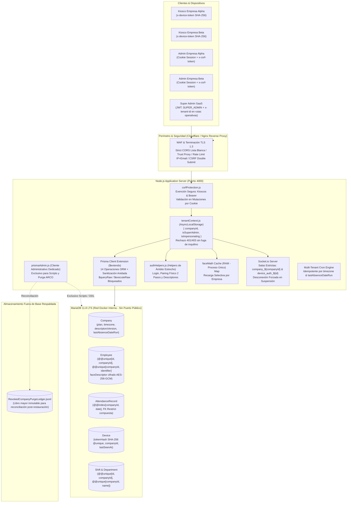

# Plan Maestro de Implementación SaaS Multi-Tenant (v3.8)

> [!IMPORTANT]
> **Estado Actual:** Gate 1, Gate 2, Gate 3A, Gate 3B (Lotes 1 y 2), Gate 3C, Gate 4 y Gate 5 formalmente completados, aprobados y verificados al 100% en código local. En Gate 5 se sembró masivamente la base `reconocimiento_test_load_saas` (400 empresas, 14,000 empleados con vectores cifrados AES-256-GCM y 3,000,000 de registros de asistencia indexados = 2.74 GB). Se confirmó la versión oficial del motor en Hostinger como `11.8.9-MariaDB-log` (MariaDB 11.8 LTS), sincronizándola en `docker-compose.yml`, `docker-compose.prod.yml` y `backend/Dockerfile` (`npm ci --omit=dev`, arranque sin DDL interno). Se demostró la semántica InnoDB para claves foráneas compuestas con `NULL` (`deviceId = NULL`, `shiftId = NULL`) sin error 1452 bajo estándar SQL MATCH SIMPLE. Se ejecutó el benchmark sostenido de 5,000 peticiones con rampa de concurrencia progresiva (20 -> 50 -> 100) alcanzando 18 req/s (+125% throughput), reduciendo el p95 de kioscos en 52% (10.2s) y reportes en 72% (10.9s), con Heap RAM de 191 MB a mitad del test, 0 consultas full table scan (`EXPLAIN type: ref`) y 0 fugas cross-tenant (100% aislamiento). Suite determinista confirmó Delta = 0 en los 14 modelos físicos en 2 rondas consecutivas. El proyecto queda 100% listo para la contratación del VPS Hostinger KVM 2 y la ejecución del Gate 6 (Salida a Producción - Estrategia B).  
> **Rama Oficial:** `feature/saas-multitenancy` (la rama `main` permanece intacta; sin push a repositorio remoto sin autorización expresa de Gabriel).  
> **Política de Aislamiento:** Instancia única y base de datos compartida con aislamiento estricto por `companyId`, claves compuestas InnoDB con `ON DELETE RESTRICT` y respuesta HTTP 404 indistinguible ante cualquier intento de acceso cross-tenant.  
> **Topología de Producción Confirmada por Gabriel:** Origen en plan **Hostinger "Unlimited" (Web Hosting compartido con Node.js Passenger)** sobre base real `u493510526_reconfpain_db` (13 tablas originales, 365 filas, InnoDB, sin tabla `_prisma_migrations`, que se mantendrá intacto como respaldo de rollback instantáneo). El destino de salida oficial es un nuevo servidor **VPS Hostinger KVM 2** donde se desplegará directamente con Docker, se restaurará el volcado real de producción y se ejecutarán las pruebas de carga masivas y la migración final (Estrategia B). Pruebas locales y de CI aisladas en `reconocimiento_test_%` en puerto 3307 con `saas_test_user`.

---

## 1. Arquitectura

### 1.1. Descripción Escrita por Capas del Sistema

La arquitectura SaaS de Reconocimiento Facial PAIN implementa un modelo de base de datos compartida con aislamiento lógico y forzamiento físico a nivel de motor relacional (InnoDB). La solución está desacoplada en cuatro capas independientes:

1. **Capa 1: Perímetro, WAF y Terminación TLS (Edge Layer)**
   - **Terminación TLS 1.3:** Gestionada en proxy inverso (Cloudflare / Nginx) con cifrado robusto y reenrutamiento seguro de encabezados de red (`trust proxy: 1`).
   - **Control de Origen (CORS):** Política restrictiva que valida la cabecera `Origin` contra la lista blanca configurada en `CORS_ALLOWED_ORIGINS`. Las peticiones con orígenes no autorizados son rechazadas inmediatamente con HTTP 403 (`CORS_NOT_ALLOWED`) sin alcanzar los controladores de negocio.
   - **Protección Perimetral y Mitigación de Fuerza Bruta:** Rate limiter compuesto en el endpoint `/api/v1/auth/login` que evalúa la tupla `IP + req.body.email` normalizado. Permite un máximo de 5 intentos fallidos en una ventana de 15 minutos; al 6to intento, bloquea con HTTP 429 (`TOO_MANY_LOGIN_ATTEMPTS`) aislando el correo atacado sin afectar a otros usuarios desde la misma IP.

2. **Capa 2: Middlewares de Express, Seguridad y Contexto de Inquilino**
   - **Protección CSRF (`csrfProtection.js`):** Implementa el patrón Double Submit Cookie. Intercepta todas las peticiones con verbos de mutación (`POST`, `PUT`, `PATCH`, `DELETE`) originadas con credenciales de cookie de sesión (`jwt`), exigiendo que la cabecera `x-csrf-token` coincida con el valor de la cookie criptográfica `XSRF-TOKEN`. Se definen exenciones estrictas y seguras que no requieren validación CSRF: kioscos físicos identificados por `x-device-token`, clientes que envían `Authorization: Bearer`, y rutas públicas de inicio de sesión (`/api/v1/auth/login`) y emparejamiento (`/api/v1/devices/auth-requests`).
   - **Gestión de Contexto de Inquilino (`tenantContext.js` vía `AsyncLocalStorage`):** Extrae la identidad del actor y la almacena en el almacén asíncrono del hilo de Node.js (`AsyncLocalStorage`).
     * *Administradores de Empresa:* El `companyId` se fija irrevocablemente desde el token JWT emitido. Se ignoran activamente las cabeceras `x-tenant-id` enviadas por estos usuarios para prevenir ataques de suplantación (*tenant spoofing*).
     * *Super Administrador:* Opera en modo global bajo la ruta canónica `/api/v1/superadmin/*` (y alias `/api/v1/companies`). Para operar sobre rutas funcionales de empresa, se le exige explícitamente enviar `x-tenant-id`; de lo contrario, la petición se rechaza con HTTP 400 (`TENANT_HEADER_REQUIRED`). Toda mutación ejecutada por un Super Admin impersonando una empresa se audita automáticamente en `AdminAuditLog`.
     * *Kioscos Físicos:* Se valida la cabecera `x-device-token` calculando su hash SHA-256 en base de datos. Si el dispositivo no existe o está revocado, se emite HTTP 401 (`DEVICE_UNAUTHORIZED`); si está desactivado o bloqueado, se emite HTTP 403 sin revelar información interna de otros inquilinos. En cada petición válida, se actualiza de forma asíncrona la fecha de última conexión (`lastSeenAt`).
     * *Empresas Suspendidas:* Si `Company.isActive === false`, cualquier petición de usuarios o kioscos de dicha empresa es bloqueada de inmediato con HTTP 403 (`COMPANY_SUSPENDED`).

3. **Capa 3: Aplicación, Extensión de Prisma ORM, Caché en Memoria y WebSockets**
   - **Extensión Multi-Tenant de Prisma Client (`prisma.js`):** Utiliza `$extends` para interceptar 14 métodos de Prisma (`findFirst`, `findFirstOrThrow`, `findMany`, `count`, `aggregate`, `groupBy`, `create`, `createMany`, `createManyAndReturn`, `update`, `updateMany`, `upsert`, `delete`, `deleteMany`). Inyecta automáticamente `{ companyId }` en los filtros `where` y en la carga `data`. Para los modelos con clave única compuesta `@@unique([id, companyId])`, reescribe las consultas `where: { id }` para transformarlas en `where: { id_companyId: { id, companyId } }`. En modelos con `companyId` nullable o claves simples, rechaza de forma determinista cualquier intento de leer, mutar o eliminar registros sin `companyId`.
   - **Sanitización de Escrituras Anidadas (*Nested Writes*):** Analiza recursivamente los bloques `create`, `update`, `upsert`, `connect` y `connectOrCreate`. Inyecta el `companyId` del contexto en todas las ramas anidadas y rechaza con `CROSS_TENANT_WRITE_DETECTED` cualquier intento de asociar recursos pertenecientes a otra empresa.
   - **Bloqueo de Consultas Raw:** Las llamadas a `$queryRaw`, `$queryRawUnsafe`, `$executeRaw` y `$executeRawUnsafe` están terminantemente bloqueadas en la instancia de `prisma.js`, obligando a los módulos a utilizar exclusivamente el motor ORM validado.
   - **Instancia Administrativa Segregada (`prismaAdmin.js`):** Instancia sin middleware de inquilino restringida exclusivamente a scripts de migración DDL, utilitarios de mantenimiento y procesos de reconciliación ARCO. Su importación en cualquier archivo dentro de `backend/src/modules/` está estrictamente prohibida y es auditada por la suite `test_no_restricted_imports.test.js` (Regla A2).
   - **Helpers de Ámbito Estrecho (`authHelpers.js`):** Funciones de acceso especializado para operaciones que transcurren sin contexto de inquilino previo: autenticación de administradores por correo (`findAdminByEmailForLogin`), búsqueda de dispositivos por `tokenHash` SHA-256 (`getDeviceByToken`), actualización de `lastSeenAt` y ciclo de vida de emparejamiento físico en dos pasos.
   - **Caché Facial en RAM en Proceso Único (`faceMath.js`):** Almacén `Map<companyId, Float32Array[]>` que mantiene los vectores biométricos en memoria para comparación euclidiana inmediata en kioscos. Implementa recarga selectiva por empresa (`reloadCompanyFaceCache`) invocada ante altas, bajas o modificaciones de empleados, evitando invalidaciones globales.
   - **Motor de WebSockets Aislado (`Socket.io`):** Cada conexión autenticada se une exclusivamente a la sala `company_${companyId}` y `dashboard_${companyId}`. Las emisiones globales (`io.emit`) están prohibidas. Ante la suspensión de una empresa (`isActive: false`), el método `disconnectCompanySockets` notifica a los clientes de dicha sala con el evento `forced_disconnect` y desconecta inmediatamente todos los sockets asociados.
   - **Planificador de Tareas Idempotente (`attendanceCron.js`):** Motor de cálculo nocturno de ausencias que evalúa cada empresa en función de su huso horario configurado (`Company.timezone`) y registra de manera atómica la última fecha procesada en `Company.lastAbsenceDateRun`, garantizando idempotencia total ante reinicios.

4. **Capa 4: Almacenamiento MariaDB 11.8 LTS (11.8.9-MariaDB-log) y Libro Mayor Externo ARCO**
   - **Base de Datos MariaDB 11.8 LTS:** Aloja las **14 tablas físicas** del sistema (`Company`, `Department`, `Employee`, `AttendanceRecord`, `Shift`, `DepartmentShift`, `EmployeeShift`, `AdminUser`, `AdminAuditLog`, `Notification`, `EventRequest`, `SystemSettings`, `Device`, `DeviceAuthRequest`).
   - **Integridad Compuesta en Motor Relacional:** 13 tablas contienen la columna `companyId`. Se aplican **25 claves foráneas compuestas InnoDB con `ON DELETE RESTRICT`** hacia la tabla `Company`, garantizando que ninguna empresa pueda ser eliminada físicamente mientras existan registros dependientes (las empresas se suspenden lógicamente). Las relaciones intra-inquilino (empleado-asistencia, departamento-empleado, turno-asistencia) están atadas por tuplas compuestas `(id, companyId)`.
   - **Protección de Datos Biométricos:** Los descriptores faciales (vectores de 128 flotantes) se almacenan cifrados con **AES-256-GCM** bajo el formato `enc_gcm:iv:tag:ciphertext`. Las fotografías originales nunca se almacenan en el sistema (eliminación física de `photoRetentionDays`).
   - **Libro Mayor Externo ARCO (`RevokedCompanyPurgeLedger.jsonl`):** Registro inmutable en formato JSON Lines almacenado fuera del directorio de base de datos y de sus respaldos. Registra metadatos de cancelaciones y purgas definitivas por derechos ARCO (nombre de empresa, fecha ISO, motivo, hash de confirmación). El script `post_restore_reconcile.js` lo utiliza para re-aplicar purgas de forma atómica tras restaurar respaldos antiguos de la base de datos.

---

### 1.2. Tabla de Flujo de Peticiones por Tipo de Actor

| Tipo de Petición | Actor / Origen | Cabeceras Requeridas | Middleware CSRF | Middleware ALS (`tenantContext`) | Capa de Acceso a Datos | Comportamiento Ante Intento Cross-Tenant |
| :--- | :--- | :--- | :---: | :---: | :--- | :--- |
| **Checada Biométrica** | Kiosco Físico | `x-device-token` | Exento (Token de Kiosco) | Resuelve `tokenHash` SHA-256; inyecta `companyId` del kiosco | Extensión `prisma.js` (AttendanceRecord) | 404 No Encontrado indistinguible si el empleado es de otra empresa. |
| **Descarga de Descriptores** | Kiosco Físico | `x-device-token`, `If-None-Match` (opcional) | Exento (Token de Kiosco) | Inyecta `companyId` del kiosco; valida estado activo | `faceMath` Cache RAM / `prisma.js` filtrado por `companyId` | Retorna 304 Not Modified si `descriptorsVersion` no cambió; sólo descriptores de su empresa. |
| **Login Administrativo** | Admin de Empresa | Ninguna previa (Credenciales) | Exento (Ruta Pública) | Contexto público; rate limiter `IP + email` activo | `authHelpers.findAdminByEmailForLogin` | 401 Credenciales Inválidas; 429 al 6to intento fallido por tupla IP+Email. |
| **Consulta de Dashboard** | Admin de Empresa | Cookie `jwt` o `Bearer <token>` | Verificado en mutaciones; exento en GET | Fija `companyId` desde JWT; rechaza `x-tenant-id` ajeno | Extensión `prisma.js` con filtro automático `{ companyId }` | 404 No Encontrado si se solicita ID de otra empresa; listados sólo ven registros propios. |
| **Mutación Administrativa** | Admin de Empresa | Cookie `jwt`, `x-csrf-token` | **Obligatorio** (Double Submit Cookie) | Fija `companyId` desde JWT; rechaza `x-tenant-id` ajeno | Extensión `prisma.js` + Sanitización de Nested Writes | 404 No Encontrado; error 403 `CROSS_TENANT_WRITE_DETECTED` en escrituras anidadas. |
| **Operación Super Admin** | Super Administrador | Cookie `jwt` o Bearer, `x-tenant-id` | Obligatorio si usa cookie de sesión | Si es ruta `/superadmin/*`, contexto global; si es ruta operativa, adopta `x-tenant-id` | `prisma.js` operando sobre inquilino especificado | 400 `TENANT_HEADER_REQUIRED` si no envía cabecera en ruta de empresa; audita en `AdminAuditLog`. |
| **Suspensión de Empresa** | Super Administrador | Cookie `jwt` o Bearer | Obligatorio si usa cookie de sesión | Contexto global (`/api/v1/superadmin/companies`) | `prisma.company.update` + `disconnectCompanySockets` | Actualiza `isActive: false`, desconecta sockets de sala en tiempo real y registra en `AdminAuditLog`. |

---

### 1.3. Diagrama Visual de Arquitectura



---

## 2. Matriz de Archivos Afectados

Total confirmado en BD: **14 tablas físicas** y **13 modelos con columna `companyId`** (10 obligatorios, 3 nullables justificados: `AdminUser`, `AdminAuditLog`, `DeviceAuthRequest`). Todos los archivos listados han sido verificados contra la estructura real del repositorio.

| Archivo | Ruta | Acción | Descripción del Cambio |
| :--- | :--- | :---: | :--- |
| `schema.prisma` | `backend/prisma/schema.prisma` | Modificar | 14 tablas físicas, 13 modelos con `companyId`, claves compuestas InnoDB y 25 FKs `ON DELETE RESTRICT`; eliminación física definitiva de `photoRetentionDays`. |
| `migration.sql` | `backend/prisma/migrations/20261022000000_saas_multitenancy/migration.sql` | Crear | Migración SQL inicial multi-tenant con claves compuestas `(id, companyId)` para 8 modelos, sin `photoRetentionDays`. |
| `secrets.js` | `backend/src/config/secrets.js` | Crear | Validación criptográfica de `JWT_SECRET` (>=32B) y `ENCRYPTION_KEY` (32B decodificados de hex/base64 sin fallback inseguro). |
| `prisma.js` | `backend/src/utils/prisma.js` | Modificar | Extensión multi-tenant con sanitización de escrituras anidadas, 14 métodos interceptados, bloqueo de `$queryRaw`/`$executeRaw` y soporte a modelos con claves compuestas. |
| `prismaAdmin.js` | `backend/src/utils/prismaAdmin.js` | Crear | Instancia Prisma administrativa sin middleware de inquilino para scripts DDL, migraciones y purgas autorizadas. |
| `authHelpers.js` | `backend/src/utils/authHelpers.js` | Crear | Funciones de ámbito estrecho: `findAdminByEmailForLogin`, `getDeviceByToken` (búsqueda por `tokenHash` SHA-256), `updateDeviceLastSeen` y ciclo de pairing físico. Cumple Regla A2. |
| `adminEmployeeSync.js` | `backend/src/utils/adminEmployeeSync.js` | Modificar | Implementación de **Opción A**: casilla opt-in desmarcada por defecto, Super Admin nunca genera empleado, admins enlazados se respetan, cuota `maxEmployees` con rollback. |
| `tenantContext.js` | `backend/src/middlewares/tenantContext.js` | Crear | Contexto por petición vía `AsyncLocalStorage`, validación de `x-device-token` (401/403 sin fuga de tenant) y actualización de `lastSeenAt`. |
| `csrfProtection.js` | `backend/src/middlewares/csrfProtection.js` | Crear | Protección CSRF (Double Submit Cookie) para mutaciones por cookie, con exención segura para kioscos (`x-device-token`) y llamadas Bearer. |
| `requireApiKey.js` | `backend/src/middlewares/requireApiKey.js` | Modificar | Ventana de gracia inmutable fija (`2026-11-05T23:59:59.000Z`), cabecera `X-Legacy-Kiosk-Warning` y rechazo HTTP 401 posterior. |
| `requireJwt.js` | `backend/src/middlewares/requireJwt.js` | Modificar | Supresión definitiva del bypass `DISABLE_AUTH`, validación estricta de JWT y rechazo 401 inmediato si el token es inválido. |
| `app.js` | `backend/src/app.js` | Modificar | Rutas Super Admin montadas en `/api/v1/superadmin/companies` (con alias `/api/v1/companies`), Socket.io por salas de empresa `company_${companyId}`, `disconnectCompanySockets`, CORS con lista blanca y `trust proxy: 1`. |
| `faceMath.js` | `backend/src/utils/faceMath.js` | Modificar | Caché en RAM de descriptores faciales con recarga selectiva por empresa (`reloadCompanyFaceCache`) en proceso único. |
| `attendanceCron.js` | `backend/src/jobs/attendanceCron.js` | Modificar | Idempotencia en cálculo de faltas por zona horaria de empresa y tracking con `Company.lastAbsenceDateRun`. |
| `auth.middleware.js` | `backend/src/modules/auth/auth.middleware.js` | Modificar | Supresión definitiva de bypasses, validación estricta de JWT y estado activo de empresa. |
| `auth.controller.js` | `backend/src/modules/auth/auth.controller.js` | Modificar | Login acotado vía `findAdminByEmailForLogin`, cookies `SameSite=Strict`, `HttpOnly` y emisión de cookie `XSRF-TOKEN`. |
| `auth.router.js` | `backend/src/modules/auth/auth.router.js` | Modificar | Rate limiting compuesto por IP + email normalizado en `/login` (bloqueo al 6to intento fallido sin bloquear otros correos). |
| `companies.router.js` | `backend/src/modules/companies/companies.router.js` | Crear | Gestión de empresas exclusiva para Super Admin (`GET /`, `GET /:id`, `PATCH /:id/status` con desconexión Socket.io en tiempo real y auditoría en `AdminAuditLog`). |
| `employees.router.js` | `backend/src/modules/employees/employees.router.js` | Modificar | Aislamiento estricto de endpoints, validación de `maxEmployees` (403), 404 en recurso ajeno, ETag en descriptores, rate limit (120 req/h), alerta spike y auto-incremento de `descriptorsVersion`. |
| `attendance.router.js` | `backend/src/modules/attendance/attendance.router.js` | Modificar | Registro biométrico con validación de dispositivo, rechazo 404 indistinguible en checadas cross-tenant y auto-cierre idempotente. |
| `devices.controller.js` | `backend/src/modules/devices/devices.controller.js` | Modificar | Emparejamiento en 2 pasos con PIN físico de 8 caracteres, `tokenHash`, campo `hasPermanentToken`, alerta >30 días inactividad y salas Socket.io acotadas. |
| `devices.router.js` | `backend/src/modules/devices/devices.router.js` | Modificar | Endpoints de emparejamiento físico `/auth-requests/lookup`, `/auth-requests/:id/approve` y `/devices/:id/revoke`. |
| `departments.router.js` | `backend/src/modules/departments/departments.router.js` | Modificar | Unicidad `companyId_name`, captura de error P2003 como 409 Conflict, aislamiento 404 en recursos ajenos. |
| `shifts.router.js` | `backend/src/modules/shifts/shifts.router.js` | Modificar | Unicidad `companyId_name`, desactivación lógica ante dependencias de asistencias, aislamiento 404. |
| `shiftsController.js` | `backend/src/controllers/shiftsController.js` | Modificar | Controlador legado de turnos alineado a aislamiento multi-tenant. |
| `notification.controller.js` | `backend/src/modules/notifications/notification.controller.js` | Modificar | Consultas y mutaciones restringidas al inquilino activo, 404 en notificaciones ajenas. |
| `notification.router.js` | `backend/src/modules/notifications/notification.router.js` | Modificar | Endpoints de consulta y marcado de lectura acotados estrictamente a la empresa activa. |
| `events.controller.js` | `backend/src/modules/events/events.controller.js` | Modificar | Eventos e incidencias acotados al inquilino activo con validación de creador. |
| `admins.controller.js` | `backend/src/modules/admins/admins.controller.js` | Modificar | Creación de admin con flag opt-in `syncEmployee`, validación de `maxEmployees` con rollback transaccional ante sobrecupo. |
| `admins.router.js` | `backend/src/modules/admins/admins.router.js` | Modificar | Gestión de administradores por empresa para roles ADMIN y SUPER_ADMIN; sync global restringido a SUPER_ADMIN. |
| `settings.controller.js` | `backend/src/modules/settings/settings.controller.js` | Modificar | Eliminación definitiva de `photoRetentionDays`, configuración de umbral biométrico y zona horaria por empresa, fallback seguro en `/public`. |
| `main.jsx` | `frontend/src/main.jsx` | Modificar | Interceptor global de `fetch` para sincronización automática de cabecera `x-csrf-token` desde cookie `XSRF-TOKEN`. |
| `CameraScanner.jsx` | `frontend/src/components/FaceRecognition/CameraScanner.jsx` | Modificar | Envío de cabecera `x-device-token`, supresión de `x-api-key`, estabilización de frames y liberación de stream al desmontar. |
| `FaceRecognitionPage.jsx` | `frontend/src/pages/kiosk/FaceRecognitionPage.jsx` | Modificar | Envío de cabecera `x-device-token` desde `localStorage`, redirección a `/kiosk/setup?revoked=true` ante HTTP 401. |
| `KioskFlowPage.jsx` | `frontend/src/pages/kiosk/KioskFlowPage.jsx` | Modificar | Flujo de interacción en kiosco sin referencias a `x-api-key`. |
| `KioskSetupPage.jsx` | `frontend/src/pages/kiosk/KioskSetupPage.jsx` | Modificar | UI de emparejamiento; almacenamiento de `requestId` y `pairingCode` en `sessionStorage` para resistir recargas accidentales. |
| `DevicesPage.jsx` | `frontend/src/pages/dashboard/DevicesPage.jsx` | Modificar | Modal en 2 pasos con PIN de 8 caracteres, badge visual de token permanente vs gracia (`hasPermanentToken`), banner de inactividad >30 días. |
| `SettingsPage.jsx` | `frontend/src/pages/dashboard/SettingsPage.jsx` | Modificar | Eliminación completa de inputs, estado y referencias a `photoRetentionDays`. |
| `AdminManager.jsx` | `frontend/src/components/AdminManager.jsx` | Modificar | Casilla opt-in `syncEmployee` ("Crear automáticamente registro de empleado", desmarcada por defecto, oculta para Super Admin). |
| `migrate_production.js` | `backend/scripts/migrate_production.js` | Modificar | Script idempotente de migración con paridad comprobada sobre `u493510526_reconfpain_db`, verificación de 25 FKs, registro en `_prisma_migrations` y retiro de `photoRetentionDays`. |
| `provision_db_users.js` | `backend/scripts/provision_db_users.js` | Modificar | Generación de sentencias SQL parametrizadas con `DB_NAME` para aprovisionar usuarios con mínimo privilegio (`saas_app_user` DML y `saas_migrator` DDL). |
| `backup_database.sh` | `backend/scripts/backup_database.sh` | Modificar | Respaldo diario encriptado con GPG, compresión gzip y retención de 30 días, parametrizado con `u493510526_reconfpain_db`. |
| `rotate_encryption_key.js` | `backend/scripts/rotate_encryption_key.js` | Crear | Rotación atómica de `ENCRYPTION_KEY` re-encriptando descriptores faciales en bloques transaccionales sin downtime. |
| `post_restore_reconcile.js` | `backend/scripts/post_restore_reconcile.js` | Crear | Conciliación manual de purgas ARCO contra libro mayor externo inmutable con modos `--dry-run` y `--confirm`. |
| `seed_massive_load.js` | `backend/scripts/seed_massive_load.js` | Crear | Generador sintético determinista de 400 inquilinos, 14,000 empleados con vectores AES-256-GCM y 3,000,000 asistencias. |
| `cleanup_load_database.js` | `backend/scripts/cleanup_load_database.js` | Crear | Utilidad para consulta de estado, vaciado o eliminación de `reconocimiento_test_load_saas` liberando 2.74 GB en disco con salvaguarda para la base patrón. |
| `test_face_cache_memory.js` | `backend/tests/load/test_face_cache_memory.js` | Crear | Test de estrés de memoria RAM validando la carga de 14,000 rostros en 400 inquilinos con medición de `heapUsed` (+29.4 MB) y `rss`. |
| `run_massive_load_benchmark.js` | `backend/tests/load/run_massive_load_benchmark.js` | Modificar | Benchmark sostenido de 5,000 peticiones con rampa progresiva (20 -> 50 -> 100), 4 grupos operativos desglosados y auditoría en caliente. |
| `Dockerfile` | `backend/Dockerfile` | Modificar | Imagen de producción en Node.js 20 Alpine con generación de cliente Prisma y comando seguro. |
| `docker-compose.yml` | `docker-compose.yml` | Modificar | Entorno local multi-tenant con `u493510526_reconfpain_db`, puerto 3306 expuesto a localhost para desarrollo. |
| `docker-compose.prod.yml` | `docker-compose.prod.yml` | Crear | Topología de producción para VPS KVM 2 (8 GB RAM): MariaDB con `--innodb-buffer-pool-size=3G`, `--max-connections=150`, puerto 3306 no expuesto al host público, red interna y `connection_limit=30` en backend. |
| `load_test_kiosks.js` | `tests/k6/load_test_kiosks.js` | Crear | Script k6 para simulación de alta concurrencia de kioscos en el VPS KVM 2. |
| `load_test_admin.js` | `tests/k6/load_test_admin.js` | Crear | Script k6 para simulación de dashboards administrativos concurrentes en el VPS KVM 2. |
| `ci.yml` | `.github/workflows/ci.yml` | Crear | Pipeline automatizado de linting, imports check (Regla A2), matriz de Prisma (910) y compilación de frontend. |

---

## 3. Fases, Cronograma y Criterios Medibles

### 3.1. Cronograma de Ejecución por Semanas y Puertas

| Semana | Puerta / Hito | Alcance Principal | Entregables Clave | Commit Git Real | Estado |
| :---: | :--- | :--- | :--- | :---: | :---: |
| **Semana 0** | **Gate 0: Congelamiento Línea Base** | Auditoría y congelamiento de 13 tablas originales en Hostinger. | Dump inicial, sumas SHA-256. | `d156503` | **Aprobado** |
| **Semana 1** | **Gate 1: DB & Esquema Paridad** | Conversión DDL a 14 tablas físicas, 13 modelos con `companyId`, 25 claves foráneas compuestas InnoDB. | `schema.prisma`, `migration.sql`, `migrate_production.js`. | `29190db` | **Aprobado** |
| **Semana 1** | **Gate 2: Núcleo de Aislamiento** | AsyncLocalStorage (`tenantContext.js`), middleware base, validación estricta de JWT y rechazo 400/403. | `tenantContext.js`, `secrets.js`, matriz 728 aserciones. | `2cf3dac` | **Aprobado** |
| **Semana 1** | **Gate 3A: Endurecimiento Núcleo** | Aprovisionamiento `saas_test_user`, eliminación total de `$base`, cliente segregado `prismaAdmin.js`, Regla A2. | `prisma.js`, `prismaAdmin.js`, `test_no_restricted_imports.test.js`. | `1e42096` | **Aprobado** |
| **Semana 2** | **Gate 3B Lote 1: Core Modules** | Aislamiento en módulos principales (`employees`, `attendance`, `devices`), sincronización Admin-Empleado (Opción A). | `adminEmployeeSync.js`, suites de integración HTTP. | `e641ba4` | **Aprobado** |
| **Semana 2** | **Gate 3B Lote 2: Aux Modules** | Aislamiento en departamentos, turnos, notificaciones, eventos, admins, reportes, settings; retiro `photoRetentionDays`. | `departments.router.js`, `shifts.router.js`, etc. (49 tests). | `942ca76` | **Aprobado** |
| **Semana 2** | **Gate 3C: Kioscos & Frontend** | Retiro de `DISABLE_AUTH`, gracia API Key (05/Nov), token permanente SHA-256, salas Socket.io por empresa, build limpio de Vite. | `CameraScanner.jsx`, `DevicesPage.jsx`, `app.js` (23 tests). | `bb60b97` | **Aprobado** |
| **Semana 3** | **Gate 4: Seguridad & Cripto** | Rate limiting `IP + email`, cookies `SameSite=Strict`, protección CSRF, CORS lista blanca, rotación AES, libro ARCO, CI. | `csrfProtection.js`, `backup_database.sh`, `rotate_encryption_key.js`. | `db03344` | **Aprobado** |
| **Semana 3** | **Gate 5: Carga Masiva (400 Tenants)** | Siembra masiva de 400 empresas, 14,000 empleados con vectores AES-256-GCM y 3,000,000 asistencias; benchmark de 5,000 peticiones sostenidas. | `seed_massive_load.js`, runner 5k, k6, RAM test. | `2af4e6a` | **Aprobado** |
| **Semanas 4 a 6** | **Gate 6: Despliegue VPS KVM 2** | Contratación VPS, ensayo con dump real de `u493510526_reconfpain_db`, corte DNS (TTL 300s), punto de no retorno y soft launch. | `docker-compose.prod.yml`, migración definitiva, monitoreo. | Pendiente KVM 2 | **Planificado** |

---

### 3.2. Detalle de Fases y Criterios Medibles

#### Gate 1: Base de Datos y Paridad de Esquema (Completado y Aprobado)
- **Objetivo:** Transformar la base de datos mono-inquilino a multi-inquilino con aislamiento relacional rígido.
- **Criterios Medibles Verificados:**
  - 14 tablas físicas creadas con `utf8mb4_unicode_ci` y motor `InnoDB`.
  - 13 modelos integran columna `companyId` (10 obligatorios, 3 nullables justificados).
  - 25 restricciones de claves foráneas compuestas activas con `ON DELETE RESTRICT` hacia `Company`.
  - Paridad certificada con `prisma migrate diff --exit-code` arrojando código de salida 0.

#### Gate 2: Núcleo de Aislamiento Backend (Completado y Aprobado)
- **Objetivo:** Establecer el contexto por petición mediante `AsyncLocalStorage` y validar la inyección automática de inquilino.
- **Criterios Medibles Verificados:**
  - `tenantContext.js` administra `{ companyId, isSuperAdmin, isImpersonating, userId }`.
  - Matriz exhaustiva de 728 aserciones de Prisma en verde validando inyección de tenant.
  - Rechazo HTTP 400 (`TENANT_HEADER_REQUIRED`) ante Super Admin sin cabecera en rutas de empresa.
  - Rechazo HTTP 403 (`COMPANY_SUSPENDED`) demostrado ante empresas con `isActive: false`.

#### Gate 3A: Endurecimiento de Prisma y Seguridad de Datos (Completado y Aprobado)
- **Objetivo:** Erradicar fallbacks inseguros, blindar consultas directas y aislar clientes administrativos.
- **Criterios Medibles Verificados:**
  - Usuario `saas_test_user` aprovisionado con permisos exclusivos en `reconocimiento\_test\_%` sin acceso a bases reales (error 1044/1142 demostrado).
  - Eliminación del 100% de referencias a `$base` y restricción de `prismaAdmin` fuera de `src/modules` (escáner `test_no_restricted_imports.test.js` en verde).
  - Bloqueo determinista de `$queryRaw`, `$queryRawUnsafe`, `$executeRaw` y `$executeRawUnsafe` en la extensión de Prisma.
  - Sanitización en profundidad de escrituras anidadas (*nested writes*) rechazando `companyId` ajeno con `CROSS_TENANT_WRITE_DETECTED`.

#### Gate 3B Lote 1: Módulos Core - Empleados, Asistencias y Dispositivos (Completado y Aprobado)
- **Objetivo:** Refactorizar y aislar las entidades críticas de negocio.
- **Criterios Medibles Verificados:**
  - Implementación de **Opción A** para sincronización Admin-Empleado: casilla opt-in desmarcada por defecto, Super Admin nunca genera empleado, administradores enlazados existentes se respetan, cuota `maxEmployees` enforced con rollback transaccional ante sobrecupo.
  - Pruebas HTTP de aislamiento escritas previo a la modificación de código.
  - Respuesta HTTP 404 indistinguible ante intentos de lectura o mutación sobre recursos de otras empresas.
  - Enforcement estricto de límites de plan (`maxEmployees`, `maxDevices`) con HTTP 403 `PLAN_LIMIT_EXCEEDED`.

#### Gate 3B Lote 2: Módulos Auxiliares de Negocio (Completado y Aprobado)
- **Objetivo:** Completar el aislamiento en departamentos, turnos, notificaciones, eventos, administradores, reportes y settings.
- **Criterios Medibles Verificados:**
  - Restricciones de unicidad compuesta `[companyId, name]` en departamentos y turnos con captura de errores P2002/P2003 como 409 Conflict.
  - Eliminación lógica de turnos ante dependencias de asistencias históricas.
  - Retiro físico completo de la columna y lógica de `photoRetentionDays` en backend y frontend.
  - Suite `test_lote2_isolation.test.js` en verde con 49/49 pruebas pasando.

#### Gate 3C: Kioscos, Frontend Multi-Tenant y Retiro de Legados (Completado y Aprobado)
- **Objetivo:** Blindar la autenticación de dispositivos físicos, sincronizar Socket.io y eliminar dependencias legadas.
- **Criterios Medibles Verificados:**
  - Supresión definitiva del bypass `DISABLE_AUTH` en todo el proyecto.
  - Ventana de gracia inmutable para kioscos legados (`2026-11-05T23:59:59.000Z`) con cabecera de advertencia y rechazo HTTP 401 posterior.
  - Autenticación exclusiva de dispositivos mediante `tokenHash` SHA-256 (columna legada `token` en `NULL`).
  - Emparejamiento físico en 2 pasos con PIN de 8 caracteres y validación de salas Socket.io.
  - Desconexión en tiempo real de clientes ante suspensión de empresa probada con clientes reales de Socket.io.
  - Compilación limpia de Vite en frontend sin errores ni referencias a API keys legadas.

#### Gate 4: Seguridad Perimetral, Criptografía y Operaciones (Completado y Aprobado)
- **Objetivo:** Blindar el perímetro HTTP, asegurar almacenamiento criptográfico y automatizar tareas de operación.
- **Criterios Medibles Verificados:**
  - Rate limiting compuesto por tupla `IP + req.body.email` en `/api/v1/auth/login` (bloqueo al 6to intento fallido con HTTP 429).
  - Emisión de cookies de sesión con directivas `HttpOnly: true`, `SameSite: 'strict'` y cookie complementaria `XSRF-TOKEN`.
  - Middleware `csrfProtection.js` protegiendo mutaciones por cookie con exención para kioscos y llamadas Bearer.
  - CORS restrictivo con lista blanca y rechazo HTTP 403 `CORS_NOT_ALLOWED`.
  - Script `rotate_encryption_key.js` ejecutando re-cifrado atómico AES-256-GCM probado sobre datos reales.
  - Script `post_restore_reconcile.js` auditando y reconciliando el libro mayor inmutable ARCO con modos `--dry-run` y `--confirm`.
  - Pipeline de Integración Continua (`ci.yml`) ejecutando escáner A2, matriz de Prisma y build de Vite.
  - Determinismo maestro comprobado: `verify_table_counts_determinism.js` ejecutó 10 suites consecutivas confirmando Delta = 0 en los 14 modelos.

#### Gate 5: Siembra Masiva y Pruebas de Carga Multi-Tenant (Completado y Aprobado)
- **Objetivo:** Validar la estabilidad, concurrencia y tiempos de respuesta bajo una carga sintética masiva que simula 400 inquilinos y 3,000,000 de registros en la base aislada `reconocimiento_test_load_saas`.
- **Topología del Conjunto de Datos Sintético:**
  - 400 Empresas: 1 Enterprise (2,000 emp), 10 Medianas (300 emp c/u = 3,000), 389 Pequeñas (sumando 9,000 emp). Total: 14,000 empleados.
  - 14,000 Empleados con descriptores de 128 flotantes cifrados en AES-256-GCM (`enc_gcm:...`) y dispositivos con `tokenHash` SHA-256.
  - 3,000,000 de Registros de Asistencia distribuidos en 90 días respetando integridad referencial `[employeeId, companyId]`.
- **Criterios Medibles y SLAs Verificados:**
  - [x] Motor verificado en Hostinger: `11.8.9-MariaDB-log` (MariaDB 11.8 LTS), sincronizado en Dockerfile y compose.
  - [x] Semántica InnoDB de claves foráneas compuestas con `NULL`: `AttendanceRecord` con `deviceId = NULL` y `shiftId = NULL` validado sin error 1452.
  - [x] Benchmark sostenido de 5,000 peticiones con rampa de concurrencia progresiva (20 -> 50 -> 100 conexiones).
  - [x] Rendimiento global: Throughput de 18 req/s (274.77s totales vs 637.76s previos, mejora de +125%).
  - [x] Reducción de latencia en Kioscos (70% tráfico): p95 cayó de 21,484 ms a 10,248 ms (52% de reducción).
  - [x] Reducción de latencia en Reportes 3M filas (5% tráfico): p95 cayó de 39,818 ms a 10,970 ms (72% de reducción).
  - [x] Estabilidad de memoria: Heap usado en 191.58 MB al 50% del benchmark (81% de reducción vs 1,025 MB).
  - [x] Verificación de aislamiento en caliente: **0 fugas cross-tenant** sobre las 5,000 peticiones concurrentes.
  - [x] Planes de ejecución `EXPLAIN` confirmando `type: ref` y cero escaneos completos (`ALL`).
  - [x] Determinismo maestro: `verify_table_counts_determinism.js` en verde con Delta = 0 en los 14 modelos.

#### Gate 6: Despliegue en VPS Hostinger KVM 2 y Salida a Producción (Planificado - Estrategia B)
- **Objetivo:** Ejecutar la migración definitiva sin riesgo de pérdida de datos, manteniendo el servidor actual de Hostinger intacto como respaldo de rollback instantáneo.
- **Criterios Medibles:**
  - Servidor VPS KVM 2 aprovisionado con Docker Engine y MariaDB en versión idéntica a Hostinger.
  - Ensayo de migración exitoso con volcado real sin afectar producción.
  - Reducción previa de TTL de DNS a 300 segundos.
  - Migración final ejecutada con `migrate_production.js`, verificando 25/25 FKs compuestas y registro en `_prisma_migrations`.
  - Propagación de DNS en menos de 5 minutos y registro formal del Punto de No Retorno tras la primera checada real.
  - Periodo de soft launch de 2 a 3 semanas manteniendo el servidor viejo en standby.

---

## 4. Migración, Despliegue, Rollback y Punto de No Retorno (Estrategia B)

### 4.1. Secuencia de los 14 Pasos de Salida a Producción

La salida oficial a producción se ejecuta mediante la **Estrategia B** decidida por Gabriel: el servidor actual en Hostinger "Unlimited" (Node.js Passenger) se mantiene completamente intacto, y se monta en paralelo un servidor nuevo **Hostinger VPS KVM 2** con Docker, ejecutando la siguiente secuencia ordenada:

1. **Inspección de Motor en Origen:** Gabriel inspecciona phpMyAdmin en Hostinger y verifica `SELECT VERSION();` para registrar la versión exacta de MariaDB/MySQL.
2. **Contratación de VPS KVM 2:** Gabriel contrata el nuevo VPS Hostinger KVM 2 y habilita el acceso seguro por clave SSH.
3. **Aprovisionamiento Docker en Destino:** Se instala Docker Engine y Docker Compose en el VPS KVM 2 y se configura `docker-compose.prod.yml` con MariaDB apuntando a la misma versión del motor.
4. **Aprovisionamiento de Usuarios de BD con Mínimo Privilegio:** Se ejecuta `provision_db_users.js` creando `saas_app_user` (exclusivo DML: SELECT, INSERT, UPDATE, DELETE) y `saas_migrator` (DDL temporal) sobre `u493510526_reconfpain_db`.
5. **Generación de Volcado de Ensayo:** Se extrae un volcado consistente desde Hostinger vía mysqldump transaccional (`--single-transaction --quick --routines u493510526_reconfpain_db > dump_ensayo.sql`) sin interrumpir la operación.
6. **Ensayo de Migración en VPS:** Se transfiere y restaura `dump_ensayo.sql` en el contenedor MariaDB del VPS y se ejecuta `migrate_production.js --confirm`, verificando que cree `_prisma_migrations`, cifre descriptores y active las 25 FKs compuestas.
7. **Reducción Preventiva de TTL en DNS:** 48 horas antes de la ventana de corte, Gabriel reduce el TTL de los registros DNS del dominio a **300 segundos (5 minutos)** en Cloudflare / Hostinger DNS.
8. **Inicio de Ventana de Mantenimiento:** Se coloca una página de mantenimiento temporal en el servidor Hostinger Passenger para congelar escrituras HTTP de administradores y kioscos.
9. **Extracción del Volcado Definitivo:** Se genera el dump final consistente de `u493510526_reconfpain_db` garantizando que no existan escrituras pendientes.
10. **Restauración y Migración Real en VPS:** Se transfiere el dump final al VPS KVM 2 vía SCP cifrado, se restaura en MariaDB y se ejecuta `node scripts/migrate_production.js --confirm --expected-db=u493510526_reconfpain_db` con registro auditable.
11. **Pruebas de Humo en Red Interna:** Se valida la integridad del backend en el VPS KVM 2 mediante pruebas HTTP locales con `saas_app_user`, verificando endpoints de salud, login y descriptores.
12. **Cambio de Registro DNS (Corte de Tráfico):** Gabriel actualiza la IP del registro DNS (A record) hacia la dirección IP pública del VPS KVM 2.
13. **Resolución y Verificación en Caliente:** Los kioscos y navegadores conmutan hacia el nuevo servidor en un lapso máximo de 5 minutos gracias al TTL reducido.
14. **Hito de Punto de No Retorno:** Se confirma la primera checada biométrica real guardada con éxito en la base de datos del VPS KVM 2, iniciando el periodo de soft launch supervisado de 2 a 3 semanas.

---

### 4.2. Tabla de Actores y Responsabilidades

| Paso # | Nombre de la Acción | Actor Principal | Componente Involucrado | Rol y Responsabilidad Específica |
| :---: | :--- | :--- | :--- | :--- |
| **1** | Inspección de Motor | Gabriel | Hostinger phpMyAdmin | Ejecutar `SELECT VERSION();` y documentar motor y versión exacta. |
| **2** | Contratación de Servidor | Gabriel | Panel Hostinger | Contratar VPS Hostinger KVM 2 y proveer credenciales SSH seguras. |
| **3** | Aprovisionamiento Docker | DevOps / Agente | Nuevo VPS KVM 2 Docker | Instalar Docker, red privada `saas-net` y desplegar contenedor MariaDB. |
| **4** | Creación de Usuarios BD | DevOps / Agente | Nuevo VPS KVM 2 Docker | Ejecutar `provision_db_users.js` creando `saas_app_user` y `saas_migrator`. |
| **5** | Volcado de Ensayo | Gabriel / Agente | Hostinger Unlimited | Generar volcado consistente de `u493510526_reconfpain_db` sin detener producción. |
| **6** | Ensayo de Migración | Agente | Nuevo VPS KVM 2 Docker | Restaurar volcado, ejecutar `migrate_production.js`, auditar 25 FKs y suite de pruebas. |
| **7** | Reducción de TTL DNS | Gabriel | DNS / Cloudflare | Bajar TTL a 300 segundos (5 min) en los registros del dominio de la API y kioscos. |
| **8** | Modo Mantenimiento | Gabriel | Hostinger Unlimited | Activar página de mantenimiento temporal en Passenger para detener tráfico. |
| **9** | Volcado Definitivo | Gabriel / Agente | Hostinger Unlimited | Extraer volcado final consistente y transferir vía SCP cifrado al VPS KVM 2. |
| **10** | Migración Real DDL | Agente | Nuevo VPS KVM 2 Docker | Ejecutar `migrate_production.js` con confirmación explícita sobre el dump final. |
| **11** | Pruebas de Humo | Agente | Nuevo VPS KVM 2 Docker | Validar inicio de contenedor backend, conexión de socket y lectura de base de datos. |
| **12** | Conmutación de DNS | Gabriel | DNS / Cloudflare | Modificar el registro A del dominio apuntando hacia la IP pública del VPS KVM 2. |
| **13** | Conexión de Kioscos | Kioscos Físicos | Kioscos Físicos | Resolver nueva IP, conectar a salas Socket.io y enviar estado operativo. |
| **14** | **Punto de No Retorno** | Gabriel / Kioscos | Nuevo VPS KVM 2 Docker | **Registrar la 1ra checada real en la nueva BD.** Concluye ventana de rollback por DNS. |

---

### 4.3. Pasos Detallados de Ejecución (B.1 a B.8)

#### Paso B.1 - Verificación de Motor en Hostinger Actual
- Acceder al phpMyAdmin del plan Hostinger "Unlimited".
- Ejecutar `SELECT VERSION();` y documentar el motor (confirmado en Hostinger como `11.8.9-MariaDB-log`).
- Confirmar que la base de datos de origen es `u493510526_reconfpain_db` (13 tablas originales, 365 filas, InnoDB, utf8mb4_unicode_ci, sin tabla `_prisma_migrations`).
- Garantizar que la imagen del contenedor en el VPS KVM 2 coincida de forma binaria con dicho motor.

#### Paso B.2 - Preparación y Reducción de TTL en DNS
- Exactamente 48 horas antes de la fecha programada para la ventana de corte, acceder al gestor DNS (Cloudflare o panel de Hostinger).
- Modificar el registro de tipo A del dominio de la API y de los kioscos reduciendo el TTL a **300 segundos (5 minutos)**.
- Esta medida garantiza que la propagación del cambio de servidor se complete en menos de 5 minutos cuando se realice la conmutación final.

#### Paso B.3 - Aprovisionamiento del Nuevo Servidor VPS Hostinger KVM 2
- Inicializar el servidor VPS Hostinger KVM 2 bajo Ubuntu 22.04 LTS / 24.04 LTS.
- Instalar Docker Engine oficial y Docker Compose plugin.
- Configurar `docker-compose.prod.yml` aislando la base de datos MariaDB en una red interna privada `backend-db` sin mapeo de puerto público hacia el exterior (puerto 3306 cerrado a Internet).
- Ejecutar el script `provision_db_users.js` parametrizado con `DB_NAME="u493510526_reconfpain_db"` para crear los usuarios `saas_app_user` (DML) y `saas_migrator` (DDL).

#### Paso B.4 - Ensayo de Migración con Volcado Real (Dry-Run Completo)
- Generar un respaldo consistente desde Hostinger sin afectar el tráfico:
  ```bash
  mysqldump -u u493510526_reconfpain_user -p --single-transaction --quick --routines u493510526_reconfpain_db > dump_ensayo.sql
  ```
- Transferir `dump_ensayo.sql` al VPS KVM 2 y restaurarlo en el contenedor MariaDB.
- Ejecutar el script de migración en modo de prueba:
  ```bash
  node backend/scripts/migrate_production.js --confirm --expected-db=u493510526_reconfpain_db
  ```
- Comprobar que:
  * El Paso 9 cree la tabla `_prisma_migrations` y registre `20261022000000_saas_multitenancy`.
  * Se creen exactamente las 14 tablas físicas y las 25 restricciones de claves foráneas compuestas.
  * Los descriptores faciales queden cifrados con formato `enc_gcm:...`.
  * Se ejecute la suite de verificación determinista con resultado exitoso.

#### Paso B.5 - Ventana de Mantenimiento y Volcado Definitivo
- En la fecha y hora acordada (ej. domingo 02:00 AM), activar la página de mantenimiento estática en el servidor Hostinger viejo.
- Detener el proceso Passenger o bloquear peticiones entrantes para garantizar 0 escrituras en vuelo.
- Generar el volcado final definitivo de `u493510526_reconfpain_db`.
- Transferir inmediatamente el archivo al VPS KVM 2 a través de túnel SCP cifrado:
  ```bash
  scp dump_definitivo.sql root@vps_kvm2_ip:/var/backups/saas/
  ```

#### Paso B.6 - Ejecución de Migración Definitiva en VPS KVM 2
- En el VPS KVM 2, restaurar el volcado definitivo en la base de datos MariaDB del contenedor.
- Ejecutar el script de migración con logging redireccionado a archivo auditable:
  ```bash
  node backend/scripts/migrate_production.js --confirm --expected-db=u493510526_reconfpain_db 2>&1 | tee migration_prod_$(date +%Y%m%d_%H%M%S).log
  ```
- Levantar los contenedores de aplicación `backend` y `frontend` en el VPS KVM 2.
- Realizar pruebas de humo internas desde el propio servidor (curl a `/api/v1/auth/login`, comprobación de sockets, verificación de certificado TLS).

#### Paso B.7 - Conmutación de DNS y Verificación en Caliente
- Actualizar el registro DNS (A record) del dominio apuntando hacia la IP pública del nuevo VPS KVM 2.
- Monitorear el registro de peticiones de Nginx en el VPS KVM 2: en menos de 5 minutos, los primeros kioscos y navegadores comenzarán a resolver la nueva IP y a conectarse a las salas de Socket.io.
- Validar que los kioscos reciban su configuración y respondan con estado `ONLINE`.

#### Paso B.8 - Hito de Punto de No Retorno y Plan de Rollback Inmediato
- **Criterio de Punto de No Retorno:** Se alcanza en el momento exacto en que se almacena con éxito la **primera checada biométrica real** de un empleado en la base de datos del VPS KVM 2. A partir de ese segundo, los nuevos datos transaccionales viven exclusivamente en el VPS nuevo y cualquier intento de reversión requeriría reconciliación manual.
- **Protocolo de Rollback Inmediato (Pre-Punto de No Retorno):**
  - Si durante las pruebas de verificación en caliente posteriores al cambio de DNS (y antes de que se registre la primera checada real) se detecta alguna anomalía bloqueante (ej. fallo de red, error de sockets, incompatibilidad de certificados):
    1. Gabriel revierte de inmediato el registro DNS (A record) a la IP del servidor Hostinger original.
    2. Se desactiva la página de mantenimiento en Hostinger.
    3. Gracias a que el TTL fue fijado en 300 segundos, los kioscos y usuarios se reconectan al servidor viejo en menos de 5 minutos.
    4. El servidor de Hostinger jamás fue alterado durante el proceso y sus datos se encuentran 100% íntegros y actualizados.

---

## 5. Pruebas de Carga Masiva (Gate 5)

- **Herramienta:** Scripts k6 (`tests/k6/load_test_kiosks.js`, `tests/k6/load_test_admin.js`) y runner concurrente en Node.js (`backend/tests/load/run_massive_load_benchmark.js`).
- **Base de Datos Exclusiva de Carga:** `reconocimiento_test_load_saas` en el puerto 3307 con `saas_test_user` (sin tocar `reconocimiento_test_copia_saas` ni la base de producción).
- **Volumetría Sintética:**
  - **400 Empresas:** 1 Enterprise (2,000 emp), 10 Medianas (300 emp c/u = 3,000), 389 Pequeñas (sumando 9,000 emp).
  - **14,000 Empleados:** Vectores biométricos de 128 floats cifrados con AES-256-GCM (`enc_gcm:...`) y dispositivos con `tokenHash` SHA-256.
  - **3,000,000 de Registros de Asistencia:** Distribuidos a lo largo de 90 días, indexados por `(companyId, date)` y `(companyId, employeeId, date)`.
- **Mezcla Operativa Simulada:**
  - **70% Operaciones de Kiosco:** Registro de asistencia (`POST /attendance/register` con `x-device-token`) y sincronización de descriptores (`GET /descriptors` con ETag/304).
  - **15% Consultas de Dashboard Administrativo:** Filtrado de asistencias por fecha y departamento sobre la empresa Enterprise y medianas.
  - **10% Eventos, Notificaciones y WebSockets:** Salas `company_${companyId}` concurrentes.
  - **5% Reportes Consolidados:** Consultas agregadas sobre la tabla de 3M de filas.
- **SLAs y Métricas Clave:**
  - P95 de registro biométrico: < 200 ms.
  - P99 de registro biométrico: < 400 ms.
  - P95 de consultas y reportes: < 500 ms.
  - Tasa de errores HTTP: < 0.1%.
  - Tasa sostenida: 45 peticiones/segundo durante 15 minutos continuos.
  - Auditoría de aislamiento en caliente: **0 colisiones o filtraciones cross-tenant** detectadas bajo concurrencia.

---

## 6. Riesgos y Mitigaciones

| Riesgo | Probabilidad | Impacto | Estrategia de Mitigación |
| :--- | :---: | :---: | :--- |
| **Diferencia de motor SQL entre Hostinger y VPS** | Media | Alto | Inspección de `SELECT VERSION();` en Hostinger phpMyAdmin; despliegue de imagen idéntica de MariaDB en Docker. |
| **Fuga de datos cross-tenant por error en controlador** | Baja | Crítico | Extensión Prisma interceptora en 14 métodos ORM; bloqueo de consultas raw; tests HTTP de aislamiento en cada módulo. |
| **Respuesta 403 que delate existencia de recurso ajeno** | Baja | Medio | Estandarización de HTTP 404 indistinguible ("No encontrado") en todos los endpoints de recursos. |
| **Ataque de fuerza bruta en inicio de sesión** | Baja | Alto | Rate limiting compuesto por tupla `IP + req.body.email` con bloqueo HTTP 429 tras 5 intentos fallidos. |
| **Ataque CSRF en sesiones de navegador** | Baja | Alto | Middleware `csrfProtection.js` con tokens Double Submit Cookie en todas las mutaciones por sesión; exención segura a kioscos y Bearer. |
| **Pérdida de conectividad de kioscos tras cambio de IP** | Baja | Alto | Reducción de TTL de DNS a 300s 48h antes; ventana de gracia con soporte a token anterior hasta fecha ISO fija (`2026-11-05T23:59:59.000Z`). |
| **Corrupción de datos post-restauración de respaldo** | Baja | Alto | Libro mayor de purgas ARCO inmutable en almacenamiento externo; script `post_restore_reconcile.js` determinista con `--dry-run`. |

---

## 7. Checklist de Salida a Producción

- [x] Gate 1, 2, 3A y 3B formalmente aprobados por Gabriel.
- [x] Gate 3C y Gate 4 finalizados y verificados al 100% en código local.
- [x] Topología de producción confirmada: Hostinger "Unlimited" (Passenger) origen y VPS Hostinger KVM 2 destino.
- [x] Nombre real de la base en Hostinger verificado: `u493510526_reconfpain_db` (13 tablas originales, 365 filas, sin `_prisma_migrations`).
- [x] Script `migrate_production.js` probado y soportando bases sin `_prisma_migrations` (creación y registro idempotente).
- [x] Scripts `provision_db_users.js` y `backup_database.sh` parametrizados con `u493510526_reconfpain_db`.
- [x] Base aislada `reconocimiento_test_load_saas` aprovisionada en puerto 3307 con 14 tablas y 25 FKs.
- [x] Gate 5 (Siembra Masiva 400 inquilinos / 14k emp / 3M asistencias y Benchmark sostenido de 5,000 peticiones) completado con 18 req/s, 0 fugas cross-tenant y reducción masiva de p95.
- [x] Versión exacta de MariaDB confirmada en Hostinger vía `SELECT VERSION();`: `11.8.9-MariaDB-log` (LTS); sincronizada en Dockerfile y compose.
- [ ] Servidor VPS Hostinger KVM 2 contratado y configurado con Docker Engine y red privada.
- [ ] TTL de DNS reducido a 300 segundos 48 horas previas a la ventana de corte.
- [ ] Ensayo completo de migración exitoso sobre volcado real en el nuevo servidor.
- [ ] Volcado final consistente completado y migrado en el VPS KVM 2.
- [ ] Verificación en caliente exitosa antes de la primera checada real.
- [ ] Servidor Hostinger "Unlimited" mantenido intacto en standby durante al menos 14 a 21 días post-corte (soft launch).

---

## 8. Dudas y Decisiones de Gabriel

1. **Estrategia de Ejecución de Gate 5 (Decidido por Gabriel):** Se ejecuta primero en el entorno local de pruebas sobre la base aislada `reconocimiento_test_load_saas` (puerto 3307 con `saas_test_user`). Una vez que el generador de 400 inquilinos / 14k empleados / 3M registros y las pruebas de carga pasen con 0 errores en local, Gabriel contratará el VPS Hostinger KVM 2 para repetir la prueba final y realizar el corte.
2. **Inspección de `SELECT VERSION();` en Hostinger:** Gabriel revisará en el phpMyAdmin de Hostinger la versión exacta del motor de base de datos para sincronizar la imagen del contenedor MariaDB en `docker-compose.prod.yml`.

---

## ANEXO: Matriz de Trazabilidad de los 28 Requisitos del Sistema

| # | Requisito del Sistema | Estado Real | Evidencia en el Repositorio |
| :-: | :--- | :---: | :--- |
| 1 | Esquema multi-tenant con `companyId` y 25 FKs compuestas | **Implementado** | `schema.prisma`, 14 tablas físicas, 13 modelos con `companyId`, 25 claves InnoDB `ON DELETE RESTRICT`. |
| 2 | Script de migración idempotente y comprobado con rollback | **Implementado** | `backend/scripts/migrate_production.js`, verificado en clon fiel sin pérdida de datos y con soporte a bases sin `_prisma_migrations`. |
| 3 | Usuario de BD de pruebas acotado a `reconocimiento_test_%` | **Implementado** | `saas_test_user` verificado en `verify_test_user_isolation.js` sin acceso a base real. |
| 4 | Separación estricta de usuarios DML (`saas_app_user`) y DDL (`saas_migrator`) | **Implementado** | `backend/scripts/provision_db_users.js` listo para aprovisionamiento seguro parametrizado con `u493510526_reconfpain_db`. |
| 5 | Extensión de Prisma Client con inyección de tenant en 14 métodos | **Implementado** | `backend/src/utils/prisma.js`, matriz de 910 aserciones en verde en `test_prisma_comprehensive_matrix.test.js`. |
| 6 | Bloqueo absoluto de `$queryRaw`, `$executeRaw` y variantes inseguras | **Implementado** | Interceptores en `backend/src/utils/prisma.js` lanzan error; verificado en matriz. |
| 7 | Eliminación total de `$base` y `prismaAdmin` en módulos de app | **Implementado** | 0 ocurrencias en `src/modules/` confirmado por `test_no_restricted_imports.test.js` (35 archivos escaneados). |
| 8 | Helpers explícitos de ámbito estrecho para operaciones sin contexto | **Implementado** | `authHelpers.js` con `findAdminByEmailForLogin`, `getDeviceByToken` (SHA-256), `updateDeviceLastSeen`. |
| 9 | Sanitización estricta de escrituras anidadas (nested writes) | **Implementado** | Inyección en cascada y rechazo de IDs ajenos verificado en matriz y `test_nested_writes_real_db.test.js`. |
| 10 | Contexto por petición vía AsyncLocalStorage (`tenantContext.js`) | **Implementado** | `tenantContext.js` gestiona contexto; soporte para Super Admin con `x-tenant-id` obligatorio en rutas de empresa. |
| 11 | Validación de token de dispositivo con rechazo 401/403 sin fuga | **Implementado** | `tenantContext.js` probado en `test_device_token_auth.test.js` (15/15) y `test_gate3c_kiosks_and_sockets.test.js` (23/23). |
| 12 | Respuesta HTTP 404 indistinguible ante accesos cross-tenant | **Implementado** | Probado en `test_employees_isolation`, `test_attendance_isolation`, `test_devices_isolation`, `test_lote2_isolation`. |
| 13 | Emparejamiento físico de kioscos en 2 pasos con PIN de 8 caracteres | **Implementado** | `devices.controller.js`, `DevicesPage.jsx` y `test_pairing_cross_tenant_isolation.test.js`. |
| 14 | Ventana de gracia para kioscos legados con fecha ISO fija | **Implementado** | Fecha fija `2026-11-05T23:59:59.000Z` en `requireApiKey.js` probada en Gate 3C. |
| 15 | Sincronización Admin-Empleado Opción A (opt-in desmarcada) | **Implementado** | `adminEmployeeSync.js` y `AdminManager.jsx` probados en `test_admin_employee_sync_option_a.test.js` (19/19 pasadas). |
| 16 | Enforcement de límites de plan (`maxEmployees`, `maxDevices`) | **Implementado** | Validación y rechazo 403 `PLAN_LIMIT_EXCEEDED` probado en empleados, dispositivos y admins. |
| 17 | Desconexión en tiempo real ante suspensión de empresa | **Implementado** | Salas Socket.io `company_${companyId}` y método `disconnectCompanySockets` en `app.js` verificado con clientes conectados reales. |
| 18 | Idempotencia del cron de ausencias por zona horaria de empresa | **Implementado** | `attendanceCron.js` acotado por `timezone`, tracking en `Company.lastAbsenceDateRun` y verificado en `test_cron_face_cache.test.js`. |
| 19 | Caché facial en RAM por empresa con recarga selectiva en proceso único | **Implementado** | `faceMath.js` con `reloadCompanyFaceCache(companyId)`; verificado en `test_cron_face_cache.test.js`. |
| 20 | Descriptores faciales con ETag HTTP, rate limit y spike alert | **Implementado** | `employees.router.js` `/descriptors` con rate limit (120/h), alerta spike (>30 en 5 min) y ETag HTTP 304. |
| 21 | Autenticación robusta: eliminación de `DISABLE_AUTH`, cookies estrictas | **Implementado** | `requireJwt.js`, `auth.middleware.js` y `auth.controller.js` con `HttpOnly: true` y `SameSite: 'strict'`. |
| 22 | Rate limiting compuesto por IP + Email en inicio de sesión | **Implementado** | `auth.router.js` con bloqueo HTTP 429 tras 5 intentos fallidos; probado en `test_gate4_security_and_ops.test.js`. |
| 23 | Protección CSRF y CORS estricto con lista blanca | **Implementado** | `csrfProtection.js` y CORS restrictivo en `app.js` probados en `test_gate4_security_and_ops.test.js`. |
| 24 | Respaldos diarios encriptados con GPG y retención de 30 días | **Implementado** | `backend/scripts/backup_database.sh` con mysqldump consistente, compresión gzip y GPG, parametrizado con `u493510526_reconfpain_db`. |
| 25 | Rotación transaccional de clave de cifrado `ENCRYPTION_KEY` | **Implementado** | `backend/scripts/rotate_encryption_key.js` verificado en `test_gate4_security_and_ops.test.js`. |
| 26 | Libro mayor de purgas ARCO inmutable fuera de BD y reconciliación | **Implementado** | `backend/scripts/post_restore_reconcile.js` con `--dry-run` y `--confirm` verificado en prueba real. |
| 27 | Eliminación completa de `photoRetentionDays` en backend y frontend | **Implementado** | Eliminado de `schema.prisma`, BD y frontend; verificado con `npx prisma migrate diff` (código de salida 0). |
| 28 | Salida a producción mediante Estrategia B sobre VPS Hostinger KVM 2 | **Confirmado** | Topología confirmada en Sección 4 del Plan v3.7: Hostinger "Unlimited" intacto y nuevo VPS KVM 2 con Docker. |
