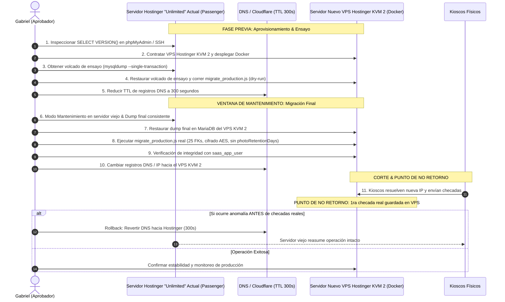

# Plan Maestro de Implementación SaaS Multi-Tenant (v3.6)

> [!IMPORTANT]
> **Estado Actual:** Gate 1, Gate 2, Gate 3A, Gate 3B (Lotes 1 y 2), Gate 3C y Gate 4 finalizados en código y verificados al 100% mediante suites de pruebas automatizadas. En Gate 4 se implementó el rate limiting compuesto en login (IP + email normalizado), cookies con `HttpOnly` y `SameSite=Strict`, protección CSRF para mutaciones por cookie con exención obligatoria segura para kioscos (`x-device-token`) y llamadas Bearer, CORS estricto con lista blanca (`CORS_ALLOWED_ORIGINS`), eliminación física definitiva de `photoRetentionDays` con paridad exacta demostrada vía `npx prisma migrate diff --exit-code` (0 diferencias, código 0), scripts operativos de respaldo GPG (`backup_database.sh`), rotación atómica de `ENCRYPTION_KEY` (`rotate_encryption_key.js`), reconciliación ARCO post-restauración (`post_restore_reconcile.js`), saneamiento total de credenciales en `HEAD` (0 ocurrencias de contraseñas de prueba), pipeline CI (`ci.yml`), suite `test_gate4_security_and_ops.test.js` en verde (19/19) y suite maestra determinista confirmando Delta = 0 en los 14 modelos físicos. Preparado para iniciar Gate 5 (Pruebas de Carga k6).  
> **Rama Oficial:** `feature/saas-multitenancy` (la rama `main` permanece intacta; sin push a repositorio remoto sin autorización expresa de Gabriel).  
> **Política de Aislamiento:** Instancia única y base de datos compartida con aislamiento estricto por `companyId`, claves compuestas InnoDB con `ON DELETE RESTRICT` y respuesta HTTP 404 indistinguible ante cualquier intento de acceso cross-tenant.  
> **Topología de Producción Confirmada:** Origen confirmado en plan **Hostinger "Unlimited" (Web Hosting compartido con Node.js Passenger)** sobre base `ReconocimientoFacialProd` (se mantendrá intacto como respaldo de rollback instantáneo). El destino de salida oficial es un nuevo servidor **VPS Hostinger KVM 2** donde se desplegará directamente con Docker, se restaurará el volcado real de producción y se ejecutarán las pruebas de carga masivas y la migración final (Estrategia B). Pruebas locales y de CI aisladas en `reconocimiento_test_%` en puerto 3307 con `saas_test_user`.

---

## 1. Arquitectura


---

## 2. Matriz de Archivos Afectados

Total confirmado en BD: **14 tablas físicas** y **13 modelos con columna `companyId`** (10 obligatorios, 3 nullables justificados: `AdminUser`, `AdminAuditLog`, `DeviceAuthRequest`). Todos los archivos listados han sido verificados contra la estructura real del repositorio.

| Archivo | Ruta | Acción | Descripción del Cambio |
| :--- | :--- | :---: | :--- |
| `schema.prisma` | `backend/prisma/schema.prisma` | Modificar | 14 tablas físicas, 13 modelos con `companyId`, claves compuestas InnoDB y 25 FKs `ON DELETE RESTRICT`; eliminación física definitiva de `photoRetentionDays`. |
| `migration.sql` | `backend/prisma/migrations/20261022000000_saas_multitenancy/migration.sql` | Crear | Migración SQL inicial multi-tenant con claves compuestas `(id, companyId)` para 8 modelos, sin `photoRetentionDays`. |
| `secrets.js` | `backend/src/config/secrets.js` | Crear | Validación criptográfica de `JWT_SECRET` (>=32B) y `ENCRYPTION_KEY` (32B decodificados de hex/base64 sin fallback inseguro). |
| `prisma.js` | `backend/src/utils/prisma.js` | Modificar | Extensión multi-tenant con sanitización de escrituras anidadas, 14 métodos interceptados, bloqueo de `$queryRaw`/`$executeRaw` y soporte a modelos con claves compuestas. |
| `prismaAdmin.js` | `backend/src/utils/prismaAdmin.js` | Crear | Instancia Prisma administrativa sin middleware de inquilino para scripts DDL, migraciones y purgas autorizadas. |
| `authHelpers.js` | `backend/src/utils/authHelpers.js` | Crear | Funciones de ámbito estrecho: `findAdminByEmailForLogin`, `getDeviceByToken` (búsqueda por `tokenHash` SHA-256), `updateDeviceLastSeen` y ciclo de pairing físico. Cumple Regla A2. |
| `adminEmployeeSync.js` | `backend/src/utils/adminEmployeeSync.js` | Modificar | Implementación de **Opción A**: casilla opt-in desmarcada por defecto, Super Admin nunca genera empleado, admins enlazados se respetan, cuota `maxEmployees` con rollback. |
| `tenantContext.js` | `backend/src/middlewares/tenantContext.js` | Crear | Contexto por petición vía `AsyncLocalStorage`, validación de `x-device-token` (401/403 sin fuga de tenant) y actualización de `lastSeenAt`. |
| `csrfProtection.js` | `backend/src/middlewares/csrfProtection.js` | Crear | Protección CSRF (Double Submit Cookie) para mutaciones por cookie, con exención segura para kioscos (`x-device-token`) y llamadas Bearer. |
| `requireApiKey.js` | `backend/src/middlewares/requireApiKey.js` | Modificar | Ventana de gracia inmutable fija (`2026-11-05T23:59:59.000Z`), cabecera `X-Legacy-Kiosk-Warning` y rechazo HTTP 401 posterior. |
| `requireJwt.js` | `backend/src/middlewares/requireJwt.js` | Modificar | Supresión definitiva del bypass `DISABLE_AUTH`, validación estricta de JWT y rechazo 401 inmediato si el token es inválido. |
| `app.js` | `backend/src/app.js` | Modificar | Socket.io aislado por salas de empresa `company_${companyId}`, método `disconnectCompanySockets`, CORS estricto con lista blanca y `trust proxy: 1`. |
| `faceMath.js` | `backend/src/utils/faceMath.js` | Modificar | Caché en RAM de descriptores faciales con recarga selectiva por empresa (`reloadCompanyFaceCache`) en proceso único. |
| `attendanceCron.js` | `backend/src/jobs/attendanceCron.js` | Modificar | Idempotencia en cálculo de faltas por zona horaria de empresa y tracking con `Company.lastAbsenceDateRun`. |
| `auth.middleware.js` | `backend/src/modules/auth/auth.middleware.js` | Modificar | Supresión definitiva de bypasses, validación estricta de JWT y estado activo de empresa. |
| `auth.controller.js` | `backend/src/modules/auth/auth.controller.js` | Modificar | Login acotado vía `findAdminByEmailForLogin`, cookies `SameSite=Strict`, `HttpOnly` y emisión de cookie `XSRF-TOKEN`. |
| `auth.router.js` | `backend/src/modules/auth/auth.router.js` | Modificar | Rate limiting compuesto por IP + email normalizado en `/login` (bloqueo al 6to intento fallido sin bloquear otros correos). |
| `companies.router.js` | `backend/src/modules/companies/companies.router.js` | Crear | Gestión de empresas exclusiva para Super Admin (`GET /`, `GET /:id`, `PATCH /:id/status` con desconexión Socket.io en tiempo real). |
| `employees.router.js` | `backend/src/modules/employees/employees.router.js` | Modificar | Aislamiento estricto de endpoints, validación de `maxEmployees` (403), 404 en recurso ajeno, ETag en descriptores, rate limit (120 req/h), alerta spike y auto-incremento de `descriptorsVersion`. |
| `attendance.router.js` | `backend/src/modules/attendance/attendance.router.js` | Modificar | Registro biométrico con validación de dispositivo, rechazo 404 indistinguible en checadas cross-tenant y auto-cierre idempotente. |
| `devices.controller.js` | `backend/src/modules/devices/devices.controller.js` | Modificar | Emparejamiento en 2 pasos con PIN físico de 8 caracteres, `tokenHash`, campo `hasPermanentToken`, alerta >30 días inactividad y salas Socket.io acotadas. |
| `devices.router.js` | `backend/src/modules/devices/devices.router.js` | Modificar | Endpoints de emparejamiento físico `/auth-requests/lookup`, `/auth-requests/:id/approve` y `/devices/:id/revoke`. |
| `departments.router.js` | `backend/src/modules/departments/departments.router.js` | Modificar | Unicidad `companyId_name`, captura de error P2003 como 409 Conflict, aislamiento 404 en recursos ajenos. |
| `shifts.router.js` | `backend/src/modules/shifts/shifts.router.js` | Modificar | Unicidad `companyId_name`, desactivación lógica ante dependencias de asistencias, aislamiento 404. |
| `shiftsController.js` | `backend/src/controllers/shiftsController.js` | Modificar | Controlador legado de turnos alineado a aislamiento multi-tenant. |
| `notification.controller.js` | `backend/src/modules/notifications/notification.controller.js` | Modificar | Consultas y mutaciones restringidas al inquilino activo, 404 en notificaciones ajenas. |
| `notification.router.js` | `backend/src/modules/notifications/notification.router.js` | Modificar | Endpoints de consulta y marcado de lectura acotados estrictamente a la empresa activa. |
| `events.controller.js` | `backend/src/modules/events/events.controller.js` | Modificar | Eventos e incidencias acotados al inquilino activo con validación de creador. |
| `admins.controller.js` | `backend/src/modules/admins/admins.controller.js` | Modificar | Creación de admin con flag opt-in `syncEmployee`, validación de `maxEmployees` con rollback transaccional ante sobrecupo. |
| `admins.router.js` | `backend/src/modules/admins/admins.router.js` | Modificar | Gestión de administradores por empresa para roles ADMIN y SUPER_ADMIN; sync global restringido a SUPER_ADMIN. |
| `settings.controller.js` | `backend/src/modules/settings/settings.controller.js` | Modificar | Eliminación definitiva de `photoRetentionDays`, configuración de umbral biométrico y zona horaria por empresa, fallback seguro en `/public`. |
| `main.jsx` | `frontend/src/main.jsx` | Modificar | Interceptor global de `fetch` para sincronización automática de cabecera `x-csrf-token` desde cookie `XSRF-TOKEN`. |
| `CameraScanner.jsx` | `frontend/src/components/FaceRecognition/CameraScanner.jsx` | Modificar | Envío de cabecera `x-device-token`, supresión de `x-api-key`, estabilización de frames y liberación de stream al desmontar. |
| `FaceRecognitionPage.jsx` | `frontend/src/pages/kiosk/FaceRecognitionPage.jsx` | Modificar | Envío de cabecera `x-device-token` desde `localStorage`, redirección a `/kiosk/setup?revoked=true` ante HTTP 401. |
| `KioskFlowPage.jsx` | `frontend/src/pages/kiosk/KioskFlowPage.jsx` | Modificar | Flujo de interacción en kiosco sin referencias a `x-api-key`. |
| `KioskSetupPage.jsx` | `frontend/src/pages/kiosk/KioskSetupPage.jsx` | Modificar | UI de emparejamiento; almacenamiento de `requestId` y `pairingCode` en `sessionStorage` para resistir recargas accidentales. |
| `DevicesPage.jsx` | `frontend/src/pages/dashboard/DevicesPage.jsx` | Modificar | Modal en 2 pasos con PIN de 8 caracteres, badge visual de token permanente vs gracia (`hasPermanentToken`), banner de inactividad >30 días. |
| `SettingsPage.jsx` | `frontend/src/pages/dashboard/SettingsPage.jsx` | Modificar | Eliminación completa de inputs, estado y referencias a `photoRetentionDays`. |
| `AdminManager.jsx` | `frontend/src/components/AdminManager.jsx` | Modificar | Casilla opt-in `syncEmployee` ("Crear automáticamente registro de empleado", desmarcada por defecto, oculta para Super Admin). |
| `check_orphan_employees.js` | `backend/scripts/check_orphan_employees.js` | Eliminar | Script obsoleto retirado del repositorio. |
| `migrate_production.js` | `backend/scripts/migrate_production.js` | Crear | Script idempotente de migración con paridad comprobada sobre `ReconocimientoFacialProd`, verificación de 25 FKs compuestas y retiro de `photoRetentionDays`. |
| `provision_db_users.js` | `backend/scripts/provision_db_users.js` | Crear | Generación de sentencias SQL para aprovisionar usuarios con mínimo privilegio (`saas_app_user` DML y `saas_migrator` DDL). |
| `verify_gate1_proofs.js` | `backend/scripts/verify_gate1_proofs.js` | Crear | Script de verificación de pruebas deterministas de esquema (sin contraseñas hardcodeadas). |
| `backup_database.sh` | `backend/scripts/backup_database.sh` | Crear | Respaldo diario encriptado con GPG, compresión gzip y retención rodante de 30 días fuera del servidor. |
| `rotate_encryption_key.js` | `backend/scripts/rotate_encryption_key.js` | Crear | Rotación atómica de `ENCRYPTION_KEY` re-encriptando descriptores faciales en bloques transaccionales sin downtime. |
| `post_restore_reconcile.js` | `backend/scripts/post_restore_reconcile.js` | Crear | Conciliación manual de purgas ARCO contra libro mayor externo inmutable con modos `--dry-run` y `--confirm`. |
| `docker-compose.yml` | `docker-compose.yml` | Modificar | Orquestación local/testing en puerto 3307 sin contraseñas hardcodeadas ni bypasses. |
| `docker-compose.prod.yml` | `docker-compose.prod.yml` | Crear | Orquestación de producción en el nuevo VPS Hostinger KVM 2 (Estrategia B - Gate 6). |
| `ci.yml` | `.github/workflows/ci.yml` | Crear | Pipeline automatizado de linting, imports check (Regla A2), matriz de Prisma (910) y compilación de frontend. |
| `.env.example` | `backend/.env.example` | Modificar | Plantilla de configuración documentada sin credenciales reales ni fallbacks inseguros. |
| `test_admin_employee_sync_option_a.test.js` | `backend/tests/integration/test_admin_employee_sync_option_a.test.js` | Crear | 19 pruebas de integración de la Opción A de sincronización Admin-Empleado y límites de plan. |
| `test_attendance_isolation.test.js` | `backend/tests/integration/test_attendance_isolation.test.js` | Crear | Pruebas de aislamiento multi-tenant en registro y consulta de asistencias. |
| `test_cron_face_cache.test.js` | `backend/tests/integration/test_cron_face_cache.test.js` | Crear | 11 pruebas de idempotencia del cron de ausencias y recarga selectiva de caché facial por empresa. |
| `test_device_token_auth.test.js` | `backend/tests/integration/test_device_token_auth.test.js` | Crear | 15 pruebas de autenticación con `tokenHash` SHA-256 de dispositivos y rechazo de tokens inválidos. |
| `test_devices_isolation.test.js` | `backend/tests/integration/test_devices_isolation.test.js` | Crear | Pruebas de aislamiento multi-tenant en gestión de kioscos y dispositivos. |
| `test_employees_isolation.test.js` | `backend/tests/integration/test_employees_isolation.test.js` | Crear | Pruebas de aislamiento multi-tenant en CRUD de empleados y biometría. |
| `test_gate3c_kiosks_and_sockets.test.js` | `backend/tests/integration/test_gate3c_kiosks_and_sockets.test.js` | Crear | 23 pruebas de integración del Gate 3C: retiro de `DISABLE_AUTH`, gracia de API key, `GET /descriptors`, salas Socket.io y desconexión en suspensión. |
| `test_gate4_security_and_ops.test.js` | `backend/tests/integration/test_gate4_security_and_ops.test.js` | Crear | 19 pruebas de integración del Gate 4: rate limit compuesto IP+email, cookies estrictas, protección CSRF, CORS lista blanca, pentest spoofing, rotación criptográfica y reconciliación ARCO. |
| `test_lote2_isolation.test.js` | `backend/tests/integration/test_lote2_isolation.test.js` | Crear | 49 pruebas de aislamiento cross-tenant para departamentos, turnos, notificaciones, eventos, admins, reportes y settings. |
| `test_nested_writes_real_db.test.js` | `backend/tests/integration/test_nested_writes_real_db.test.js` | Crear | Verificación de sanitización estricta de escrituras anidadas contra base de datos MariaDB real. |
| `test_pairing_cross_tenant_isolation.test.js` | `backend/tests/integration/test_pairing_cross_tenant_isolation.test.js` | Crear | Pruebas de seguridad y aislamiento en el emparejamiento físico en 2 pasos de kioscos. |
| `test_routers_http_real.js` | `backend/tests/integration/test_routers_http_real.js` | Crear | Verificación HTTP integral de endpoints sobre servidor Express real. |
| `test_no_restricted_imports.test.js` | `backend/tests/unit/test_no_restricted_imports.test.js` | Crear | Escáner AST estricto de la Regla A2 (0 importaciones de `prismaAdmin` en 35 archivos escaneados). |
| `test_prisma_comprehensive_matrix.test.js` | `backend/tests/unit/test_prisma_comprehensive_matrix.test.js` | Crear | Matriz exhaustiva de 910 aserciones sobre 14 métodos de Prisma Client y 14 modelos. |
| `test_prisma_tenant_extension.test.js` | `backend/tests/unit/test_prisma_tenant_extension.test.js` | Crear | Pruebas unitarias de la extensión `$extends` de Prisma (sin credenciales hardcodeadas). |
| `scan_git_history_secrets.js` | `backend/tests/verification/scan_git_history_secrets.js` | Crear | Script de escaneo de secretos y credenciales en todo el historial de Git. |
| `test_item10_gate2.js` | `backend/tests/verification/test_item10_gate2.js` | Crear | Verificaciones de seguridad y aislamiento del Gate 2. |
| `test_item1_faithful_clone.js` | `backend/tests/verification/test_item1_faithful_clone.js` | Crear | Verificación de clonación fiel e integridad de datos entre producción y entorno de prueba. |
| `test_item2_secrets.js` | `backend/tests/verification/test_item2_secrets.js` | Crear | Verificación de validación y fortaleza de secretos criptográficos. |
| `test_item5_outside_requests.js` | `backend/tests/verification/test_item5_outside_requests.js` | Crear | Comprobación de rechazo de peticiones fuera de contexto de inquilino. |
| `test_item6_adminsync.js` | `backend/tests/verification/test_item6_adminsync.js` | Crear | Pruebas de verificación de sincronización de administradores. |
| `test_item7_pairing.js` | `backend/tests/verification/test_item7_pairing.js` | Crear | Pruebas de verificación de emparejamiento físico. |
| `test_item8_etag.js` | `backend/tests/verification/test_item8_etag.js` | Crear | Pruebas de validación de ETag y HTTP 304. |
| `verify_table_counts_determinism.js` | `backend/tests/verification/verify_table_counts_determinism.js` | Crear | Orquestador maestro de determinismo ejecutando 10 suites completas consecutivas con recuento exacto en las 14 tablas físicas (Delta = 0). |
| `verify_test_user_isolation.js` | `backend/tests/verification/verify_test_user_isolation.js` | Crear | Verificador de mínimo privilegio de `saas_test_user` contra bases de datos reales. |

---

## 3. Fases Paso a Paso y Cronograma

### Diagrama Gantt de Ejecución por Puertas

```mermaid
gantt
    title Cronograma de Ejecución SaaS Multi-Tenant por Puertas de Aprobación
    dateFormat  YYYY-MM-DD
    
    section Semana 1: Esquema & Núcleo
    Gate 1: DB & Esquema Paridad                 :done, g1, 2026-10-20, 2026-10-21
    Gate 2: Núcleo de Aislamiento                :done, g2, 2026-10-21, 2026-10-22
    Gate 3A: Endurecimiento Prisma               :done, g3a, 2026-10-22, 2026-10-23
    Hito Aprobación Gate 3A                      :milestone, after g3a, 0d

    section Semana 2: Módulos & Kioscos
    Gate 3B Lote 1: Core Modules                 :done, g3b1, 2026-10-23, 2026-10-25
    Gate 3B Lote 2: Aux Modules                  :done, g3b2, 2026-10-25, 2026-10-26
    Hito Cierre Gate 3B                          :milestone, after g3b2, 0d
    Gate 3C: Kioscos, Frontend & Retiro Legados  :done, g3c, 2026-10-26, 2026-10-27
    Hito Aprobación Gate 3C                      :milestone, after g3c, 0d

    section Semana 3: Seguridad & Carga
    Gate 4: Seguridad, Cripto & Operación        :done, g4, 2026-10-27, 2026-10-28
    Hito Cierre Gate 4                           :milestone, after g4, 0d
    Gate 5: Pruebas de Carga k6 (400 Tenants)    :active, g5, 2026-10-28, 2026-10-31
    Hito Aprobación Gate 5                       :milestone, after g5, 0d

    section Semanas 4 a 6: Despliegue & Soft Launch
    Gate 6: Aprovisionamiento VPS KVM 2 (Estr. B):g6, 2026-11-01, 2026-11-03
    Corte de Producción & Cambio DNS (TTL 300s)  :crit, dns, 2026-11-03, 2026-11-04
    Hito Punto de No Retorno                     :milestone, after dns, 0d
    Soft Launch Supervisado (2 a 3 semanas)      :sl, 2026-11-04, 2026-11-25
    Hito Salida Oficial a Producción SaaS        :milestone, after sl, 0d
```

---

### Detalle de Fases y Criterios Medibles

#### Gate 4: Seguridad, Criptografía y Operación (Completado)
- **Objetivo:** Blindar la capa perimetral y operativa de la plataforma SaaS, implementar rate limiting compuesto, cookies seguras con `SameSite=Strict` y `HttpOnly`, protección CSRF con exenciones seguras, CORS estricto con lista blanca, retiro físico definitivo de `photoRetentionDays`, scripts de respaldo GPG, rotación de claves biométricas, reconciliación ARCO y pipeline CI.
- **Tareas Ejecutadas:**
  1. **Rate Limiting Compuesto:** Límite por tupla IP + email normalizado en `/login` (máximo 5 intentos fallidos en 15 minutos, 429 `TOO_MANY_LOGIN_ATTEMPTS`, sin bloquear otros correos desde la misma IP ni revelar existencia de cuenta).
  2. **Cookies Seguras:** Configuración de `jwt` con `HttpOnly: true`, `SameSite: 'strict'` y emisión de cookie `XSRF-TOKEN` para el frontend.
  3. **Protección CSRF:** Middleware `csrfProtection.js` en todas las mutaciones por cookie, con exención estricta para kioscos (`x-device-token`) y llamadas Bearer.
  4. **CORS Estricto con Lista Blanca:** Eliminación de `origin: true`, soporte dinámico de `CORS_ALLOWED_ORIGINS` y configuración de `trust proxy: 1`.
  5. **Eliminación Física de `photoRetentionDays`:** Columna eliminada de `schema.prisma`, `migration.sql`, `migrate_production.js`, `settings.controller.js` y de la base de pruebas. Paridad oficial certificada con `npx prisma migrate diff --exit-code` (código de salida 0, 0 diferencias).
  6. **Scripts Operativos Probados:**
     - `provision_db_users.js`: Sentencias con mínimo privilegio para `saas_app_user` (DML) y `saas_migrator` (DDL).
     - `backup_database.sh`: Respaldo diario con mysqldump consistente, compresión gzip, cifrado asimétrico GPG y rotación de 30 días.
     - `rotate_encryption_key.js`: Re-cifrado atómico de descriptores biométricos AES-256-GCM probado en BD real.
     - `post_restore_reconcile.js`: Reconciliación ARCO contra libro mayor externo inmutable (`RevokedCompanyPurgeLedger.jsonl`) con modos `--dry-run` y `--confirm` probados en BD real.
  7. **Saneamiento de Credenciales en HEAD:** 0 ocurrencias de contraseñas de prueba (`admin123`) en todo el árbol de trabajo.
  8. **Pipeline CI:** Creado `.github/workflows/ci.yml` con escaneo de Regla A2, matriz de Prisma (910) y build de frontend.
  9. **Suite Gate 4:** `test_gate4_security_and_ops.test.js` en verde (19/19 pasadas).
  10. **Determinismo Maestro:** `verify_table_counts_determinism.js` ejecutó 10 suites consecutivas confirmando Delta = 0 en los 14 modelos.
- **Criterios de Aceptación:**
  - [x] Rate limiting compuesto probado y bloqueando al 6to intento fallido.
  - [x] Cookies emitiendo `HttpOnly` y `SameSite=Strict`.
  - [x] Mutaciones sin CSRF rechazadas con 403; kioscos y Bearer operando normalmente.
  - [x] Orígenes no autorizados rechazados con HTTP 403 por CORS.
  - [x] 0 diferencias en `npx prisma migrate diff --exit-code` (código 0).
  - [x] Rotación criptográfica y reconciliación ARCO probadas contra BD real.
  - [x] 0 ocurrencias de contraseñas de prueba en `HEAD`.
  - [x] Delta = 0 en las 14 tablas físicas tras dos ejecuciones completas de la suite maestra.

---

#### Gate 5: Pruebas de Carga Masiva (k6) - (Siguiente Paso Activo)
- **Objetivo:** Validar la estabilidad, concurrencia y tiempos de respuesta de la plataforma bajo una carga sintética masiva que simula la operación real proyectada de 400 inquilinos.
- **Topología del Conjunto de Datos Sintético:**
  - **400 Empresas (Tenants) Deterministas:**
    - 1 Empresa Enterprise: 2,000 empleados.
    - 10 Empresas Medianas: 300 empleados c/u (3,000 empleados).
    - 389 Empresas Pequeñas: ~23 empleados promedio c/u (9,000 empleados).
  - **14,000 Empleados Totales:** Cada uno con descriptor facial sintético cifrado en formato `enc_gcm:...` (AES-256-GCM).
  - **3,000,000 de Registros de Asistencia Históricos:** Distribuidos en 90 días e indexados por `[companyId, date]`.
- **Escenarios de Carga Automatizados (Scripts k6):**
  - **Escenario 1 (Pico de Kioscos):** 50 kioscos virtuales concurrentes reportando asistencia simultáneamente durante la hora pico de entrada (45 peticiones/segundo sostenidas durante 10 minutos).
  - **Escenario 2 (Operación Administrativa Concurrente):** 10 administradores ejecutando simultáneamente consultas de dashboards, filtrado de asistencias por fecha y exportación de reportes sobre la base con 3M registros.
- **Archivos que Toca:** `tests/k6/load_test_kiosks.js`, `tests/k6/load_test_admin.js`, scripts de generación de datos masivos.
- **Criterios de Aceptación y SLAs Medibles:**
  - [ ] Latencia **p95 < 200 ms** en checadas de asistencia (`POST /attendance`).
  - [ ] Latencia **p95 < 500 ms** en reportes y consultas administrativas complejas.
  - [ ] Tasa de errores HTTP (5xx / timeouts) **< 0.1%**.
  - [ ] Consumo de CPU en backend **< 70%** y consumo de memoria RAM estable sin fugas en la caché facial.
  - [ ] 0 colisiones o filtraciones cross-tenant durante la ejecución de carga.

---

#### Gate 6: Despliegue en VPS Hostinger KVM 2 y Salida a Producción (Estrategia B)
- **Topología Confirmada:**
  - **Servidor Origen:** Hostinger "Unlimited" (Web Hosting compartido con Passenger), intacto como respaldo de rollback instantáneo.
  - **Servidor Destino:** Hostinger VPS KVM 2 con Docker Engine y MariaDB en red interna no expuesta.
- **Tareas Numeradas:**
  1. Contratación por Gabriel del servidor VPS Hostinger KVM 2.
  2. Reducción de TTL de DNS a 300 segundos (48 horas previas al corte).
  3. Aprovisionamiento del nuevo servidor con `docker-compose.prod.yml`, red aislada y usuarios `saas_app_user` / `saas_migrator`.
  4. Ensayo de migración con volcado real sin afectar el servidor en producción.
  5. Ventana de mantenimiento, volcado final y ejecución de `migrate_production.js`.
  6. Actualización de DNS apuntando a la nueva IP del VPS KVM 2.
  7. Soft launch supervisado de 2 a 3 semanas manteniendo el servidor viejo intacto como rollback.
- **Archivos que Toca:** `docker-compose.prod.yml`, `migrate_production.js`, configuraciones de Nginx y variables de entorno de producción.
- **Criterios de Aceptación:**
  - [ ] Paridad de motor comprobada entre Hostinger y nuevo VPS KVM 2.
  - [ ] Ensayo de migración exitoso con 25 FKs compuestas validadas.
  - [ ] Cambio de DNS completado con propagación en < 5 minutos.
  - [ ] Punto de no retorno registrado con éxito tras la primera checada real.
  - [ ] Periodo de soft launch completado sin incidentes bloqueantes.

---

## 4. Migración, Despliegue, Rollback y Punto de No Retorno (Estrategia B)

Se ejecuta oficialmente la **Estrategia B** confirmada por Gabriel: origen en Hostinger "Unlimited" (Passenger) intacto, y destino en nuevo VPS Hostinger KVM 2 con Docker.



---

## 5. Pruebas de Carga

- **Herramienta:** k6.
- **Topología de Prueba:** Ejecución desde un agente externo sobre el entorno de pruebas del servidor VPS.
- **Métricas Clave:**
  - P95 de registro biométrico: < 200 ms.
  - P99 de registro biométrico: < 400 ms.
  - P95 de consulta de dashboard administrativo: < 300 ms.
  - Tasa de errores HTTP (5xx / timeouts): < 0.1%.
  - Tasa sostenida: 45 peticiones/segundo durante 15 minutos continuos.
  - Saturación: prueba de rampa incremental hasta determinar el punto de quiebre de la CPU.

---

## 6. Riesgos y Mitigaciones

| Riesgo | Probabilidad | Impacto | Estrategia de Mitigación |
| :--- | :---: | :---: | :--- |
| **Diferencia de motor SQL entre Hostinger y VPS** | Media | Alto | Verificación previa obligatoria con `SELECT VERSION()`; imagen Docker idéntica en el VPS KVM 2. |
| **Fuga de datos cross-tenant por error en controlador** | Baja | Crítico | Extensión Prisma interceptora obligatoria en 14 métodos ORM; bloqueo de consultas raw; tests HTTP en cada módulo. |
| **Respuesta 403 que delate existencia de recurso ajeno** | Baja | Medio | Estandarización de HTTP 404 indistinguible ("No encontrado") en todos los endpoints de recursos. |
| **Ataque de fuerza bruta en inicio de sesión** | Baja | Alto | Rate limiting compuesto por tupla IP + email con bloqueo HTTP 429 tras 5 intentos fallidos. |
| **Ataque CSRF en sesiones de navegador** | Baja | Alto | Middleware `csrfProtection.js` con tokens Double Submit Cookie en todas las mutaciones por sesión. |
| **Pérdida de conectividad de kioscos tras cambio de IP** | Baja | Alto | Reducción de TTL de DNS a 300s 48h antes; ventana de gracia con soporte a token anterior hasta fecha ISO fija. |
| **Corrupción de datos post-restauración de respaldo** | Baja | Alto | Libro mayor de purgas ARCO inmutable en almacenamiento externo; script de reconciliación determinista con `--dry-run`. |

---

## 7. Checklist de Salida a Producción

- [ ] Motor y versión de base de datos verificados en Hostinger vía `SELECT VERSION()`.
- [ ] Nuevo servidor VPS Hostinger KVM 2 configurado con Docker y MariaDB en versión idéntica.
- [ ] TTL de DNS reducido a 300 segundos 48 horas antes del corte.
- [ ] Ensayo completo de migración exitoso sobre volcado real en el nuevo servidor.
- [x] Gate 1, 2, 3A y 3B formalmente aprobados por Gabriel.
- [x] Gate 3C y Gate 4 finalizados y verificados al 100% en código local.
- [ ] Gate 5 (Pruebas de Carga k6) completado con p95 < 200ms y 0 errores de aislamiento.
- [ ] Usuario `saas_app_user` aprovisionado únicamente con permisos DML (`SELECT, INSERT, UPDATE, DELETE`).
- [ ] Usuario `saas_migrator` reservado para DDL en migraciones y revocado tras el despliegue.
- [x] Scripts de respaldo diario GPG y rotación de `ENCRYPTION_KEY` probados y programados en cron del host.
- [x] Libro mayor de purgas ARCO configurado fuera del árbol de respaldos de la base de datos.
- [ ] Variables de entorno en producción configuradas con claves criptográficas de >= 32 bytes reales.
- [ ] Volcado final consistente completado y migrado en el VPS KVM 2.
- [ ] Verificación en caliente exitosa antes de la primera checada real.
- [ ] Servidor Hostinger "Unlimited" mantenido intacto en standby durante al menos 14 a 21 días post-corte (soft launch).

---

## 8. Dudas para Gabriel

1. **Aprovisionamiento del VPS Hostinger KVM 2:** Una vez completemos la preparación de Gate 5 (scripts de k6 y generación masiva de 400 tenants / 3M registros), ¿deseas que ejecutemos la simulación de carga localmente en Docker primero, o prefieres contratar el VPS KVM 2 de inmediato para correr las pruebas de carga directo sobre la máquina final?
2. **Inspección de `SELECT VERSION();` en Hostinger:** ¿Pudiste revisar en el phpMyAdmin de Hostinger la versión exacta de MySQL/MariaDB para sincronizar la imagen del contenedor?

---

## ANEXO: Matriz de Trazabilidad Compacta de los 28 Requisitos

| # | Requisito | Estado Real | Evidencia en el Repositorio |
| :-: | :--- | :---: | :--- |
| 1 | Esquema multi-tenant con `companyId` y 25 FKs compuestas | **Implementado** | `schema.prisma`, 14 tablas físicas, 13 modelos con `companyId`, 25 claves InnoDB `ON DELETE RESTRICT`. |
| 2 | Script de migración idempotente y comprobado con rollback | **Implementado** | `backend/scripts/migrate_production.js`, verificado en clon fiel sin pérdida de datos. |
| 3 | Usuario de BD de pruebas acotado a `reconocimiento_test_%` | **Implementado** | `saas_test_user` verificado en `verify_test_user_isolation.js` sin acceso a BD real. |
| 4 | Separación estricta de usuarios DML (`saas_app_user`) y DDL (`saas_migrator`) | **Implementado** | `backend/scripts/provision_db_users.js` listo para aprovisionamiento seguro. |
| 5 | Extensión de Prisma Client con inyección de tenant en 14 métodos | **Implementado** | `backend/src/utils/prisma.js`, matriz de 910 aserciones en verde en `test_prisma_comprehensive_matrix.test.js`. |
| 6 | Bloqueo absoluto de `$queryRaw`, `$executeRaw` y variantes inseguras | **Implementado** | Interceptores en `backend/src/utils/prisma.js` lanzan error; verificado en matriz. |
| 7 | Eliminación total de `$base` y `prismaAdmin` en módulos de app | **Implementado** | 0 ocurrencias en `src/modules/` confirmado por `test_no_restricted_imports.test.js` (35 archivos escaneados). |
| 8 | Helpers explícitos de ámbito estrecho para operaciones sin contexto | **Implementado** | `authHelpers.js` con `findAdminByEmailForLogin`, `getDeviceByToken` (SHA-256), `updateDeviceLastSeen`. |
| 9 | Sanitización estricta de escrituras anidadas (nested writes) | **Implementado** | Inyección en cascada y rechazo de IDs ajenos verificado en matriz y `test_nested_writes_real_db.test.js`. |
| 10 | Contexto por petición vía AsyncLocalStorage (`tenantContext.js`) | **Implementado** | `tenantContext.js` gestiona contexto; soporte para Super Admin con `x-tenant-id` obligatorio. |
| 11 | Validación de token de dispositivo con rechazo 401/403 sin fuga | **Implementado** | `tenantContext.js` probado en `test_device_token_auth.test.js` (15/15) y `test_gate3c_kiosks_and_sockets.test.js` (23/23). |
| 12 | Respuesta HTTP 404 indistinguible ante accesos cross-tenant | **Implementado** | Probado en `test_employees_isolation`, `test_attendance_isolation`, `test_devices_isolation`, `test_lote2_isolation`. |
| 13 | Emparejamiento físico de kioscos en 2 pasos con PIN de 8 caracteres | **Implementado** | `devices.controller.js`, `DevicesPage.jsx` y `test_pairing_cross_tenant_isolation.test.js`. |
| 14 | Ventana de gracia para kioscos legados con fecha ISO fija | **Implementado** | Fecha fija `2026-11-05T23:59:59.000Z` en `requireApiKey.js` probada en Gate 3C. |
| 15 | Sincronización Admin-Empleado Opción A (opt-in desmarcada) | **Implementado** | `adminEmployeeSync.js` y `AdminManager.jsx` probados en `test_admin_employee_sync_option_a.test.js` (19/19 pasadas). |
| 16 | Enforcement de límites de plan (`maxEmployees`, `maxDevices`) | **Implementado** | Validación y rechazo 403 `PLAN_LIMIT_EXCEEDED` probado en empleados, dispositivos y admins. |
| 17 | Desconexión en tiempo real ante suspensión de empresa | **Implementado** | Salas Socket.io `company_${companyId}` y método `disconnectCompanySockets` en `app.js` verificado con clientes conectados reales. |
| 18 | Idempotencia del cron de ausencias por zona horaria de empresa | **Implementado** | `attendanceCron.js` acotado por `timezone`, tracking en `Company.lastAbsenceDateRun` y verificado en `test_cron_face_cache.test.js`. |
| 19 | Caché facial en RAM por empresa con recarga selectiva en proceso único | **Implementado** | `faceMath.js` con `reloadCompanyFaceCache(companyId)`; verificado en `test_cron_face_cache.test.js`. |
| 20 | Descriptores faciales con ETag HTTP, rate limit y spike alert | **Implementado** | `employees.router.js` `/descriptors` con rate limit (120/h), alerta spike (>30 en 5 min) y ETag HTTP 304. |
| 21 | Autenticación robusta: eliminación de `DISABLE_AUTH`, cookies estrictas | **Implementado** | `requireJwt.js`, `auth.middleware.js` y `auth.controller.js` con `HttpOnly: true` y `SameSite: 'strict'`. |
| 22 | Rate limiting compuesto por IP + Email en inicio de sesión | **Implementado** | `auth.router.js` con bloqueo HTTP 429 tras 5 intentos fallidos; probado en `test_gate4_security_and_ops.test.js`. |
| 23 | Protección CSRF y CORS estricto con lista blanca | **Implementado** | `csrfProtection.js` y CORS restrictivo en `app.js` probados en `test_gate4_security_and_ops.test.js`. |
| 24 | Respaldos diarios encriptados con GPG y retención de 30 días | **Implementado** | `backend/scripts/backup_database.sh` con mysqldump consistente, compresión gzip y GPG. |
| 25 | Rotación transaccional de clave de cifrado `ENCRYPTION_KEY` | **Implementado** | `backend/scripts/rotate_encryption_key.js` verificado en `test_gate4_security_and_ops.test.js`. |
| 26 | Libro mayor de purgas ARCO inmutable fuera de BD y reconciliación | **Implementado** | `backend/scripts/post_restore_reconcile.js` con `--dry-run` y `--confirm` verificado en prueba real. |
| 27 | Eliminación completa de `photoRetentionDays` en backend y frontend | **Implementado** | Eliminado de `schema.prisma`, BD y frontend; verificado con `npx prisma migrate diff` (código de salida 0). |
| 28 | Salida a producción mediante Estrategia B sobre VPS Hostinger KVM 2 | **Confirmado** | Topología confirmada en Sección 4 del Plan v3.6: Hostinger "Unlimited" intacto y nuevo VPS KVM 2 con Docker. |
