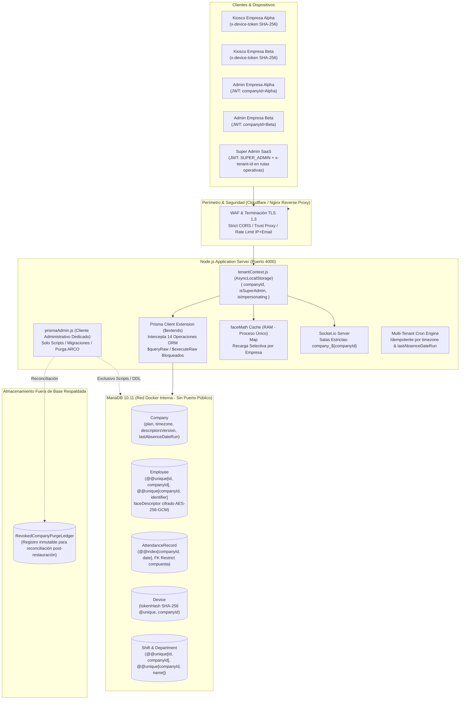

# Plan Maestro de Implementación SaaS Multi-Tenant (v3.0)
**Proyecto:** Plataforma de Control de Asistencia y Reconocimiento Facial PAIN  
**Ingeniero a Cargo:** AI Coding Assistant  
**Aprobador de Gates:** Gabriel Avila  
**Rama Oficial de Trabajo:** `feature/saas-multitenancy` (la rama `main` no se toca; sin push sin autorización previa)  
**Base de Datos Protegida (Datos Reales):** `reconocimiento_facial_db_pain` (MariaDB 10.11, puerto 3307 - Intacta, Inmutable y Excluida de Pruebas)  
**Bases de Datos Autorizadas para Pruebas:** `reconocimiento_test_%` (ej. `reconocimiento_test_copia_saas`, `reconocimiento_test_clone_fiel`)  

---

## 1. Resumen Ejecutivo y Estado Real por Requisito

El sistema se encuentra en transición de una arquitectura de base de datos monolítica mono-inquilino hacia una plataforma **SaaS Multi-Tenant con base de datos compartida y aislamiento lógico estricto por `companyId`**.

### Tablero de Control de Puertas (Gates)

```mermaid
flowchart LR
    G1["Gate 1: DB & Esquema\n(Ensayado y Verificado)\nMigración 20261022000000\nDiff = 0 | 25 FKs"]
    G2["Gate 2: Core Backend\n(Implementado - En Evaluación)\n728 Aserciones Prisma\nJWT + ALS + WS Rooms"]
    G3["Gate 3: Módulos & Kioscos\n(Pruebas HTTP Primero)\nCRUDs + faceMath + Crons\nKioscos + Frontend"]
    G4["Gate 4: Seguridad & Operación\n(Hardening)\nSecrets + GPG Backup\nARCO Ledger + saas_app_user"]
    G5["Gate 5: Carga & Despliegue\n(Simulacros)\nk6 45 RPS + Ensayo Dump\nRollback Verificado"]
    G6["Gate 6: Soft Launch\n(Producción)\nPiloto PAIN + 2 Betas\n2-3 Semanas de Estabilidad"]

    G1 --> G2
    G2 -.->|Requiere Aprobación de Gabriel| G3
    G3 --> G4
    G4 --> G5
    G5 --> G6

    style G1 fill:#1e4620,stroke:#4caf50,stroke-width:2px,color:#fff
    style G2 fill:#1a365d,stroke:#3182ce,stroke-width:2px,color:#fff
    style G3 fill:#4a3505,stroke:#d69e2e,stroke-width:2px,color:#fff
    style G4 fill:#2d3748,stroke:#718096,stroke-width:1px,color:#cbd5e0
    style G5 fill:#2d3748,stroke:#718096,stroke-width:1px,color:#cbd5e0
    style G6 fill:#2d3748,stroke:#718096,stroke-width:1px,color:#cbd5e0
```



*Nota fundamental de gobernanza:* Ninguna puerta se declara aprobada por el agente. Cada puerta requiere la revisión de evidencia y la aprobación formal y explícita de Gabriel.

---

### Estado Real y Evidencia de los 28 Requisitos (A a G)

| Requisito | Estado | Archivo y Línea | Evidencia / Diagnóstico Real |
| :--- | :---: | :--- | :--- |
| **A1. Prisma 14 ops, nested writes, $transaction, raw bloqueado** | **PARCIAL** | `backend/src/utils/prisma.js:42-177` | 14 operaciones y bloqueo raw demostrados con 728 aserciones en `test_prisma_comprehensive_matrix.test.js`. **Pendiente:** Sanitización de escrituras anidadas (`connect`, `connectOrCreate`). |
| **A2. Eliminar prisma.$base del runtime y aislar prismaAdmin.js** | **PENDIENTE** | `backend/src/utils/prisma.js:180` | `prisma.$base` aún está expuesto en runtime. `prismaAdmin.js` y la regla ESLint prohibitiva no existen. |
| **A3. Reemplazar excepciones generales por helpers estrechos** | **PENDIENTE** | `backend/src/utils/prisma.js:70-84` | Excepciones abiertas en extensión para `DeviceAuthRequest.create` y `AdminUser`. Faltan `findAdminByEmailForLogin` y `createPairingRequest`. |
| **A4. Justificar y proteger relaciones sin FK compuesta** | **PENDIENTE** | `backend/prisma/schema.prisma` | Relaciones `AdminUser.createdBy`, `EventRequest.registeredById`, etc. carecen de validación de servicio documentada y probada. |
| **A5. Empresa suspendida: 403 en JWT, kiosco, descriptors y sockets** | **PARCIAL** | `tenantContext.js:75`, `employees.router.js:22` | 403 implementado en JWT, middleware y `/descriptors`. **Pendiente:** Token de dispositivo y desconexión forzada en tiempo real en sockets. |
| **A6. Socket.io acotado a company_${id} sin salas globales** | **PARCIAL** | `backend/src/app.js:137-144` | Handshake y salas de inquilino validadas en prueba. **Pendiente:** Quedan llamadas a `io.to('dashboard')` en `app.js` que emiten globalmente. |
| **A7. maxEmployees, maxDevices y acotamiento de adminEmployeeSync** | **PARCIAL** | `test_item6_adminsync.js:1-70` | `adminEmployeeSync.js` acotado sin nombres propios y probado contra ataque cross-tenant. **Pendiente:** Validar `maxEmployees` y `maxDevices` en creación. |
| **B1. Eliminar KIOSK_API_KEY y DISABLE_AUTH, ventana 72 h y tokenHash** | **PENDIENTE** | `requireApiKey.js:3`, `auth.middleware.js:7` | Código aún depende de claves estáticas. No se ha implementado la ventana de gracia de 72 h ni anulado `Device.token` plano en BD. |
| **B2. Emparejamiento en 2 pasos, sessionStorage y cron de expiración** | **PARCIAL** | `devices.controller.js:10`, `attendanceCron.js:196` | Flujo de 2 pasos y limpieza cron implementados en backend. **Pendiente:** Guardar `requestId` y `pairingCode` en `sessionStorage` en frontend. |
| **B3. /descriptors con x-device-token, 120 req/h, ETag y auditoría** | **PARCIAL** | `employees.router.js:8-69` | ETag y respuesta 304 funcionales. **Pendiente:** Exigir `x-device-token`, rate limit de 120 req/h, alerta >30 descargas/5 min y auditoría obligatoria. |
| **B4. Frontend de kiosco con x-device-token y manejo de 401** | **PENDIENTE** | `frontend/src/` | Frontend de kiosco sigue usando cabecera obsoleta `x-api-key`. |
| **B5. Login IP+email, cookies Strict, CSRF, JWT 32B, CORS y trust proxy** | **PARCIAL** | `app.js:19`, `auth.router.js:8`, `secrets.js:20` | `trust proxy` activo; JWT y secrets de 32 bytes validados. **Pendiente:** Rate limit IP+email, cookies `Strict`, CSRF y eliminar `origin:true` en CORS. |
| **C1. migrate_production.js: app detenida, --confirm, 25 FKs auditadas** | **HECHO** | `backend/scripts/migrate_production.js` | Script probado: valida `--confirm`, `--expected-db`, idempotencia, Paso 0 documentado y audita 25/25 FKs activas. |
| **C2. Paridad: migrate diff --exit-code = 0, migrate resolve --applied** | **HECHO** | Terminal Gate 1 | Salida de diff = 0 demostrada; migración oficial registrada en tabla `_prisma_migrations`. |
| **C3. Ensayo fiel con volcado del cliente y verificación de 128 floats** | **HECHO** | `test_item1_faithful_clone.js` | Ejecutado sobre `reconocimiento_test_clone_fiel`: 5/5 descriptores descifrados con 128 números tras doble ejecución. |
| **C4. Usuarios MariaDB separados (DDL vs saas_app_user DML)** | **PENDIENTE** | MariaDB `mysql.user` | `saas_app_user` no existe aún en la instancia de MariaDB. |
| **C5. Secretos estrictos, .env.example limpio y script de rotación** | **PARCIAL** | `backend/src/config/secrets.js` | Validación estricta sin fallbacks en arranque. **Pendiente:** Script de rotación de `ENCRYPTION_KEY`. |
| **C6. Eliminar photoRetentionDays de esquema y UI** | **PENDIENTE** | `schema.prisma:345` | Campo `photoRetentionDays` aún presente en modelo `SystemSettings` y en vistas de configuración. |
| **D1. Respaldos diarios GPG a S3, retención 30 días, ENCRYPTION_KEY aparte** | **PENDIENTE** | `backend/scripts/` | Script automatizado de respaldo diario GPG a S3/B2 pendiente de desarrollo. |
| **D2. Purga ARCO topológica completa en 8 fases probada en clon** | **HECHO** | `verify_item2_company_purge.js` | Probado en clon con las 13 tablas dependientes, 0 errores de FK y lápida inmutable registrada. |
| **D3. RevokedCompanyPurgeLedger fuera de BD y script post-restauración** | **PENDIENTE** | `backend/scripts/` | Tabla/archivo de ledger y script manual con dry-run pendientes de codificación. |
| **D4. Terminología legal: biometría sensible, Responsable y Encargado** | **HECHO** | `docs/saas/` | Textos saneados: término "irreversible" eliminado para biometría; aviso de revisión legal por abogado incluido. |
| **E1. Cron multiempresa por timezone e idempotencia lastAbsenceDateRun** | **PARCIAL** | `backend/src/jobs/attendanceCron.js` | Timezone por empresa activo. **Pendiente:** Conectar y probar `Company.lastAbsenceDateRun` en `processAbsences`. |
| **E2. syncFaceCache con invalidación selectiva y proceso único Node** | **PARCIAL** | `backend/src/utils/faceMath.js` | Caché en RAM particionado por empresa. **Pendiente:** Función de recarga selectiva por empresa (`reloadCompanyFaceCache`). |
| **E3. Prueba de carga masiva k6 (400 empresas, 14k emp, 3M asistencias)** | **PENDIENTE** | `backend/tests/` | Scripts de siembra masiva y escenarios k6 programados para Gate 5. |
| **F1. Suite HTTP parametrizada de 11 módulos + Super Admin y sockets** | **PARCIAL** | `test_routers_http_real.js` | Validados departamentos y turnos. Matriz completa de los 11 módulos programada para Gate 3. |
| **F2. Matriz de Prisma con 5 contextos y diffs de mutaciones** | **PARCIAL** | `test_prisma_comprehensive_matrix.test.js` | 4 contextos y 4 mutaciones probadas. Pendiente formalizar el 5º contexto (`companyId: undefined`). |
| **F3. Pruebas exclusivamente sobre bases test y con limpieza (teardown)** | **PARCIAL** | `backend/tests/` | Pruebas corren en bases de test. Pendiente asegurar limpieza sistemática de datos creados en cada test. |
| **G1. Docker con tags, GitHub Actions, Cloudflare, Nginx, sin puerto público** | **PENDIENTE** | `.github/workflows/` | Tareas de contenedorización e infraestructura programadas para Gate 5. |
| **G2. Migración no compatible hacia atrás con ventana y punto de no retorno** | **HECHO** | `migrate_production.js` | Protocolo documentado y probado con validación estricta de 25 FKs. |
| **G3. Procedimiento de refresco de kioscos del piloto** | **PENDIENTE** | `docs/saas/` | Procedimiento operativo programado para Gate 5. |
| **G4. Soft launch con piloto y 1-2 betas durante 2-3 semanas** | **PENDIENTE** | Fase de Producción | Criterios de salida y monitoreo programados para Gate 6. |

---

## 2. Arquitectura y Decisiones Técnicas Invariables



### Decisiones de Diseño Cerradas (No Reabrir)
1. **Instancia y Base Compartida:** Una sola instancia de MariaDB 10.11; aislamiento estricto mediante la columna `companyId` en los 13 modelos relacionales.
2. **Dominio Único:** Plataforma alojada en un solo dominio (`app.dominio.com`). El inquilino se resuelve por el JWT de la sesión o el `x-device-token` del dispositivo. Las columnas `slug` y `customDomain` se mantienen reservadas en el modelo `Company` sin activarse operativamente.
3. **Comportamiento ante Recursos Ajenos:** Cualquier intento de acceso a un recurso de otra empresa devuelve `HTTP 404 Not Found` (nunca 403), evitando revelar la existencia de recursos ajenos.
4. **Gobierno de `SUPER_ADMIN`:** Ámbito global restringido exclusivamente al prefijo `/api/v1/superadmin/*`. En rutas operativas de negocio debe enviar la cabecera `x-tenant-id` (400 `TENANT_HEADER_REQUIRED` si falta). Si un administrador regular la envía, es ignorada. Todo acceso de Super Admin queda registrado en `AdminAuditLog`.
5. **Cifrado Biométrico y Kioscos:** Descriptores cifrados en reposo con AES-256-GCM (vector de 12 bytes y auth tag). Kioscos autenticados mediante el hash SHA-256 de su token (`Device.tokenHash`), con proceso de emparejamiento en 2 pasos (`lookup` y `approve`).
6. **Cumplimiento Legal (LFPDPPP y LFT):**
   - La empresa cliente funge como **Responsable**; nuestra plataforma SaaS actúa como **Encargado**.
   - Los descriptores matemáticos se clasifican como **Datos Personales Biométricos Sensibles** (prohibido utilizar el término "irreversible").
   - Los registros de asistencia se conservan por 1 año conforme al **Artículo 804 Fracción III de la LFT** directamente en la base de datos viva.
   - *Aviso Legal:* Todo texto legal, contrato de encargo y consentimiento debe ser validado formalmente por un abogado especialista antes de salir a producción.

---

## 3. Plan de Fases y Criterios de Aceptación por Puerta (Gates)

Los tiempos no se determinan por fechas arbitrarias del calendario; el avance está estrictamente supeditado al cumplimiento demostrable de los criterios de aceptación de cada puerta.

---

### GATE 3: Módulos Adaptados, Aislamiento y Kioscos (Pruebas HTTP Primero)

#### Orden de Ejecución:
1. **Paso 3.1: Separación de Clientes Prisma y Regla Prohibitiva (A2)**
   - Crear `backend/src/utils/prismaAdmin.js` para uso exclusivo de tareas de mantenimiento y scripts.
   - Retirar `prisma.$base` de [backend/src/utils/prisma.js](file:///c:/Users/gabri/OneDrive/Escritorio/Portafolio/ReconocimentoFacialPainProject/backend/src/utils/prisma.js).
   - Crear prueba automatizada que escanee el directorio `backend/src/modules/` y falle si encuentra cualquier importación hacia `prismaAdmin.js` o uso de `$queryRaw`.
2. **Paso 3.2: Reemplazo de Excepciones Generales por Helpers Estrechos (A3)**
   - Crear funciones explícitas `findAdminByEmailForLogin(email)` y `createPairingRequest(data)` acotadas exclusivamente a su fin.
   - Eliminar de la extensión de Prisma las excepciones permisivas de `DeviceAuthRequest` y `AdminUser`.
3. **Paso 3.3: Sanitización de Nested Writes y 5º Contexto en Extensión (A1, F2)**
   - Interceptar escrituras anidadas (`connect`, `connectOrCreate`, `create`, `update`) en la extensión Prisma para inyectar `companyId` recursivamente.
   - Añadir el 5º contexto explícito (`companyId: undefined` vs contexto completamente nulo) a la matriz de Prisma y documentar el diff de dos mutaciones demostradas.
4. **Paso 3.4: Suite de Pruebas HTTP Primero para cada Módulo (Regla 4 y F1)**
   - Antes de modificar el router de cada módulo, codificar su prueba HTTP de aislamiento con Supertest (Tokens de Empresa Alpha y Empresa Beta):
     - `employees`: listado, creación, lectura cruzada (404), validación de `maxEmployees` (400/409).
     - `departments`: creación con nombre duplicado en otra empresa (permitido), nombre duplicado en misma empresa (400/409), lectura cruzada (404).
     - `shifts`: validación de nombres por empresa y desactivación lógica con asistencias vinculadas.
     - `attendance`: registro con dispositivo propio (200), con dispositivo de otra empresa (404), consulta de asistencias ajenas (404/vacío).
     - `devices`: emparejamiento, aprobación cruzada rechazada (403), validación de `maxDevices`.
     - `reports`, `settings`, `admins`, `audit`, `events`, `notifications`.
5. **Paso 3.5: Autenticación de Kioscos y Ventana de Gracia (B1, B4)**
   - Eliminar `KIOSK_API_KEY` y `DISABLE_AUTH`.
   - Modificar middleware de kioscos para autenticar contra `Device.tokenHash` (SHA-256).
   - Implementar ventana de gracia de 72 horas para kioscos del piloto: si envían la clave legacy, asignar a `default-company-pain` y responder cabecera `x-migrated-device-token`.
   - Modificar frontend de kiosco para enviar `x-device-token`, almacenar el token migrado en `localStorage` y redirigir a `/kiosk/setup` ante HTTP 401.
6. **Paso 3.6: Endurecimiento de `/descriptors` (B3)**
   - Exigir `x-device-token` válido para consultar `/descriptors`.
   - Rate limit de 120 peticiones por hora por dispositivo.
   - Incrementar `Company.descriptorsVersion` al enrolar, desenrolar, activar, desactivar, borrar empleado o cancelar biometría.
   - Alerta en `AdminAuditLog` si se detectan más de 30 descargas completas en 5 minutos por un mismo dispositivo.
   - Registro de auditoría obligatorio por cada descarga de descriptores entregada.
7. **Paso 3.7: Socket.io Acotado a Inquilino (A6)**
   - Eliminar las llamadas `io.to('dashboard')` en [app.js](file:///c:/Users/gabri/OneDrive/Escritorio/Portafolio/ReconocimentoFacialPainProject/backend/src/app.js) y sustituirlas por `io.to('dashboard_' + companyId)`.
   - Validar desconexión de sockets si la empresa es suspendida.

#### Criterios de Aceptación para Gate 3:
- [ ] `prisma.$base` eliminado del runtime; prueba de restricción de imports en verde.
- [ ] Excepciones genéricas eliminadas de `prisma.js`.
- [ ] Suite HTTP parametrizada (F1) pasando al 100% sobre los 11 módulos con rechazos 404 cross-tenant demostrados con salida real.
- [ ] Kiosco físico emparejado y funcionando con `x-device-token`, ETag 304 y auto-migración de 72 h demostrada.
- [ ] Cero emisiones globales en Socket.io.
- [ ] `maxEmployees` y `maxDevices` rechazando excedentes con prueba real.

---

### GATE 4: Seguridad, Operación y Resiliencia (Hardening)

#### Orden de Ejecución:
1. **Paso 4.1: Red y Sesiones de Usuario (B5)**
   - Limitador de tasa de login por clave compuesta `ip + req.body.email` (máximo 5 intentos cada 15 min).
   - Cookies configuradas con `SameSite=Strict; Secure; HttpOnly` y validación de cabecera `x-requested-with` o `Authorization` para protección CSRF.
   - CORS con lista blanca explícita de dominios (eliminación de `origin: true` en producción).
2. **Paso 4.2: Idempotencia de Crons y Timezone (E1)**
   - Modificar `processAbsences` en `attendanceCron.js` para consultar si `company.lastAbsenceDateRun == hoy_en_su_timezone`.
   - Actualizar atómicamente `lastAbsenceDateRun` tras la ejecución.
   - Escribir prueba automatizada que ejecute dos veces consecutivas el cron y demuestre que el segundo pase procesa 0 faltas y 0 notificaciones duplicadas.
3. **Paso 4.3: Optimización de Face Cache y Proceso Único (E2)**
   - Crear función `reloadCompanyFaceCache(companyId)` en `faceMath.js` para recargar únicamente los descriptores del inquilino modificado.
   - Documentar formalmente la restricción de proceso único de Node.js en memoria RAM.
4. **Paso 4.4: Eliminación de `photoRetentionDays` (C6)**
   - Eliminar `photoRetentionDays` del esquema Prisma, generar migración y retirar el campo de la interfaz de usuario.
5. **Paso 4.5: Libro Mayor ARCO y Script de Re-Purga (D3)**
   - Crear archivo de libro mayor `RevokedCompanyPurgeLedger` fuera de la base respaldada.
   - Desarrollar script administrativo manual con modo `--dry-run`, confirmación obligatoria y registro para reconciliación post-restauración.
6. **Paso 4.6: Respaldos Automáticos GPG y Rotación de Claves (C5, D1)**
   - Desarrollar script diario de volcado `backup_database.sh` con compresión gzip, cifrado GPG asimétrico y retención rodante máxima de 30 días con envío a S3/B2.
   - Desarrollar y probar script de rotación transaccional `rotate_encryption_key.js`.
7. **Paso 4.7: Usuario de Mínimo Privilegio `saas_app_user` (C4)**
   - Aprovisionar en MariaDB el usuario `saas_app_user` con permisos exclusivos `SELECT, INSERT, UPDATE, DELETE` sobre la base de producción.
   - Configurar `connection_limit` en `DATABASE_URL`.

#### Criterios de Aceptación para Gate 4:
- [ ] Rate limit de login compuesto `ip + email` y cookies `SameSite=Strict` verificados.
- [ ] Idempotencia de cron demostrada con salida de terminal: segunda corrida = 0 registros.
- [ ] `photoRetentionDays` totalmente purgado del código y base de datos.
- [ ] Script de rotación de claves probado sobre un clon cifrado.
- [ ] Script de respaldo GPG ejecutado con éxito y validado en contenedor efímero.
- [ ] Usuario `saas_app_user` creado y verificado que no puede ejecutar `DROP TABLE` ni `ALTER TABLE`.

---

### GATE 5: Pruebas de Carga, Ensayos con Datos Reales y Rollback

#### Orden de Ejecución:
1. **Paso 5.1: Siembra Masiva de Datos para Estrés (E3)**
   - Generar script de siembra sintética: 400 empresas, 14,000 empleados con vectores válidos y 3,000,000 de asistencias históricas.
2. **Paso 5.2: Ejecución de Prueba de Carga con k6 (E3)**
   - Ejecutar prueba con k6:
     - Línea base de 45 RPS durante 10 minutos.
     - Rampa gradual (+10 RPS cada 2 min) hasta saturación.
     - Tráfico mixto: 70% checadas, 15% dashboard, 10% sockets, 5% reportes.
   - Medir y reportar consumo de CPU, RAM, latencia p95 y p99.
   - Calibrar parámetros de MariaDB (`innodb_buffer_pool_size`) y pool de conexiones de Prisma.
3. **Paso 5.3: Ensayo Completo con Volcado del Cliente (C3)**
   - Importar mysqldump real del cliente en base de prueba efímera.
   - Ejecutar `migrate_production.js --confirm`.
   - Validar descifrado del 100% de descriptores (128 floats cada uno) y conteos idénticos por tabla.
4. **Paso 5.4: Simulacro de Despliegue, Rollback y Punto de No Retorno (G2)**
   - Simular procedimiento completo de despliegue en ventana de mantenimiento.
   - Simular contingencia previa al Punto de No Retorno: restauración de respaldo en menos de 30 segundos.
   - Validar protocolo de corrección hacia adelante (*forward-fix*) posterior al Punto de No Retorno.
5. **Paso 5.5: Dockerización y Pipeline CI/CD (G1)**
   - Crear `Dockerfile` optimizado y multi-stage con tag semántico.
   - Configurar workflow de GitHub Actions (lint, pruebas HTTP, build, escaneo de vulnerabilidades).
   - Aislar MariaDB sin mapeo de puertos públicos al exterior.

#### Criterios de Aceptación para Gate 5:
- [ ] Reporte k6 con métricas reales: p95 < 500 ms a 45 RPS y saturación identificada.
- [ ] Ensayo con mysqldump del cliente ejecutado con 0 pérdida de registros y biometría íntegra.
- [ ] Simulacro de restauración de respaldo completado en menos de 30 segundos.
- [ ] Pipeline de CI/CD ejecutando pruebas de aislamiento de forma automatizada.

---

### GATE 6: Soft Launch y Salida a Producción General

#### Orden de Ejecución:
1. **Paso 6.1: Ventana de Mantenimiento y Migración Productiva**
   - Detención programada de la aplicación (`pm2 stop all`).
   - Generación de respaldo frío manual de `reconocimiento_facial_db_pain`.
   - Ejecución de `migrate_production.js --confirm --expected-db=reconocimiento_facial_db_pain`.
   - Verificación de 25 claves foráneas activas en producción.
2. **Paso 6.2: Arranque de Servicios y Transición de Kioscos (G3)**
   - Despliegue de la versión SaaS e inicio de servicios.
   - Monitoreo del consumo de la ventana de 72 h por parte de los kioscos del piloto.
   - Verificación de almacenamiento del nuevo `deviceToken` en los dispositivos físicos.
3. **Paso 6.3: Período de Soft Launch (G4)**
   - Duración: **2 a 3 semanas de observación intensiva**.
   - Inquilinos iniciales: Empresa piloto `default-company-pain` + 1 o 2 clientes beta reales.
   - Monitoreo diario de: latencia de checadas en kiosco, uso de CPU/RAM, eventos en `AdminAuditLog` y memoria del face cache.
4. **Paso 6.4: Criterios de Salida para Release General**
   - Cero colisiones cross-tenant registradas en auditoría.
   - Cero caídas del servidor Node.js o reinicios por out-of-memory.
   - 100% de los kioscos del piloto operando con `x-device-token` permanente.
   - Retiro formal del soporte para claves de gracia.

---

## 4. Matriz Completa de Archivos Afectados (Verificada)

| Archivo | Ruta | Acción | Propósito y Modificaciones |
| :--- | :--- | :---: | :--- |
| `schema.prisma` | `backend/prisma/schema.prisma` | Modificar | Eliminar `photoRetentionDays`; agregar modelo `RevokedCompanyPurgeLedger`. |
| `secrets.js` | `backend/src/config/secrets.js` | Mantener | Validación estricta en bootstrap: `ENCRYPTION_KEY` (32 bytes) y `JWT_SECRET` (32 bytes). |
| `prisma.js` | `backend/src/utils/prisma.js` | Modificar | Retirar `prisma.$base`; sanitizar nested writes; eliminar excepciones genéricas. |
| `prismaAdmin.js` | `backend/src/utils/prismaAdmin.js` | Crear | Cliente administrativo exclusivo para scripts, migraciones y purga ARCO. |
| `tenantContext.js` | `backend/src/middlewares/tenantContext.js` | Mantener | `AsyncLocalStorage`, regla `SUPER_ADMIN` con `x-tenant-id`, rechazo 403 en empresa suspendida. |
| `requireApiKey.js` | `backend/src/middlewares/requireApiKey.js` | Modificar | Autenticar por `Device.tokenHash`; ventana de gracia 72 h con `x-migrated-device-token`. |
| `auth.middleware.js`| `backend/src/modules/auth/auth.middleware.js` | Modificar | Eliminar `DISABLE_AUTH`; validación estricta de firma y estado de empresa. |
| `auth.controller.js`| `backend/src/modules/auth/auth.controller.js` | Modificar | Cookies `SameSite=Strict`; helper `findAdminByEmailForLogin`. |
| `auth.router.js` | `backend/src/modules/auth/auth.router.js` | Modificar | Rate limit compuesto `ip + req.body.email`. |
| `employees.router.js`| `backend/src/modules/employees/employees.router.js`| Modificar | Exigir `x-device-token` en `/descriptors`; rate limit 120 req/h; auditoría de descarga. |
| `faceMath.js` | `backend/src/utils/faceMath.js` | Modificar | Recarga selectiva por empresa (`reloadCompanyFaceCache`); documentación de proceso único. |
| `attendanceCron.js` | `backend/src/jobs/attendanceCron.js` | Modificar | Idempotencia en `processAbsences` conectando `Company.lastAbsenceDateRun`. |
| `app.js` | `backend/src/app.js` | Modificar | Eliminar `origin:true` en CORS; migrar `io.to('dashboard')` a salas por inquilino. |
| `departments.router.js`| `backend/src/modules/departments/departments.router.js`| Modificar | Validar `companyId_name` y captura de error P2003 con HTTP 409. |
| `shifts.router.js` | `backend/src/modules/shifts/shifts.router.js` | Modificar | Validar `companyId_name` y desactivación lógica ante asistencias vinculadas. |
| `devices.controller.js`| `backend/src/modules/devices/devices.controller.js`| Modificar | Validar `maxDevices` antes de aprobar; helper `createPairingRequest`. |
| `KioskSetupPage.jsx`| `frontend/src/pages/kiosk/KioskSetupPage.jsx` | Modificar | Almacenar `requestId` y `pairingCode` en `sessionStorage` para evitar re-emisiones. |
| `migrate_production.js`| `backend/scripts/migrate_production.js` | Mantener | Script productivo con `--confirm`, `--expected-db` y auditoría de 25 FKs. |
| `backup_database.sh`| `backend/scripts/backup_database.sh` | Crear | Respaldo diario gzip + GPG hacia S3/B2 con retención rodante de 30 días. |
| `rotate_encryption_key.js`| `backend/scripts/rotate_encryption_key.js` | Crear | Rotación transaccional de clave de cifrado biométrico. |
| `post_restore_reconcile.js`| `backend/scripts/post_restore_reconcile.js` | Crear | Script de reconciliación ARCO contra libro mayor post-restauración. |

---

## 5. Riesgos, Mitigaciones y Procedimiento de Despliegue

### Matriz de Riesgos

| Riesgo Técnico / Operativo | Impacto | Probabilidad | Estrategia de Mitigación |
| :--- | :---: | :---: | :--- |
| **Acceso accidental de scripts a la base real** | Crítico | Baja | Guarda de código *fail-fast* en todos los scripts que aborta si la URL contiene `reconocimiento_facial_db_pain`. Usuario de prueba sin permisos sobre bases de producción. |
| **Fuga de datos por consultas raw** | Crítico | Baja | Bloqueo absoluto de `$queryRaw` y `$executeRaw` en la extensión de la app. Retiro de `prisma.$base` del runtime. |
| **Desconexión de kioscos del piloto tras el corte** | Alto | Media | Ventana de gracia de 72 horas para solicitudes con clave legacy, emitiendo el nuevo token permanente en la cabecera `x-migrated-device-token`. |
| **Resurrección de datos personales tras restaurar respaldo de desastre** | Alto | Baja | Retención máxima de 30 días en respaldos; registro inmutable en `RevokedCompanyPurgeLedger` fuera de la base y script obligatorio de reconciliación post-restauración. |
| **Saturación de memoria RAM por faceMath** | Medio | Media | Monitoreo en prueba de carga k6. El almacenamiento en RAM de 14,000 vectores (128 floats = 512 bytes c/u) requiere menos de 15 MB de RAM. Proceso único de Node.js documentado. |

---

### Procedimiento de Despliegue, Rollback y Punto de No Retorno

1. **Procedimiento Previo al Corte:**
   - Detener la aplicación Node.js (`pm2 stop all`). Ninguna escritura en paralelo permitida.
   - Ejecutar respaldo completo en frío de `reconocimiento_facial_db_pain` con compresión y checksum SHA-256.
2. **Ejecución de la Migración:**
   - Ejecutar `node backend/scripts/migrate_production.js --confirm --expected-db=reconocimiento_facial_db_pain`.
   - El script desvincula temporalmente las FKs (Paso 0), actualiza tipos a `VARCHAR(191)`, asigna registros a la empresa piloto, cifra descriptores biométricos con AES-256-GCM y restablece las 25 FKs compuestas con `ON DELETE RESTRICT`.
   - Si la auditoría final no contabiliza exactamente 25 claves foráneas activas, el proceso aborta con código de salida 1.
3. **Punto de No Retorno:**
   - Se alcanza en el instante en que se levanta la nueva versión de Node.js y un kiosco registra la primera checada real de un empleado bajo el nuevo esquema.
   - **Antes del Punto de No Retorno:** Si la migración falla o se detecta un error en el arranque, se restaura el volcado previo en frío en menos de 30 segundos (`mysql -u root -p reconocimiento_facial_db_pain < pre_migration_backup.sql`).
   - **Después del Punto de No Retorno:** Queda prohibido restaurar respaldos completos antiguos (provocaría pérdida irreversible de registros de asistencia de la jornada). Cualquier contingencia se resuelve mediante corrección hacia adelante (*Hotfix*) o script compensatorio.

---

### Checklist de Salida a Producción

- [ ] Todas las 6 puertas (Gate 1 a Gate 6) revisadas y aprobadas explícitamente por Gabriel.
- [ ] Base original `reconocimiento_facial_db_pain` respaldada en frío y verificada legible.
- [ ] Escaneo completo de secretos en el historial de Git sin coincidencias (`gitleaks` y `git grep`).
- [ ] Variables `JWT_SECRET` y `ENCRYPTION_KEY` de 32 bytes configuradas en el `.env` de producción con permisos `chmod 600`.
- [ ] Usuario MariaDB `saas_app_user` creado con privilegios exclusivos DML.
- [ ] Suite de pruebas HTTP pasando al 100% sobre base de prueba clonada.
- [ ] Notificación formal al personal operativo del inicio de la ventana de mantenimiento.

---

## 6. Lista de Dudas Técnicas para Gabriel

Para asegurar que no existan suposiciones durante la implementación del Gate 3, presento las siguientes preguntas para tu retroalimentación:

1. **Usuario MariaDB de Pruebas (Regla Inviolable #2):**  
   ¿Deseas que creemos un usuario específico en MariaDB (por ejemplo `saas_test_user`) con permisos restringidos exclusivamente a `reconocimiento_test_%` mediante un script de aprovisionamiento, y que actualicemos los scripts de test para conectarse con él en lugar de `root`?
2. **Expiración de Tokens de Kioscos Físicos:**  
   Actualmente el `Device.tokenHash` generado en el emparejamiento no tiene fecha de expiración automática (permanece activo hasta que el administrador lo revoca manualmente desde el panel). ¿Deseas mantener este comportamiento permanente o prefieres una rotación periódica programada (por ejemplo, cada 90 o 180 días)?
3. **Política de Manejo de Excedentes en Planes (`maxEmployees` / `maxDevices`):**  
   Al intentar crear el empleado número `maxEmployees + 1`, ¿prefieres que el backend responda con `HTTP 409 Conflict` indicando que se alcanzó el límite del plan, o un `HTTP 403 Forbidden` con código de error de negocio `PLAN_LIMIT_EXCEEDED`?
4. **Validación Legal:**  
   Confirmando lo establecido en la sección de decisiones: ningún texto de consentimiento en kiosco o términos del servicio se activará comercialmente sin la revisión previa de un abogado especialista en LFPDPPP y derecho laboral.

---

```
FIN DEL PLAN v3.0 - DETENIDO A LA ESPERA DE TU APROBACIÓN PARA INICIAR PROGRAMACIÓN
```
