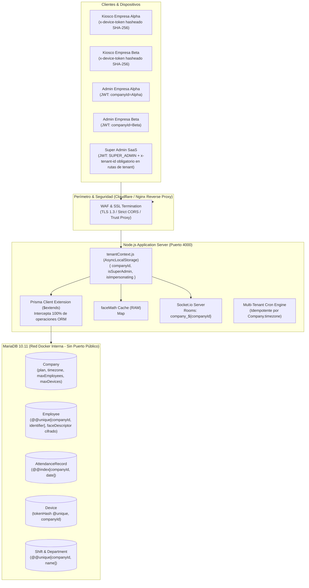
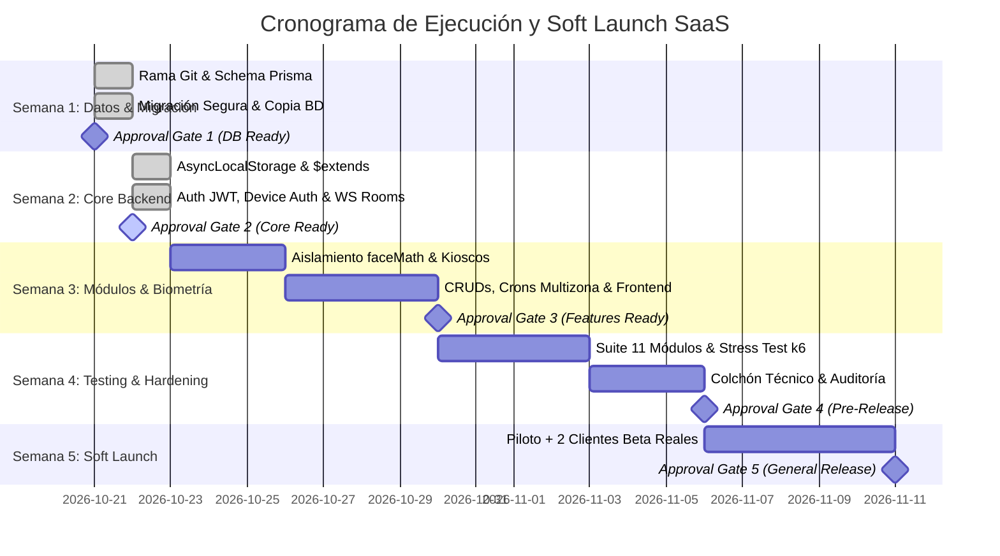

# Plan de Implementación v2.1: Transición a Arquitectura SaaS Multi-Tenant

> [!IMPORTANT]
> **Estado Operativo:** FASE 1 COMPLETADA Y VERIFICADA (Gate 1 superado).  
> - **Rama de Trabajo:** `feature/saas-multitenancy` (rama `main` intacta y protegida).  
> - **Paridad de Esquema Verificada:** `prisma migrate diff --exit-code` arrojó `0` (`No difference detected`) tanto contra `schema.prisma` como entre la base nueva creada por migraciones y la base migrada por `migrate_production.js`.  
> - **Migración Registrada Oficialmente:** Marcada con `prisma migrate resolve --applied 20261022000000_saas_multitenancy`.  
> - **Siguiente Hito:** Fase 2 (Core Backend: `tenantContext`, extensión Prisma `$extends`, JWT con `companyId`, Socket.io por salas).

---

## 1. Arquitectura y Modelo de Inquilino (SaaS Centralizado)



---

## 2. Respuestas a los 15 Requerimientos Técnicos Avanzados

### 1. Extensión de Prisma Exhaustiva y Versión del ORM
* **Versión del Proyecto:** Prisma 6 (`@prisma/client: ^6.19.3`, `prisma: ^6.19.3`).
* **La Razón Real de `@@unique([id, companyId])`:**
  1. **Requisito Físico del Motor InnoDB (MariaDB/MySQL):** Las claves foráneas compuestas que garantizan el aislamiento entre inquilinos (por ejemplo, `FOREIGN KEY (departmentId, companyId) REFERENCES Department(id, companyId)`) exigen obligatoriamente que las columnas objetivo en la tabla padre formen una `PRIMARY KEY` o tengan un índice `UNIQUE KEY` explícito. Dado que `id` es la clave primaria simple, MariaDB rechaza la creación de cualquier clave foránea compuesta con `ERROR 1005 (errno: 150) / Error 1215: Cannot add foreign key constraint` a menos que exista `@@unique([id, companyId])` en el modelo padre.
  2. **Compatibilidad Nativa de Prisma 6:** Prisma exige un identificador único en la cláusula `where` de `update` y `delete`. Con `@@unique([id, companyId])`, Prisma genera automáticamente el selector compuesto `where: { id_companyId: { id, companyId } }`, permitiendo que las operaciones de modificación y borrado inyecten el inquilino directamente en el índice sin hacer consultas intermedias de lectura (`findFirst`).
* **Cobertura Total de Operaciones en `$extends`:**
  * **Lectura masiva (`findMany`, `findFirst`, `findFirstOrThrow`, `count`, `aggregate`, `groupBy`):** Se intercepta `args.where` inyectando forzosamente `args.where.companyId = ctx.companyId`.
  * **Lectura única (`findUnique`, `findUniqueOrThrow`):** Se mapea a la clave compuesta (`id_companyId` o `companyId_identifier`), o se canaliza a `findFirstOrThrow({ where: { ...args.where, companyId: ctx.companyId } })`.
  * **Creación (`create`, `createMany`):** En `create`, se inyecta `args.data.companyId = ctx.companyId`. En `createMany`, se mapea cada objeto del array inyectando `companyId`.
  * **Modificación y Borrado (`update`, `updateMany`, `delete`, `deleteMany`):** Para masivas, se inyecta `where.companyId`. Para individuales, se usa `where: { ...where, companyId }` o `id_companyId`.
  * **Upsert (`upsert`):** Se inyecta `companyId` en `where`, en `create` y en `update`.
* **Tratamiento de `$queryRaw` y `$executeRaw`:** Quedan estrictamente bloqueados o canalizados mediante una función de control que valida la presencia de `companyId` en los parámetros.
* **Alcance:** Incluye `AdminAuditLog` (`companyId`), `DeviceAuthRequest` (`companyId`), y `AdminUser` (`companyId` obligatorio salvo `SUPER_ADMIN`).

### 2. Integridad Referencial entre Inquilinos (Cross-Tenant Foreign Key Integrity)
* **A Nivel de Base de Datos (Foreign Keys Compuestas con ON DELETE RESTRICT):** Para evitar que una petición envíe un `departmentId` o `shiftId` de la Empresa B a un empleado de la Empresa A, las claves foráneas en MariaDB se definen compuestas:
  ```prisma
  // En Employee:
  departmentId Int?
  companyId    String
  department   Department? @relation(fields: [departmentId, companyId], references: [id, companyId], onDelete: Restrict)
  ```
  > [!NOTE]
  > **¿Por qué `Restrict` y NO `SetNull`?**  
  > En MariaDB/InnoDB, una clave foránea compuesta que incluye una columna `NOT NULL` (como `companyId`) no puede definirse con `ON DELETE SET NULL`, ya que el motor relacional no puede anular solo una de las columnas compuestas y generaría `ERROR 1005 (errno: 150)`. Además, por integridad de negocio, un departamento o turno no puede eliminarse si tiene personal o asistencias activas; debe reasignarse previamente o desactivarse (`isActive: false`).
* **Rechazo Físico en MariaDB (Error 1452):** Si un atacante o bug intenta asociar un recurso de otra empresa, MariaDB rechaza la inserción a nivel de motor (`Cannot add or update a child row: a foreign key constraint fails`).
* **Lugares que Cambian `findUnique` por Clave Compuesta:**
  1. `Employee.findUnique({ where: { identifier } })` $\rightarrow$ `findUnique({ where: { companyId_identifier: { companyId, identifier } } })`.
  2. `Employee.findUnique({ where: { email } })` $\rightarrow$ `findUnique({ where: { companyId_email: { companyId, email } } })`.
  3. `Department.findUnique({ where: { name } })` $\rightarrow$ `findUnique({ where: { companyId_name: { companyId, name } } })`.
  4. `Shift.findUnique({ where: { name } })` $\rightarrow$ `findUnique({ where: { companyId_name: { companyId, name } } })`.
  5. `SystemSettings.findUnique({ where: { id: 1 } })` $\rightarrow$ `findUnique({ where: { companyId } })`.

### 3. Aislamiento Estricto de `SUPER_ADMIN`
* **Acceso Global Exclusivo:** El `SUPER_ADMIN` solo posee visión global en el prefijo de rutas `/api/v1/superadmin/*` (creación de empresas, suspensiones, auditoría del SaaS).
* **Prohibición de Contexto Global en Rutas Operativas:** En cualquier ruta de negocio (`/api/v1/employees`, `/api/v1/attendance`, `/api/v1/devices`, etc.), el middleware `tenantContext` exige obligatoriamente la cabecera `x-tenant-id` si la petición proviene de un `SUPER_ADMIN`.
* Si un `SUPER_ADMIN` invoca una ruta de tenant sin especificar a qué empresa desea ingresar, el servidor responde:
  `HTTP 400 Bad Request: { "error": "TENANT_HEADER_REQUIRED", "message": "Super Admin debe especificar x-tenant-id para operar en rutas de empresa." }`.
* **Cero Riesgo de Fuga:** Ninguna ruta operativa puede ejecutarse con contexto global o sin filtro de empresa.

### 4. Protocolo de Rollback, Punto de No Retorno y Migraciones Compatibles
* **ADVERTENCIA CRÍTICA DE DESPLIEGUE (FASE 1):**  
  Esta migración inicial (de mono-tenant a multi-tenant) **NO es compatible hacia atrás** con el código anterior porque aplica `NOT NULL` sobre `companyId`, elimina índices únicos globales y cifra los descriptores con AES-256. Por lo tanto, el script de migración y el código nuevo (descifrado, `tenantContext`, extensión Prisma) **deben desplegarse juntos en la misma ventana de mantenimiento**. El patrón *Expand and Contract* aplicará para **futuras** migraciones una vez que el sistema ya opere como SaaS.
* **Punto de No Retorno:** Se alcanza en el instante exacto en que la versión Multi-Tenant entra en producción y los kioscos registran la primera checada real de un empleado en la nueva estructura. A partir de ese momento, restaurar un respaldo anterior implicaría la pérdida irreversible de registros de asistencia y horas laborales devengadas.
* **Acción ante Fallos tras el Punto de No Retorno:** No se restaura la base de datos completa. Se ejecuta una corrección hacia adelante (*Forward-Fix / Hotfix*) o se corre un script compensatorio de datos.
* **Tiempo Real de Restauración:** La base de datos actual (~5 MB) se restaura en **menos de 3 segundos**. Una base de 500 MB se restaura en ~35 segundos en el NVMe de Hostinger.

### 5. Política de Respaldos y Manejo de `ENCRYPTION_KEY`
* **Respaldos Automáticos Diarios (Recuperación ante Desastres - DR):**
  * Script diario a las 02:00 AM ejecutando `mariadb-dump --single-transaction --quick` comprimido con `gzip`.
  * Cifrado del archivo de respaldo con GPG antes de salir del VPS.
  * Envío automático a almacenamiento externo fuera de Hostinger (AWS S3 / Backblaze B2).
  * **Retención de DR Unificada (Ventana Rodante Máxima de 30 Días):** 7 respaldos diarios y 4 semanales (máximo 30 días acumulados). Al transcurrir el día 31, los respaldos antiguos se purgan criptográficamente de manera automática e irreversible, manteniendo estricta coherencia con el ciclo ARCO de la Sección 11.
  * **Coherencia con el Art. 804 LFT (Conservación de 1 año):** La obligación laboral patronal se satisface directamente en la base de datos viva/operativa durante la vigencia de la relación. En caso de terminación y ejercicio de purga ARCO por el cliente, se le entrega previamente el paquete integral exportado en CSV/JSON firmado criptográficamente para su archivo legal propio; y si se restaurase un respaldo histórico de DR (<30 días), el hook post-restauración re-aplica la purga contra el registro inmutable `RevokedCompanyPurgeLedger`.
  * Prueba mensual automatizada de restauración en un contenedor efímero de prueba para validar legibilidad y coherencia.
* **Seguridad de `ENCRYPTION_KEY`:**
  * Almacenada exclusivamente en el archivo de entorno `.env` local del servidor con permisos de archivo estrictos (`chmod 600`), nunca dentro de la base de datos ni en Git.
  * Respaldo fuera de línea en una bóveda de contraseñas segura.
  * **Procedimiento de Rotación:** Script administrativo que lee la clave vieja (`OLD_KEY`) y la nueva (`NEW_KEY`), descifra cada `faceDescriptor` y lo re-encripta con la nueva clave en una sola transacción segura.

### 6. Cifrado de Descriptores y Modelo de Amenazas
* **Cifrado en Reposo:** Durante la migración, la columna `faceDescriptor` se cifra mediante **AES-256-GCM** con vector de inicialización (IV) único de 12 bytes por registro y tag de autenticación.
* **Modelo de Amenazas (Threat Modeling):**
  * *Qué cubre:* Robo físico de discos del servidor, volcados de base de datos (`.sql`) filtrados, ataques de inyección SQL (SQLi) a ciegas o accesos indebidos a nivel de MariaDB.
  * *Qué no cubre:* Si un atacante compromete un `x-device-token` de un kiosco físico, el endpoint `/descriptors` entregaría los descriptores descifrados de esa empresa.
* **Mitigaciones Compensatorias:**
  1. Los tokens de los dispositivos no se guardan en texto plano en la base de datos: se almacena su hash criptográfico **SHA-256** (`Device.tokenHash`).
  2. Capacidad de revocación inmediata con 1 clic desde el dashboard de la empresa.
  3. Límite adaptativo en `/descriptors`: **120 peticiones por hora por dispositivo** con soporte de caché condicional `If-None-Match` mediante un `descriptorsVersion` numérico por empresa (si no hay cambios en la plantilla, el backend responde `304 Not Modified` sin transferir datos).
  4. Alerta de seguridad en `AdminAuditLog` ante descargas anómalas (más de 30 descargas completas en 5 minutos) en lugar de bloqueo duro que interrumpa la operación laboral.
  5. Registro de auditoría obligatorio cada vez que se descargan descriptores (IP, fecha/hora, huella de dispositivo, cantidad de rostros entregados).

### 7. Gestión Segura de Credenciales, Cliente Administrativo y Mínimo Privilegio
* Se eliminan todas las contraseñas visibles de los scripts y documentación (sustituidas por `${DB_PASSWORD}`, `${JWT_SECRET}`).
* **Usuario de Base de Datos de Mínimo Privilegio:** En producción, el backend de Node.js no se conecta como `root`. Se crea un usuario `saas_app_user` restringido con permisos estrictamente operativos:
  `GRANT SELECT, INSERT, UPDATE, DELETE ON ReconocimientoFacialProd.* TO 'saas_app_user'@'%';`
* Las tareas de migración (DDL) se ejecutan mediante un usuario administrativo separado en una ventana de mantenimiento.
* **Cliente Administrativo Separado (`prismaAdmin.js`):** Los scripts de migración, purga ARCO y el hook post-restauración utilizan un cliente administrativo independiente (`src/utils/prismaAdmin.js`). El cliente de la aplicación (`src/utils/prisma.js`) no expone `.$base` ni métodos raw al runtime de rutas y controladores, manteniendo bloqueados `$queryRaw` y `$executeRaw` de forma hermética.
* **Salvaguarda de Protección de la Base de Datos Original (Orchestrator Safeguard):** Todo script de diagnóstico, prueba, migración o purga incluye una guarda de seguridad que evalúa la URL de conexión. Si detecta la base de datos original protegida (`reconocimiento_facial_db_pain`) en una ejecución destructiva o de prueba, el proceso aborta inmediatamente arrojando `CRITICAL_SAFETY_VIOLATION`. Todo script exige `--db=<url>` o `TEST_DATABASE_URL` explícito, sin fallback automático al `.env`.

### 8. Migración Transparente de Kioscos del Piloto (Zero-Downtime)
* **Procedimiento para Kioscos Existentes:**
  1. Durante la migración de la Fase 1, se genera automáticamente un registro en la tabla `Device` asignado a la empresa piloto con un `deviceToken` permanente.
  2. Durante una ventana de gracia de 72 horas, el backend aceptará tanto el nuevo `x-device-token` como el antiguo `KIOSK_API_KEY` (asumiendo para este último la empresa piloto).
  3. Al recibir la primera petición con la clave vieja, el backend responde con el nuevo `deviceToken` en la cabecera `x-migrated-device-token`. El kiosco lo almacena en `localStorage` y a partir de ese momento usa exclusivamente el nuevo token, completando la transición sin desconexión.

### 9. Configuración de Proxy, Rate Limiting, Cookies y CORS
* **Trust Proxy:** Configurado en [app.js](file:///c:/Users/gabri/OneDrive/Escritorio/Portafolio/ReconocimentoFacialPainProject/backend/src/app.js) como `app.set('trust proxy', 1);` adaptado para los proxies de Nginx y Cloudflare (`X-Forwarded-For`).
* **Rate Limiting Compuesto:** El limitador de login evalúa una clave combinada `ip + email` (máximo 5 intentos cada 15 minutos), evitando que atacantes distribuidos hagan ataques de fuerza bruta sobre una misma cuenta.
* **Seguridad de Cookies y CSRF:** Las cookies de sesión se marcan con `HttpOnly; Secure; SameSite=Strict`. Para evitar ataques CSRF en peticiones de cambio de estado, se exige el encabezado personalizado `x-requested-with: XMLHttpRequest` o `Authorization: Bearer`.
* **CORS en Producción:** Se elimina `origin: true`. Se restringe estrictamente a la lista blanca de dominios productivos (`https://app.tudominio.com`).

### 10. Cron Idempotente y Fuente de Verdad Horaria
* **Fuente Única de Verdad:** `Company.timezone` (ej. `"America/Mexico_City"`, `"America/Tijuana"`). El campo en `SystemSettings.timezone` se sincroniza automáticamente con el de la compañía.
* **Idempotencia Garantizada:** En el modelo `Company` se agrega la columna `lastAbsenceDateRun DateTime? @db.Date`.
* Al ejecutarse el cron diario, comprueba si `company.lastAbsenceDateRun == hoy_en_su_timezone`. Si es igual, omite la ejecución, garantizando que nunca se dupliquen faltas ni notificaciones en caso de reinicios del servidor.

### 11. Adecuación a la Normativa Legal Mexicana (LFPDPPP / LFT) y Procedimiento de Purga ARCO
* **Distinción de Roles bajo la LFPDPPP:**
  * **Responsable del Tratamiento:** La **empresa cliente (patrón)**. Es quien decide sobre el tratamiento de los datos personales de sus colaboradores, recaba el consentimiento, define las finalidades del registro de jornada y atiende directamente las solicitudes ARCO de sus trabajadores.
  * **Encargado del Tratamiento:** **Nuestra plataforma SaaS (proveedor de tecnología)**. Tratamos los datos personales y biométricos única y exclusivamente por cuenta e instrucción del Responsable (cliente) para prestar el servicio de control de asistencia, sin utilizarlos para finalidades propias ni transferirlos a terceros.
* **Declaración Técnica Rigurosa:** No se empleará el término "irreversible" en ningún documento. Se clasificarán las plantillas matemáticas como **Datos Personales Biométricos Sensibles**.
* **Conservación de Registros de Asistencia bajo la Ley Federal del Trabajo (LFT):**
  * Conforme al **Artículo 804, Fracción III de la LFT**, el patrón tiene la obligación jurídica de conservar y exhibir los controles de asistencia durante el último año y hasta un año después de extinguida la relación laboral (el Art. 784 regula la carga probatoria procesal vinculada a dicha exhibición). Por ende, el borrado de un empleado de la vista operativa no debe destruir el historial de asistencia mientras dicho plazo de conservación legal siga vigente.
* **Texto Ajustado del Consentimiento en Kiosco:**  
  *"Al posicionarse frente a la cámara, usted otorga su consentimiento expreso a su empleador (Responsable) para el tratamiento de sus datos biométricos con la única finalidad de verificar su asistencia laboral, conforme a la LFPDPPP. Sus datos son procesados por el proveedor tecnológico (Encargado) en forma de representación vectorial cifrada y serán suprimidos conforme a las políticas de retención laboral o por ejercicio de sus derechos ARCO ante su empleador."*
* > [!WARNING]
  > **AVISO LEGAL OBLIGATORIO:**  
  > La arquitectura técnica y el software proporcionan los mecanismos para facilitar el cumplimiento normativo; no obstante, el **Aviso de Privacidad Integral**, el **Contrato de Encargo de Tratamiento de Datos (DPA)**, las cláusulas de consentimiento y los plazos de retención **deben ser revisados y validados formalmente por un abogado especialista en derecho laboral y protección de datos personales** antes de la puesta en marcha comercial.

#### Procedimiento Deliberado de Borrado Definitivo de Empresas (Cumplimiento ARCO):
Dado que todas las tablas dependientes cuentan con `onDelete: Restrict` hacia `Company`, una empresa NUNCA puede borrarse accidentalmente mediante un simple `DELETE FROM Company`. Para atender el derecho de Cancelación u Oposición de un cliente SaaS, se define el siguiente protocolo deliberado en 6 fases:
1. **Acreditación Legal:** Solicitud formal firmada por el representante legal acreditado del Responsable (cliente) ante la plataforma.
2. **Suspensión Inmediata (Soft-Lock):** Se establece `Company.isActive = false`. Los administradores y kioscos de la empresa son bloqueados de inmediato (código HTTP 403 Forbidden).
3. **Exportación y Entrega:** Generación de un paquete ZIP cifrado con contraseña segura que contiene la totalidad de los datos en formato estándar (asistencias en CSV para cumplimiento de Art. 804 LFT, empleados, turnos y configuración en JSON). Se entrega formalmente al cliente para su archivo laboral.
4. **Período de Retención Preventiva:** Ventana de congelamiento de 30 días para atender posibles requerimientos de autoridades laborales (LFT / IMSS / SAT). Durante este período los datos permanecen inaccesibles para el usuario pero recuperables por el Super Admin.
5. **Confirmación con Doble Factor (2FA):** El Super Admin debe ingresar su token de autenticación de dos factores y escribir una frase de confirmación unívoca: `PURGE-ENTERPRISE-[COMPANY_SLUG]-[FECHA]`.
6. **Purga Topológica Criptográfica y Física (Script Administrativo Transaccional):**
   Para satisfacer las restricciones `onDelete: Restrict` en el grafo relacional sin colisiones, la secuencia se ejecuta dentro de una transacción administrativa estricta en el siguiente orden topológico:
   - **Fase A (Destrucción Biometría Inmediata):**  
     `UPDATE Employee SET faceDescriptor = NULL WHERE companyId = :cid;`  
     *(Destrucción inmediata y sin retorno de los vectores matemáticos biométricos sensibles).*
   - **Fase B (Entidades Transaccionales y Hojas):**  
     `DELETE FROM AttendanceRecord WHERE companyId = :cid;`  
     `DELETE FROM EventRequest WHERE companyId = :cid;`  
     `DELETE FROM Notification WHERE companyId = :cid;`  
     *(AttendanceRecord retiene FK Restrict hacia Employee, Shift y Device; EventRequest retiene FK Restrict hacia Employee y AdminUser. Deben purgarse antes que sus entidades padre).*
   - **Fase C (Tablas Pivote de Turnos y Asignaciones):**  
     `DELETE FROM EmployeeShift WHERE companyId = :cid;`  
     `DELETE FROM DepartmentShift WHERE companyId = :cid;`  
     *(Elimina las relaciones intermedias entre empleados/departamentos y turnos).*
   - **Fase D (Entidades de Personal e Infraestructura Dependiente):**  
     `DELETE FROM Employee WHERE companyId = :cid;`  
     `DELETE FROM DeviceAuthRequest WHERE companyId = :cid;`  
     `DELETE FROM Device WHERE companyId = :cid;`  
     *(Employee retiene FK Restrict hacia Department; al eliminarse Employee aquí, se desbloquea la eliminación posterior de Department. Device ya no tiene dependencias activas de asistencia).*
   - **Fase E (Estructura Organizacional, Cuentas y Configuración):**  
     `DELETE FROM Department WHERE companyId = :cid;`  
     `DELETE FROM Shift WHERE companyId = :cid;`  
     `DELETE FROM AdminAuditLog WHERE companyId = :cid;` *(purga de logs locales con nombres/emails de la empresa purgada).*  
     `DELETE FROM AdminUser WHERE companyId = :cid;` *(desbloqueado tras haber eliminado EventRequest en Fase B).*  
     `DELETE FROM SystemSettings WHERE companyId = :cid;`
   - **Fase F (Entidad Raíz):**  
     `DELETE FROM Company WHERE id = :cid;`  
     *(Al haberse vaciado con éxito las 13 tablas dependientes, la restricción Restrict se satisface al 100% y MariaDB autoriza el borrado físico de la empresa).*
   - **Fase G (Lápida Inmutable Global de Auditoría):**  
     Inserción en `AdminAuditLog` global de plataforma (`companyId = NULL`) con acción `PURGE_COMPANY_ARCO`, identificador del acta legal, hash SHA-256 del archivo exportado entregado y sello temporal inmutable.
   - **Fase H (Libro Mayor y Re-Purga Post-Restauración):**
     1. **Registro en Libro Mayor (`RevokedCompanyPurgeLedger`):** Cada purga ARCO registra de forma inmutable `companyId`, `purgedAt`, `arcoRecordId` y hash SHA-256 de confirmación.
     2. **Ciclo de Rotación Máxima de 30 Días:** Respaldos automáticos con retención de 30 días máximos; al día 31 se destruyen automáticamente.
     3. **Hook Obligatorio Post-Restauración (Post-Restore Re-Purge Hook):** Si por desastre se restaura un snapshot dentro de la ventana de 30 días, el hook de arranque coteja el `RevokedCompanyPurgeLedger` y re-ejecuta de forma inmediata la purga contra cualquier empresa revocada posterior al snapshot, impidiendo cualquier resurrección accidental de datos personales o biométricos.

### 12. Suite de Pruebas Parametrizada Integral (11 Módulos)
En lugar de pruebas aisladas, se implementa una suite parametrizada que evalúa los 11 módulos del backend:
`[employees, attendance, shifts, departments, reports, devices, settings, admins, audit, events, notifications]`.
* **Matriz de Pruebas:**
  * **Lectura:** Token B intentando leer listado o IDs de Empresa A $\rightarrow$ Debe responder **404** o lista vacía.
  * **Escritura:** Token B intentando crear un recurso con `employeeId` o `shiftId` de Empresa A $\rightarrow$ Debe responder **404 / 400**.
  * **Actualización y Borrado:** Token B intentando modificar o borrar un ID de Empresa A $\rightarrow$ Debe responder **404**.
* **Pruebas de Sockets:** Cliente conectado a sala de Empresa A no recibe ningún evento emitido a la sala de Empresa B.
* **Pruebas de Suspensión:** Petición con token de empresa suspendida recibe **403 Forbidden** de forma inmediata.

### 13. Matriz Completa de Archivos Afectados (Actualizada al Cierre de Gate 2)

| Archivo | Ruta | Acción | Justificación y Cambios Implementados |
| :--- | :--- | :---: | :--- |
| `schema.prisma` | `backend/prisma/schema.prisma` | Modificar | Tabla `Company`, claves `companyId`, foráneas compuestas, `descriptorsVersion` e índices. |
| `secrets.js` | `backend/src/config/secrets.js` | Crear | Validación estricta en bootstrap: `ENCRYPTION_KEY` (32 bytes) y `JWT_SECRET` (32 bytes), sin valores por defecto. |
| `prisma.js` | `backend/src/utils/prisma.js` | Modificar | `$extends` en 13 modelos x 14 operaciones; bloqueo estricto de `$queryRaw` y `$executeRaw`. |
| `tenantContext.js` | `backend/src/middlewares/tenantContext.js` | Crear | `AsyncLocalStorage`, regla `SUPER_ADMIN` con `x-tenant-id` (400 si falta), 403 en empresa suspendida. |
| `adminEmployeeSync.js` | `backend/src/utils/adminEmployeeSync.js` | Modificar | Eliminada lógica de nombres propios ('Gabriel', 'Avila'); scoping estricto a la empresa del admin. |
| `devices.controller.js`| `backend/src/modules/devices/devices.controller.js`| Modificar | Emparejamiento en 2 pasos (`lookup` + `approve`); rate limit 5 intentos; rechazo cross-tenant 403. |
| `devices.router.js` | `backend/src/modules/devices/devices.router.js` | Modificar | Rutas `/auth-requests/lookup` y `/auth-requests/:id/approve` habilitadas para `ADMIN` y `SUPER_ADMIN`. |
| `auth.middleware.js` | `backend/src/modules/auth/auth.middleware.js` | Modificar | Verificación de firma con `secrets.JWT_SECRET`; validación de usuario y `companyId`. |
| `auth.controller.js` | `backend/src/modules/auth/auth.controller.js` | Modificar | Login incluye `companyId` en JWT; verificación previa de `company.isActive` (403 si suspendida). |
| `employees.router.js` | `backend/src/modules/employees/employees.router.js` | Modificar | `/descriptors` soporta ETag y HTTP 304 basado en `Company.descriptorsVersion`. |
| `faceMath.js` | `backend/src/utils/faceMath.js` | Modificar | Caché particionado por empresa `Map<companyId, Array>`; descifrado AES-256-GCM. |
| `attendanceCron.js` | `backend/src/jobs/attendanceCron.js` | Modificar | Auto-cierre e inasistencias iterando empresas activas con `runWithTenantContext` y timezone propio. |
| `app.js` | `backend/src/app.js` | Modificar | Socket.io autenticado por salas aisladas `company_${companyId}` y `dashboard_${companyId}`. |
| `requireJwt.js` | `backend/src/middlewares/requireJwt.js` | Modificar | Verificación estricta de token con `secrets.JWT_SECRET`. |
| `departments.router.js`| `backend/src/modules/departments/departments.router.js`| Modificar | Captura de error P2003 de FK `Restrict` para mensajes de integridad claros. |
| `shifts.router.js` | `backend/src/modules/shifts/shifts.router.js` | Modificar | Captura de error P2003 de FK `Restrict`; soporte de `isActive` para turnos históricos. |
| `prismaAdmin.js` | `backend/src/utils/prismaAdmin.js` | Crear | Cliente administrativo aislado para scripts de migración, purga ARCO y hooks sin exponer consultas raw a la app. |

### 14. Plan de Pruebas de Carga con Volumen Realista (Stress & Ceiling Test)
* **Base de Datos Sembrada de Carga Realista:**
  * 400 empresas creadas.
  * 14,000 empleados con vectores biométricos.
  * 3,000,000 de registros históricos de asistencia.
* **Escenario de Prueba con `k6`:**
  * **Fase 1 (Línea Base):** 45 RPS sostenidos durante 10 minutos (simulación de hora pico matutina estándar).
  * **Fase 2 (Rampa al Límite):** Incremento gradual de 10 RPS en 10 RPS cada 2 minutos hasta alcanzar el punto de saturación (CPU > 85% o latencia p95 > 500 ms).
  * **Tráfico Mixto:** 70% registros de checadas (`POST /register`), 15% consultas de dashboard en vivo, 10% conexiones de sockets con heartbeat y 5% exportación de reportes CSV.

### 15. Cronograma Actualizado con Colchón y Soft Launch (5 Semanas)


